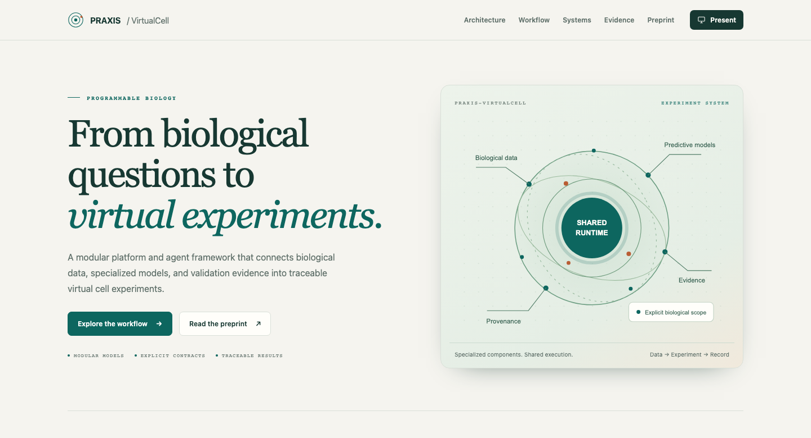
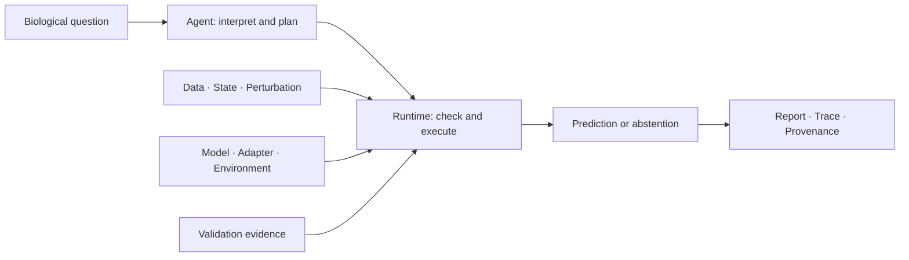

# PRAXIS-VirtualCell

[](https://arxiv.org/abs/2609.29221v1)
[](docs/INSTALL.md)
[](LICENSE)

**A programmable platform and agent framework for virtual cell experiments.**

PRAXIS-VirtualCell connects biological data, specialized predictive models,
perturbations, adapters, execution environments, and validation evidence.
Researchers can turn a biological question into an experiment with explicit
compatibility checks, traceable execution, and contextualized results.

**[Explore the presentation](docs/presentation.html)** ·
[Read the preprint](https://arxiv.org/abs/2609.29221v1) ·
[Paper PDF](https://arxiv.org/pdf/2609.29221v1) ·
[Documentation](docs/INDEX.md)

[](docs/presentation.html)

## From question to experiment



The workflow has five stages: **Ask → Review → Route → Run → Results**.
The agent helps interpret questions, propose routes, and explain results.
The deterministic runtime controls compatibility, scientific model execution,
evidence states, and the final verdict. Numerical outputs come from registered
predictors; unavailable or unsupported requests receive structured abstention.

## One framework, distinct biological tasks

| Biological system | Perturbation | Readout |
|---|---|---|
| *Escherichia coli* | Gene knockout | Growth |
| *Saccharomyces cerevisiae* | Gene deletion | Fitness |
| Human K562 cells | Genetic perturbation | Expression response |

Each task retains its own biological representation and specialized model.
VirtualCellPack records identity, conditions, features, controls, and provenance;
model contracts specify the supported inputs, interventions, and outputs.

## Try it locally

<details>
<summary><strong>Install and run an offline experiment</strong></summary>

Python 3.11+ is required. The default offline mode requires no API key.

```bash
git clone https://github.com/NHNQNHNQ/PRAXIS-Virtualcell.git
cd PRAXIS-Virtualcell
python3 -m venv .venv
. .venv/bin/activate
python -m pip install -e ".[api]"
praxis-vc run --request examples/ahr_k562.json --mode offline --out runs/ahr
praxis-vc ask --text "What happens when AHR is knocked out in human K562 cells?" \
  --mode offline --yes --out runs/ahr-question
```

For the local interface, build the frontend and start the API:

```bash
cd praxis_vc_react
npm ci
npm run build
cd ..
praxis-vc serve --host 127.0.0.1 --port 8000
```

Open [http://127.0.0.1:8000](http://127.0.0.1:8000).
See [installation](docs/INSTALL.md) for optional scientific dependencies and LLM
assistance. The standalone [presentation](docs/presentation.html) opens offline.

</details>

## Reproducibility and evidence

Experiment records bind the request, data, model, adapter, environment, evidence,
and execution trace. Development validation, external stress testing, technical
reproducibility, and scientific validation have separate meanings.

The repository includes K562 protocols, evaluation scripts, and research result
records. Large datasets and trained assets remain external; the complete
real-data microbial benchmark pipelines are not packaged here. The offline
quickstart demonstrates the runtime. See [reproducibility](docs/REPRODUCIBILITY.md)
for the available research paths and their evidence scope.

## Cite the work

Zhenyu Ma and Xukai Jiang. **PRAXIS-VirtualCell: A Programmable and Trustworthy
Framework for Agentic Virtual Cell Experiments.** arXiv:2609.29221v1 (2026).
[doi:10.48550/arXiv.2609.29221](https://doi.org/10.48550/arXiv.2609.29221)

Use [BibTeX](CITATION.bib) or [CITATION.cff](CITATION.cff), and record the exact
software commit or release used in your experiments.

[Install](docs/INSTALL.md) · [Tests](docs/TESTING.md) ·
[Contribute](CONTRIBUTING.md) · [Support](SUPPORT.md) · [MIT license](LICENSE)
