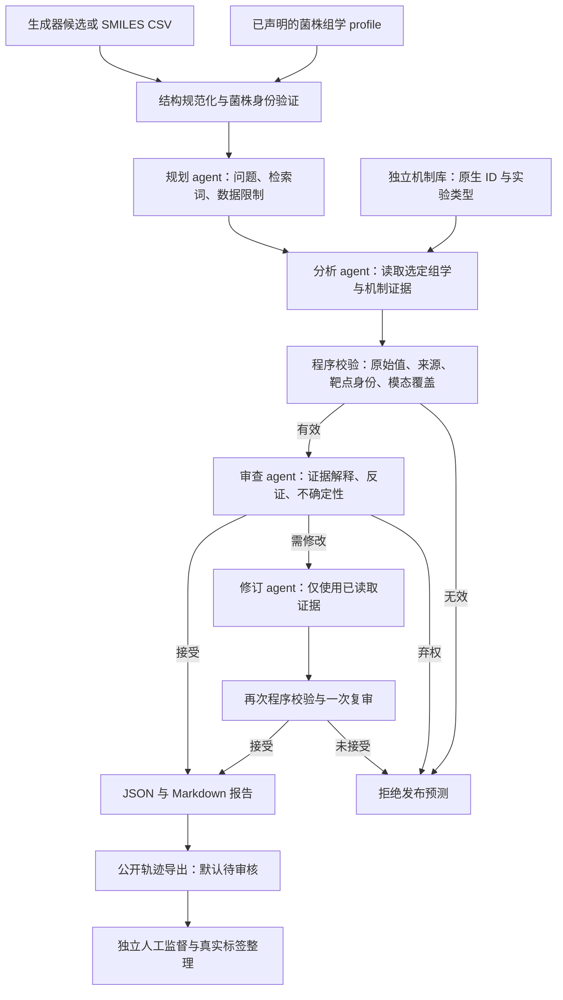

# 智能体流程与监督微调接口

平台默认入口是 `analyze_with_agents`。同一个配置好的 LLM 承担规划、分析、审查、修订四种角色，角色分别使用明确的输入输出契约；无需为每个角色部署不同模型。当前配置仍使用原平台 DeepSeek 客户端。后续专用模型可以实现同一客户端调用接口，再用相同流程评估。

## 一次候选分析



输入适配层只保留候选编号和 SMILES；既有生成器的 score/Q_value、药效终点不进入新推理。RDKit 返回结构及确定性描述符，不返回抗菌评分。组学工具返回观察和来源，不生成药效标签。推理接口没有实测 MIC 检索或监督文件参数。

完整智能体还提供 `search_mechanistic_evidence` / `query_mechanistic_evidence`。查询的菌种、菌株由 profile 固定，精确候选结构由平台固定；模型不能改换这些条件。进入分析前自动检索候选的精确蛋白实验记录，空库或空命中也以明确缺口进入上下文。基因功能参考、蛋白实验结合与整菌终点分别处理，机制引用不能替代每个所选组学的实际特征引用。当前真实数据、独立标签、冻结评估及审核队列见 [DATA-READINESS](DATA-READINESS.md)。

1. **验证输入与规划。** 先核对结构、profile 身份、组学选择。规划角色输出 `AnalysisPlan`：所选模态、分析问题、短检索词和限制。不能改换菌株或模态，也不能在规划阶段编造数值结果。
2. **读取证据并形成判断。** 分析角色调用有上限的工具循环。最终 `Assessment` 包含活性、可为空的 LLM MIC、靶点/机制假说、结构化支持观察、反证和缺口。
3. **校验引用与组学使用。** JSON Pointer、原始值、最近的 source_id 必须精确匹配。已知 target_id 必须是实际读取并引用的 gene_id 或 protein_id。每个所选模态都必须实际返回特征行，并至少有一个对应结构化观察引用；仅在概览中声明模态不算使用它。
4. **审查和有限修订。** 审查角色检查解释是否超出证据，输出 `accept/revise/abstain` 及公开意见。只允许一次修订，修订不能再取新数据，且必须再次校验与复审。第二次审查仍不接受时停止，数值 MIC 不作为有效预测返回。
5. **保存结果与公开轨迹。** 最终报告保存实际组学选择、每次工具结果、阶段输出、审查结果及 token 使用。模型隐藏思考不进入持久化轨迹。所有 API key 在服务端配置中使用，不写进报告。

分析阶段最多 `max_turns` 个模型调用；规划一次、审查最多两次、修订最多一次。原分析循环还允许在同一个轮次预算内纠正一次格式/引用错误。每次调用遵循配置的输出预算，预算包含供应商 reasoning tokens；不存在未经配置的无限重试。

审查通过代表这一轮 LLM 接受了证据解释，不是独立的实验验证。引用通过也不证明 MIC 准确或靶点因果关系。MIC 表示生长抑制，当前杀伤率、MBC、时间杀菌曲线保持未知。

工具 envelope 的 `citation_examples` 是从同一个真实 data 中生成、并用相同引用校验器核验的少量路径示例，帮助模型保留嵌套 provenance。它不修改模型答案，也不放宽 source_id、字段或值匹配；目录编号不能代替来源编号。数字 MIC 的依据必须引用真实组学 gene/protein 行，单独引用机制注释不满足该条件。

## 组学选择与数据契约

第一版 canonical 模态是 `genome`、`transcriptome`、`proteome`，支持三种单模态、三种双模态和三模态共同输入。未指定选择时使用该 profile 实际可用的模态；指定不存在的模态会拒绝，不补值。

v1 原生 RNA profile 保持兼容。v2 支持声明过身份、实验条件、样本配对、单位和来源的 CSV/JSON 特征表。基因组返回 presence/variant/copy_number 等观测，RNA 返回 expression_value，蛋白组返回 abundance_value。缺失为 null，实测零值保持零。基因注释中的参考蛋白 ID 不构成实测蛋白组。

所选视图只返回所选模态的特征和来源。多个模态必须具有一致的菌种、菌株、基因型与条件，并有明确配对声明；程序验证声明一致性，整理者仍需核验原始实验配对依据。数据不因为名称相似而自动融合。

原始数据仍单份存放。v2 是已整理特征表的导入契约，不直接处理 FASTQ/BAM、自动注释 FASTA 或将任意 H5AD/H5MU 自动转换为 profile。完整字段与准备方法见 [OMICS](OMICS.md)。现有真实 `AB5075-AZI000` 仍只有历史未暴露 RNA 背景；本次没有增加真实蛋白组、基因组配对样本。

## 模块与契约

| 模块 | 职责 |
| --- | --- |
| `omics/profiles.py`、`omics/multiomics.py` | v1/v2 资产读取、身份验证、选定模态视图及特征来源 |
| `llm_prediction/agent_schemas.py` | `AnalysisPlan`、`ScientificReview` 的公开契约 |
| `llm_prediction/orchestrator.py` | 有限阶段调度、审查、修订和完整公开轨迹 |
| `llm_prediction/workflow.py` | 原分析工具循环、允许的组学/结构工具、一次引用纠正 |
| `llm_prediction/evidence.py` | 精确引用、靶点身份和逐模态引用覆盖验证 |
| `llm_prediction/trajectories.py` | 工具协议验证、审核队列导出、独立监督答案接入 |
| `knowledge/` | 原生物种/菌株/靶点身份下的机制证据检索，不接整菌 MIC |
| `datasets/` | 独立实验标签整理、库存、分组冻结、事后评分、真实工具审核队列 |
| `web/`、`cli.py` | 选择实际模态、执行默认智能体流程、查看/导出报告 |

`llm-antibacterial-agent-v2` 保留原有 candidate/profile/assessment/evidence_validation/execution_trace，同时新增 analysis_plan、agent_review、review_resolution 和 `praxis.agent-trace.v1`。agent_trace.stages 按实际运行顺序保存 planning/analysis/review/revision，复审会产生第二个 review。旧报告仍可显示。原低层 `analyze_candidate` 和 `analyze_candidates` 继续用于兼容；平台 CLI/Web 默认使用完整角色流程。

## 从架构生成监督样本

```bash
.venv/bin/praxis-vc analyze --profile AB5075-AZI000 \
  --modalities transcriptome --smiles 'CCO' \
  --output reports/llm_live/example.json

.venv/bin/praxis-vc export-sft --input reports/llm_live/example.json \
  --output local/sft/example.jsonl
```

第一条命令会调用配置的外部 LLM，第二条只读取本地报告。结构例子仅说明接口，不能当成药效验证结果。

每个阶段可成为不同监督任务：规划训练问题选择；分析训练工具调用与证据整合；审查训练识别证据不足；修订训练依据反馈纠正结论。每条 JSONL 记录包含 task、stage、tools、messages、provenance 和 supervision。实际训练时仅将 assistant 的公开回答和工具调用作为生成监督，输入/tool 结果的 loss masking 由训练配置处理。

默认导出标为 `needs_review`、`model_generated`、`prediction_is_gold: false`。失败运行不导出为训练记录，被拒绝阶段默认跳过，隐藏思考与凭据被清除，工具 ID 与回复顺序会校验。CLI 返回跳过数量；Python `export_trajectories` 同时返回逐项跳过理由。旧版没有公开角色轨迹的报告不会凭空重建对话。

显式人工监督文件与推理入口分开：

```json
{
  "approved": true,
  "curator": "reviewer-id",
  "label_source_ids": ["review-record-id"],
  "curated_stage_indices": []
}
```

这类批准仅将记录标为流程监督，不会使模型生成的 MIC 自动成为实验真值。可额外提供 `gold_assessment`，它必须符合 Assessment schema、原工具证据及所选模态覆盖要求，且只替换最后一个已接受的分析/修订答案；监督来源保留在 record metadata，不注入模型输入或工具结果。

实测 MIC 仅用于训练监督和独立评估。`datasets/labels.py` 的独立契约保留单位、终点和 >/< 区间关系，`curation.py` 整理已有真实实验与隔离队列；推理不读取这些标签。先冻结数据集划分，再为同一配对实验生成不同组学视图，避免同一实验跨训练和测试集合。轨迹导出不生成药效真值。

## 验证范围

离线测试包含七种组学选择、实际 v1 RNA 资产读取、引用覆盖、蛋白组单输入、未选数据隔离、一次修订和复审拒绝、公开轨迹导出，以及真正执行页面 JavaScript 的选择行为。外部模型调用与离线测试分别记录，工程测试不能替代药效准确率评估。
