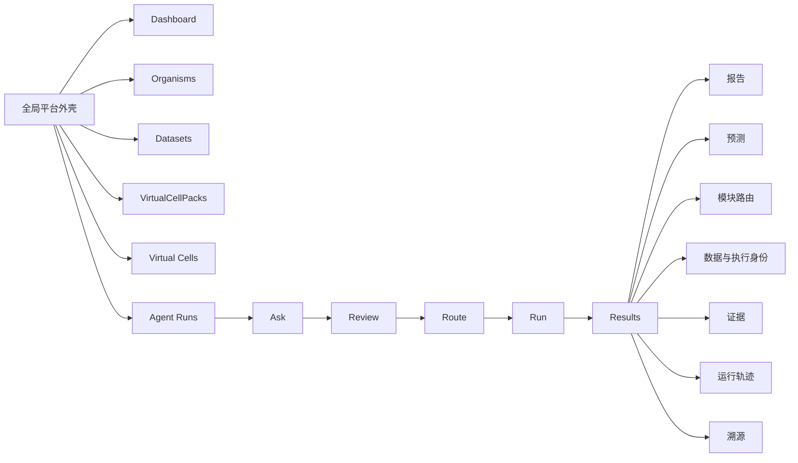

# PRAXIS-VirtualCell Phase 11A 数据中心化 UI 设计说明

## 1. 文档信息

| 项目 | 内容 |
|---|---|
| 文档状态 | P11A 历史实现说明 |
| 对应阶段 | Phase 11A：可信的数据中心化产品骨架 |
| 实现分支 | `codex/p11-data-centric-ui` |
| 实现提交 | `10f629b3a188af2d5c9af5f1325390b7d8cde615` |
| 唯一起始基线 | `5f2eb940c07f2cae5b664f35a57c407026d66587` |
| 文档日期 | 2026-07-30 |

本文描述 Phase 11A 已实现的前端产品骨架。它不是未来完整产品的概念稿，也不代表
Pack Factory、持久化 VirtualCell、自动训练或任意细胞预测已经实现。
P11B 随后在 `bf44aac25b993e49d0146ccd52dddad5c2fa14de` 完成 Cell-first 产品收口；
现行 UI 以 P11B 为准。DOCS-CLOSURE 已在
`b19c896202bea56f894d0ad540501331af42a40c` 形成；Phase 12 以该 SHA 为唯一起点，
正在 `codex/p12-model-registry-v2` 验证，状态为 `VALIDATING`，尚未形成 completion
SHA。P12 不修改前端，只复用现有 Pack list/API 调用链提供路径脱敏的 Model
Registry v2 只读投影。P13 Adapter SDK 仅为 P12 完成后的条件式候选，当前
`NOT ACTIVE`、未授权。

## 2. 设计定位

Phase 11A 将 PRAXIS-VirtualCell 的首要产品叙事从“打开页面后立即提问”调整为：

> 先检查物种、数据、Pack 和执行合同，再进入受约束的 Agent Workspace。

UI 的中心对象因此从单次自然语言问题扩展为一组彼此有明确边界的产品对象：

```text
Organism
→ Dataset
→ VirtualCellPack
→ Virtual Cell（当前尚未持久化）
→ Agent Run
→ Result / Evidence / Execution Identity
```

当前产品承诺保持为：

> 任意符合显式合同的数据可以制作成 VirtualCellPack 接入；只有存在匹配、可执行且
> 经过验证并获 product policy 批准的模型时才产生预测，否则明确 abstain。

界面不会把目录存在、文件可下载、`pack_valid=true`、模型卡存在或接口可调用解释成
“已经可以预测”。

## 3. 核心设计原则

### 3.1 数据中心化，而不是问题中心化

Dashboard、Organisms、Datasets 和 VirtualCellPacks 位于 Agent Runs 之前。用户首先
看到平台已有的数据和合同，再决定是否进入分析流程。

### 3.2 后端是真相源

页面计数、物种身份、数据集、文件状态、Pack 校验结果、模型声明、任务历史和
execution identity 均来自现有 API。浏览器不重算科学兼容性，不生成 readiness，
也不补造缺失状态。

### 3.3 Fail-closed

请求失败时显示“不可用”，而不是用空数组或数字 `0` 冒充真实状态。缺少持久化
VirtualCell 合同时显示诚实空态，不提供假的“构建成功”按钮。

### 3.4 分离数据、执行与科学有效性

UI 和后续治理合同必须区分以下概念：

- Pack：`pack_valid`；
- Registry：`cataloged / artifact_ready / revoked / superseded`；
- 每次请求计算：`model_compatible / environment_compatible / executable`；
- Scientific evidence：`benchmark_passed / scientifically_validated /
  promotion_eligible`；
- Product policy：`production_promoted`。

这些状态不能自动递进。P11A UI 没有实现独立 adapter/evidence/policy identity；
正在验证的 P12 后端合同补充该分层身份，但不回写 P11A 历史实现，也不由 UI 创建
evidence、policy 或 promotion。

### 3.5 LLM 权限最小化

顶栏常驻显示：

> 语言模型仅用于解析与解释，不参与数值预测或最终裁决。

数值结果、兼容性、abstain 和最终治理结论继续由确定性后端负责。

## 4. 信息架构



Phase 11A 使用单一 React 外壳和内部视图状态完成导航，没有引入新的路由依赖。这样
保留了原有运行状态机，同时以最小改动建立平台级信息架构。

## 5. 全局页面框架

```text
┌──────────────────────┬────────────────────────────────────────────┐
│ PRAXIS-VirtualCell   │ 模式 / LLM 边界 / 明暗主题                 │
│ 新建查询             ├────────────────────────────────────────────┤
│                      │                                            │
│ Dashboard            │ 当前页面标题、边界说明                     │
│ Organisms            │                                            │
│ Datasets             │ 页面内容：卡片、表格、状态、操作           │
│ VirtualCellPacks     │                                            │
│ Virtual Cells        │                                            │
│ Agent Runs           │                                            │
│                      │                                            │
│ 最近 Agent Runs      │                                            │
│ 收藏                 │                                            │
│ 后端/版本状态        │                                            │
└──────────────────────┴────────────────────────────────────────────┘
```

### 5.1 左侧全局侧栏

侧栏宽屏宽度为 `264px`，承担四类功能：

1. 品牌和“新建查询”入口；
2. 六个主导航入口；
3. 最近 Agent Runs 和历史任务回看；
4. 后端健康、产品版本、runtime 协议和当前运行模式。

当前导航项以低对比中性色呈现，活动页面使用浅蓝背景、蓝色文字和细边框。历史任务
列表独立滚动，不与 Agent Workspace 内部的五阶段步骤轨混在一起。

### 5.2 顶栏

顶栏包含：

- 当前模式：本地模式或语言模型辅助；
- LLM 权限边界；
- 浅色/深色主题切换。

模式和主题使用紧凑的 pill/button，不与页面主任务争夺视觉焦点。

### 5.3 主内容区

主内容区最大宽度为 `1180px`，居中显示。页面使用冷白背景、白色卡片、细边框和很轻
的阴影，形成科研控制台而非营销页面的视觉气质。

## 6. 六个主页面

### 6.1 Dashboard

Dashboard 是默认首页，回答三个问题：

1. 当前后端声明了多少物种、数据集、文件和 Pack；
2. 当前有多少 Agent Run；
3. 用户下一步可以查看数据、Pack，还是进入 Agent Workspace。

页面包含一条高优先级边界说明：

> 目录可用、Pack 校验通过或接口存在，都不代表模型可执行或已经科学验证。

本地预览时显示的 `4 个物种 / 4 个数据集 / 5 个文件 / 3 个 VirtualCellPack` 是当前
API 返回值，不是写死的产品指标。API 加载失败时页面显示不可用状态，不显示伪造计数。

### 6.2 Organisms

Organisms 页面将数据目录按 taxonomy 身份汇总。每张物种卡显示：

- scientific name；
- 产品内物种 ID；
- NCBI Taxonomy CURIE；
- 关联数据集数量；
- 文件数量；
- 已登记 VirtualCellPack 数量。

这些字段只表达目录覆盖度。页面明确声明它们不推导 VirtualCell readiness、模型
兼容性或科学有效性。Phase 11A 没有制作虚假的多组学覆盖矩阵。

### 6.3 Datasets

Datasets 页面由“公开数据目录”和“隔离上传”两部分组成。

公开数据卡展示：

- 物种和 taxon；
- modality 和 value semantics；
- observation/feature 数量；
- 来源引用和使用条款；
- 文件大小、SHA-256 摘要和服务器可用状态。

只有后端标记为 available 的文件才显示下载操作；否则按钮禁用并显示“服务器文件
未就绪”。

上传区只实现现有 quarantine API：

```text
选择物种 + 操作员令牌 + 文件
→ 原字节上传
→ quarantine receipt
```

上传 receipt 显示文件名、大小和 SHA-256，并再次说明文件不会自动参与预测。这里没有
mock QC、schema mapping、Pack authoring、自动注册、归一化或训练。

### 6.4 VirtualCellPacks

VirtualCellPacks 是只读能力面，展示后端逐次重验的 Pack 记录和模型卡声明。

Pack 卡包括：

- Pack ID、版本和 fingerprint；
- taxon、modalities 和 feature namespaces；
- manifest schema；
- `pack_valid`；
- `model_compatible`；
- `scientifically_validated`；
- 后端返回的失败原因。

模型能力卡显示模型名称、版本、状态、物种/模态范围和 fingerprint 摘要。页面不在
浏览器中运行 compatibility，也不把模型卡的 `available` 或 `planned` 状态解释为
某个具体请求可执行。

### 6.5 Virtual Cells

这是一个有意保留的诚实空态。当前页面明确显示：

- 尚无持久化 VirtualCell 实例；
- 后端尚未提供 VirtualCell 实例合同或构建 API；
- Dataset 或 Pack 存在不会自动生成 VirtualCell。

页面只提供前往 Datasets、VirtualCellPacks 和 Agent Runs 的导航，不提供假的 Builder。

### 6.6 Agent Runs

Agent Runs 保留原有五阶段工作流：

```text
Ask → Review → Route → Run → Results
```

工作区顶部新增执行上下文边界。新任务明确显示：

```text
Legacy · 未绑定 VirtualCellPack
```

打开历史任务时，不静态猜测它是否为 legacy，而是提示以该任务后端保存的
execution identity 为准。

五阶段步骤轨在宽屏位于工作区左侧：

- Ask：描述研究问题和显式高级参数；
- Review：检查并修正解析后的结构化请求；
- Route：预览可能涉及的功能模块；
- Run：运行前确认和确定性执行；
- Results：查看报告、证据和执行审计。

阶段进入有状态守卫，不能跳过未满足前提的阶段；返回上一步时保留有效草稿，并使依赖
旧请求的下游状态失效。

## 7. Results 与审计设计

结果页使用七个 tab 分离不同证据层：

| Tab | 作用 |
|---|---|
| 报告 | 结构化结论、边界和可靠性摘要 |
| 预测 | 数值结果、可靠性与 abstain 状态 |
| 模块路由 | 实际模块计划和路由裁决 |
| 数据与执行身份 | Pack、模型、fingerprint 和 executable 状态 |
| 证据 | 采纳模型、审计材料和支持信息 |
| 运行轨迹 | 按步骤显示确定性 trace |
| 溯源 | request/job/provenance 和完整 JSON |

“数据与执行身份”页签直接读取
`GET /api/reports/{job_id}/provenance` 中的 `execution_identity`：

- legacy job 显示未绑定 VirtualCellPack；
- Pack-aware job 显示 Pack ID、版本和完整 fingerprint；
- 模型表显示模型、版本、模型 fingerprint、兼容性 fingerprint 和 executable；
- 当前 schema 未记录独立 dataset identity，因此 UI 明确显示
  `未记录 dataset identity`；
- 完整 execution identity JSON 保留供逐字审计。

页面明确说明：Pack、模型兼容、executable 或 scientific evidence 均不自动推导
`production_promoted`。

## 8. 视觉语言

### 8.1 风格

整体风格是“中性、克制、可审计的科研控制台”：

- 不使用 3D 细胞动画或装饰性生物图形；
- 以卡片、表格、状态徽标和等宽 fingerprint 建立可信感；
- 通过信息层级而不是高饱和视觉制造重点；
- 错误和警告使用低面积、语义明确的状态色。

### 8.2 核心设计 token

| 用途 | 浅色主题 | 深色主题 |
|---|---|---|
| 页面背景 | `#F8FAFD` | `#131314` |
| 卡片背景 | `#FFFFFF` | `#1E1F22` |
| 主文字 | `#202124` | `#E3E3E6` |
| 次级文字 | `#5F6368` | `#9AA0A6` |
| 主色 | `#0B57D0` | `#8AB4F8` |
| 警告 | `#8A5A00` | `#FDD663` |
| 错误 | `#B3261E` | `#F28B82` |
| 边框 | `#DADCE0` | `#3C4043` |

字体系统：

- 标题、正文和控件：Inter；
- JSON、schema、hash、trace：JetBrains Mono；
- 系统字体作为加载失败时的回退。

间距使用 `4 / 8 / 12 / 16 / 24 / 32 / 48px` scale；圆角以 `8 / 12 / 16px`
为主，状态 pill 使用全圆角。

## 9. 状态与反馈

所有主要数据面都区分：

- loading；
- success；
- empty；
- unavailable/error；
- disabled；
- quarantined；
- valid/invalid/unchecked；
- compatible/incompatible/not evaluated；
- executable/non-executable；
- scientifically validated/not validated。

其中“没有数据”和“API 不可用”是两个不同状态。这个区分防止前端把未知状态降级成
看似确定的零值。

## 10. 响应式与可访问性

当前响应式策略优先保证信息可达和不横向溢出：

- `≤900px`：Agent Workspace 的竖向步骤轨变成顶部水平 stepper；
- `≤720px`：全局侧栏从 `264px` 收窄为 `210px`；
- `≤720px`：数据卡头部、文件行、事实矩阵和上传表单改为单列；
- 长 JSON、fingerprint 和表格使用换行、截断或局部横向滚动；
- 顶栏长提示在窄屏中省略显示。

导航使用语义化 `nav` 和 `aria-current`；结果区使用 tab 语义；错误使用
`role="alert"`；上传成功使用 `role="status"`；表单控件均有可访问标签。

## 11. 当前前端与 API 的关系

| UI 区域 | 现有 API/后端状态 | 前端职责 |
|---|---|---|
| Dashboard | data catalog、Pack catalog、jobs | 计数与边界展示 |
| Organisms | data catalog + Pack catalog | 按 taxon 汇总 |
| Datasets | data catalog、download URL、upload API | 筛选、下载、隔离上传 |
| VirtualCellPacks | Pack catalog + model capabilities | 只读展示后端字段 |
| Virtual Cells | 无实例/构建 API | 诚实空态 |
| Agent Runs | parse、jobs、reports、trace、provenance | 五阶段交互与只读结果 |
| Execution Identity | provenance.execution_identity | 原样展示身份和 hash |

前端不承担：

- 数据真相判定；
- 数值预测；
- compatibility 最终裁决；
- scientific validation 推导；
- 自动数据转换；
- LLM 最终裁决。

## 12. P11A 当时的限制与非目标

Phase 11A 明确没有实现：

- Pack Factory 或 upload receipt → Pack 的制作流程；
- schema mapping、真实 QC、operator review 和注册审批；
- 持久化 VirtualCell 对象及 Builder；
- Agent Run 与 VirtualCell 实例的绑定；
- 服务器公共数据安装；
- 新的模型 adapter、训练、权重或科学验证；
- Community world model；
- 用户、租户、权限、审计和对象存储；
- GitHub 正式发布或 `.53` 服务更新。

因此，P11A 当时的 UI 是“可信的数据中心化产品骨架”，不是“上传任意原始组学数据
即可得到任意细胞预测器”的完成态产品。后续 P11B 改为 Cell-first 入口，但没有改变
这些数据、模型、科学和 policy 边界。

## 13. 典型用户路径

### 浏览现有数据

```text
Dashboard
→ Organisms
→ Datasets
→ 查看来源、条款、hash 和文件可用状态
```

### 检查 Pack 能力

```text
Dashboard
→ VirtualCellPacks
→ 查看 Pack 校验、namespace 和模型声明
→ 不在前端推导具体请求可执行性
```

### 运行既有 Agent 流程

```text
Agent Runs
→ Ask
→ Review
→ Route
→ Run
→ Results
→ 数据与执行身份 / Evidence / Trace / Provenance
```

### 查看尚未实现的产品对象

```text
Virtual Cells
→ 看到持久化合同和构建 API 尚未实现
→ 返回 Datasets、VirtualCellPacks 或 Agent Runs
```

## 14. 验证证据

对应 P11A exact 实现提交
`10f629b3a188af2d5c9af5f1325390b7d8cde615` 的前端证据：

- Playwright E2E：`64 passed / 1 skipped / 0 failed`；
- TypeScript：PASS；
- Oxlint：PASS；
- production build：PASS；
- bundle budget：PASS；
- `git diff --check`：PASS。

唯一跳过项是真实 LLM 外部路径，需要独立授权和 opt-in，不能解释为 LLM、模型或科学
验证已经通过。这些数字不是 P11B、DOCS-CLOSURE 或 P12 的测试证据，也不构成
scientific evidence 或 product policy。
