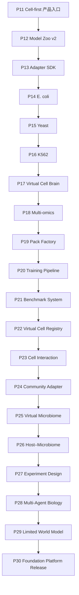

# PRAXIS-VirtualCell Phase 12–30 详细完成计划与验收对照表

> 文档状态：`OPERATIONAL_CHECKLIST — PLANNING_ONLY`
>
> 规范工作树：`/Volumes/T7/PRAXIS-virtualcell`
>
> 当前已完成工程阶段：`Phase 13`
>
> DOCS-CLOSURE completion：`b19c896202bea56f894d0ad540501331af42a40c`
>
> 已完成 work unit：`Phase 13 — Virtual Cell Model Adapter SDK`；starting SHA
> `f83c13db386cb552b3ce7a5643e5ffbead0ff573`；branch
> `codex/p13-model-adapter-sdk`；completion code SHA
> `744d0a28d2cfc13d1b10e85b133b6c13b9426174`；状态 `COMPLETE`
>
> 下一 eligible 本地工程 work unit：`P14E — E. coli K-12 knockout→growth contract`；
> `ELIGIBLE`
>
> 当前 Phase 11 产品代码锚点：`bf44aac25b993e49d0146ccd52dddad5c2fa14de`
>
> DOCS-CLOSURE parent：`b02d21985bcde50cf0758d339b05b13bb3e200a2`
>
> 当前状态核对日期：2026-08-06

本文是一份可以在整个项目周期中逐项对照的执行清单。它把
[P12–P30 权威执行路线](PHASE12-30-EXECUTION-PLAN-AND-PROMPTS.md)转换为：

```text
阶段前置条件
→ 授权门
→ 计划交付物
→ 工程验收
→ 科学验收
→ No-Go / abstain
→ 完成记录
```

本文自身不授权实施任何 Phase。P12 和 P13 已在持续本地授权内完成；该授权仍不包含
外置数据或权重、network、push、GitHub main/tag、`.53`、服务、发布、部署或真实
科学运行。P14 进一步拆为本地合同工程 `P14E`、需逐资产/窗口授权的 `P14R` 和仅能在
正科学结果后由具名 operator 决定的 `P14B`。阶段 scope、资产清单和可复制授权句仍以
[P12–P30 权威执行路线](PHASE12-30-EXECUTION-PLAN-AND-PROMPTS.md)为准。

准确产品承诺是：任意符合显式合同的数据可以制作成 VirtualCellPack 接入；只有
存在匹配、可执行且经过验证并获 product policy 批准的模型时才产生预测，否则明确
abstain。

---

## 1. 如何使用这份对照表

### 1.1 状态定义

work-unit 执行状态机使用以下状态；总进度表可另用 `NOT_STARTED/NOT_RUN/N/A`
等静态台账值：

| 状态 | 含义 |
|---|---|
| `READ_ONLY_HANDOFF` | 只读核对现场、完成证据和唯一下一 work unit |
| `AUTHORIZATION_REQUIRED` | 前置满足但缺少完整精确授权 |
| `AUTHORIZED` | 已取得唯一 starting SHA、scope 和操作边界，但尚未写代码 |
| `IN_PROGRESS` | 正在授权范围内实施和验证 |
| `VALIDATING` | 实施已停止，正在完成约定验证和 adversarial audit |
| `BLOCKED` | 缺少明确资产、权限、科学前置门或外部状态 |
| `SOFTWARE_COMPLETE_NEGATIVE_SCIENCE` | 软件和合同收口，但科学候选未胜 baseline 或未过 external gate |
| `COMPLETE` | 阶段定义的全部适用交付物、测试和完成报告已经收口 |
| `STOP_AND_PROPOSE_NEXT` | 当前 work unit 已完成，只输出下一 eligible 授权草案并停止 |
| `RELEASED` | 仅适用于完成 P30 对应发布窗口后的正式状态 |

`SOFTWARE_COMPLETE_NEGATIVE_SCIENCE` 是诚实完成状态，不等于失败返工。它允许保留
软件基础设施和负结果，但不能产生科学 promotion，也不能被后续文档改写成正结果。

### 1.2 勾选规则

- `[ ]` 表示没有完成或没有现场证据；
- `[x]` 只能在完成报告中存在 exact SHA、fingerprint、测试或外部证据时填写；
- branch 名、文件存在、接口存在、模型卡存在和一次 smoke 均不能单独勾选科学门；
- 某阶段完成后，只填写该阶段的完成记录，不回写或覆盖旧阶段的不可变证据；
- 下一个 Phase 的 starting SHA 必须使用上一个代码阶段实际完成后的 40 位 SHA；
- run-only、operator-only 和部署子阶段可能不产生新代码 SHA，必须记录“代码 SHA
  未变化”和对应的 Git 外 result/policy/deployment identity。

### 1.3 三类“完成”必须分开

| 完成类型 | 证明内容 | 不能证明 |
|---|---|---|
| 软件完成 | 合同、实现、负例和回归测试通过 | 模型在真实数据上有效 |
| 科学完成 | 预声明 benchmark、CI、external/OOD 门通过 | 已被产品批准执行 |
| 产品完成 | 具名 operator 引用 exact evidence 作出 policy decision | 更宽物种、细胞或任务有效 |

---

## 2. 当前基线与总进度

### 2.1 当前事实

- Phase 11A 已完成数据中心化前端骨架；
- Phase 11B 已完成 Cell-first 白色聊天入口、Data Center、示例问题和直接报告；
- Cell preset 仍是 context preset，不是持久化或经过科学验证的 Virtual Cell；
- Data Center 中存在数据或 Pack，不等于存在匹配、可执行、验证过的模型；
- DOCS-CLOSURE 已在 `b19c896202bea56f894d0ad540501331af42a40c` 收口；
- Phase 12 已从该 SHA 完成 exact-scope 工程实现，completion code SHA 为
  `1a5464fb0d2d9e105058f6797d92efd69783e5b2`；
- P12 实现分离 model/artifact/environment/adapter/evidence/operator-policy
  identity，保持 v1 migration 为 legacy/incomplete/no-promotion，并以 append-only
  lifecycle 表达 catalog/readiness/revoke/supersede；
- P12 completion docs commit `f83c13db386cb552b3ce7a5643e5ffbead0ff573`
  是 P13 的实际 starting SHA；P13 不能错误地从 P12 code SHA 直接起算；
- Phase 13 已在 `codex/p13-model-adapter-sdk` 以 code SHA
  `744d0a28d2cfc13d1b10e85b133b6c13b9426174`（tree
  `198e623120688d3704b9312990ddaa93c9a7b0e6`）完成统一 Adapter SDK、prepared input、
  strict output envelope、deterministic conformance 与 runtime/report 接线；
- P13 默认生产 registry 仅注册 `predict_delta_expression → delta_expression`；growth
  和 fitness adapters 只存在于测试，未新增真实模型、数据、权重、science run 或
  operator decision；
- `praxis-vc pack list` 和 `GET /api/packs` 只复用既有链路返回路径脱敏白名单投影，
  不新增管理写 API；
- 未精确绑定现有 model identity 的 P8/P9 结果保留为 `unbound` migration receipt；
  没有真实科学运行或新的 operator decision；
- 历史 ref `codex/p12-cell-first-baseline` 是误命名恢复 ref，不定义阶段状态；
- staged/modified/deleted/untracked 保护清单不在本文固定，每轮必须从现场
  `git status --short` 重建；任何新路径默认受保护；
- P14E 是当前持续本地授权下的下一 eligible 合同工程 work unit；P14R 仍需 exact
  GEM/data/assets/output root/run window 授权，P14B 在正科学结果与具名 operator 决定前
  保持 `NOT_RUN`。

### 2.2 全路线依赖



### 2.3 总进度表

`工程状态`、`科学门` 和 `产品 policy` 必须分别填写，不能用一个“完成”覆盖三者。

| Phase | 工程状态 | 科学门 | 产品 policy | 核心完成物或硬门 |
|---|---|---|---|---|
| P11 | `COMPLETE` | `NOT_CLAIMED` | `NOT_APPLICABLE` | Cell-first 产品入口和 P11 代码锚点 |
| DOCS-CLOSURE | `COMPLETE` | `NOT_APPLICABLE` | `NOT_APPLICABLE` | completion `b19c896...` |
| P12 | `COMPLETE` | `NOT_APPLICABLE` | `NO_NEW_DECISION` | 分层 identity、v1 no-promotion migration、append-only lifecycle、只读投影；completion `1a5464fb...` |
| P13 | `COMPLETE` | `NOT_RUN` | `NO_NEW_DECISION` | 统一 Adapter SDK、delta reference、conformance 与 runtime/report 接线；completion `744d0a28...` |
| P14E | `ELIGIBLE` | `NOT_APPLICABLE` | `NOT_APPLICABLE` | E. coli K-12 knockout→growth 合同与 fail-closed 工程边界 |
| P14R | `AUTHORIZATION_REQUIRED` | `NOT_RUN` | `NOT_APPLICABLE` | exact GEM/data/assets/output root/run window 后才可真实运行 |
| P14B | `NOT_RUN` | `READ_ONLY` | `NOT_RUN` | 仅在正科学结果后由具名 operator 决定 |
| P15 | `NOT_STARTED` | `NOT_RUN` | `NOT_RUN` | Yeast deletion fitness；policy 另用 P15B |
| P16 | `NOT_STARTED` | `NOT_RUN` | `NOT_RUN` | K562 delta-expression；policy 另用 P16B |
| P17 | `NOT_STARTED` | `NOT_RUN` | `NOT_APPLICABLE` | DAG 合同；真实多模型需至少两个 promoted 能力 |
| P18 | `NOT_STARTED` | `NOT_RUN` | `NOT_RUN` | typed multi-omics input；真实能力独立过门 |
| P19 | `NOT_STARTED` | `NOT_APPLICABLE` | `NOT_APPLICABLE` | receipt 到 RegisteredPack，不训练 |
| P20 | `NOT_STARTED` | `CONTRACT_ONLY` | `NOT_APPLICABLE` | training contracts 和 tiny dry-run |
| P21A | `NOT_STARTED` | `SYSTEM_ONLY` | `NOT_APPLICABLE` | benchmark/evidence system |
| P21B | `NOT_STARTED` | `NOT_RUN` | `NOT_APPLICABLE` | per-candidate run-only evidence |
| P21C | `NOT_STARTED` | `READ_ONLY` | `NOT_RUN` | per-scope operator-only policy |
| P22 | `NOT_STARTED` | `IMPORTED_ONLY` | `IMPORTED_ONLY` | curated Virtual Cell Registry |
| P23A | `NOT_STARTED` | `NOT_RUN` | `NOT_RUN` | interaction evidence score |
| P23B | `OPTIONAL_NOT_RUN` | `NOT_RUN` | `NOT_RUN` | 可选 receiver response |
| P24 | `NOT_STARTED` | `NOT_RUN` | `NOT_RUN` | 第一个真实 Community adapter |
| P25 | `NOT_STARTED` | `NOT_RUN` | `NOT_RUN` | 定义群落的唯一 primary endpoint |
| P26 | `BLOCKED` | `NOT_RUN` | `NOT_RUN` | matching host/community 均 validated + promoted |
| P27A | `NOT_STARTED` | `REPLAY_NOT_RUN` | `NOT_APPLICABLE` | experiment-design software/replay |
| P27B | `OPTIONAL_NOT_RUN` | `SHADOW_NOT_RUN` | `NOT_APPLICABLE` | 可选具名专家 blind review |
| P27C | `OPTIONAL_NOT_RUN` | `PILOT_NOT_RUN` | `NOT_APPLICABLE` | 可选 prospective pilot |
| P28 | `NOT_STARTED` | `NOT_RUN` | `NOT_APPLICABLE` | 至少三个 executable + promoted 模型模块 |
| P29 | `NOT_STARTED` | `NOT_RUN` | `NOT_RUN` | 有限 typed biological subgraph |
| P30A | `NOT_STARTED` | `SEPARATE_BADGES` | `NOT_APPLICABLE` | 本地 RC |
| P30B1–B4 | `NOT_STARTED` | `SEPARATE_BADGES` | `RELEASE_WINDOWS` | CI、发布、staging、cutover/rollback |

---

## 3. 全阶段共同 Definition of Done

任何 Phase 标记为完成以前，适用项都必须勾选。

### 3.1 身份与合同

- [ ] starting SHA 是现场验证的唯一 40 位 SHA；
- [ ] schema、contract、Pack、model、adapter、environment 和 result 使用各自版本；
- [ ] 相同 canonical bytes/contract 产生相同 fingerprint；
- [ ] 任一受身份约束的 bytes 或语义变化产生新 identity；
- [ ] 历史 identity、job 和负结果没有被原地改写；
- [ ] unknown field、坏 hash、错 scope 和错版本 fail closed。

### 3.2 数据与科学

- [ ] 没有静默 normalization、补零、imputation、去重、重排或随机 split；
- [ ] feature namespace、order、mapping、unit、assembly 和 value semantics 显式；
- [ ] 按 biological group 切分并审计 leakage；
- [ ] baseline、主指标、方向、CI、OOD 和 external policy 在 test 前冻结；
- [ ] tuning 和 threshold 只使用 train/validation；
- [ ] external validation 默认 adaptation steps 为零；
- [ ] 未胜 baseline 或任一硬门失败时保留负结果并 abstain；
- [ ] synthetic/tiny fixture 只作为合同证据，不作为科学证据。

### 3.3 Agent 与 LLM

- [ ] LLM 只产生解析、候选计划或文字解释；
- [ ] LLM 不能修改数据、数值、compatibility、evidence、policy 或最终 verdict；
- [ ] LLM 关闭、超时或遭遇注入时，确定性数值和 verdict 不变；
- [ ] Agent plan 经 schema、scope、permission、resource 和 capability gate；
- [ ] rule、lookup、advisory 和真实模型在报告中明确区分。

### 3.4 工程与安全

- [ ] 先有失败测试，再有最小实现；
- [ ] 定向、受影响 core/legacy/frontend、Ruff 和 pip check 按范围通过；
- [ ] skip/deselect 没有被写成外部模型、GPU、LLM 或科学验证通过；
- [ ] path traversal、symlink escape、secret 泄露和覆盖已有 artifact 被拒绝；
- [ ] 大数据、权重和 checkpoint 没有进入 Git；
- [ ] source root 只读，output root 是独立 write-new 目录；
- [ ] 没有超出当前授权执行 push、main/tag、`.53` 或其他远程动作。

### 3.5 阶段收口

- [ ] 只 stage 当前授权范围内文件；
- [ ] 完成报告列出 starting SHA、completion SHA、branch 和 changed files；
- [ ] 完成报告列出全部 artifact/fingerprint 和测试；
- [ ] 完成报告准确区分软件结果、科学结果和产品 policy；
- [ ] 完成报告保留负结果、known limitations 和 abstain 行为；
- [ ] 输出下一阶段精确授权句；
- [ ] 完成后停止，没有自动进入下一 Phase。

---

## 4. Milestone A：模型身份与三个窄域 Virtual Cell（P12–P16）

### Phase 12 — Virtual Cell Model Zoo v2

**状态：** `COMPLETE`

**执行身份：** starting SHA
`b19c896202bea56f894d0ad540501331af42a40c`；branch
`codex/p12-model-registry-v2`；completion code SHA
`1a5464fb0d2d9e105058f6797d92efd69783e5b2`。

**目标：** 在不下载或运行新权重的前提下，把现有 ModelCard、CapabilityRegistry 和
ModelBroker 扩展为不可变的模型、资产、环境、adapter、evidence 和 operator-policy
record identity；不作新的 operator promotion decision。

**前置与授权**

- [x] DOCS-CLOSURE completion 为
  `b19c896202bea56f894d0ad540501331af42a40c`；
- [x] 用户以该 SHA、exact allowlist 和操作边界明确授权 P12；
- [x] 分支为 `codex/p12-model-registry-v2`；
- [x] 权重、外置数据、network、training/GPU、push、`.53`、remote、service、
  deploy 和 main/tag 均保持禁止；
- [x] 本地 Phase 12 实现 commit 已形成；未执行 push、发布或部署。

下列交付物已由 completion code SHA、post-commit 验证和完成报告共同收口。

**交付物**

- [x] Model Registry v2 ADR；
- [x] v1 到 v2 状态迁移表；
- [x] model artifact identity：URI/cache key、size、SHA-256、media type、license、
  source 和安全加载策略；
- [x] environment identity：Python/package、lock/image digest、CPU/accelerator 和
  adapter 集；
- [x] validation evidence identity，绑定 Pack×model×environment×adapter×protocol；
- [x] registry state：`cataloged/artifact_ready/revoked/superseded`；
- [x] evidence state：`benchmark_passed/scientifically_validated/promotion_eligible`；
- [x] versioned/fingerprinted operator-policy record schema 和 no-promotion migration
  fixture；不作新的 operator decision；
- [x] revoke/supersede append-only 记录；
- [x] 路径脱敏的只读 CLI/API 投影；
- [x] 现有 5 张模型卡和 P8/P9 evidence 的兼容迁移 fixture。

实现候选使用的版本化身份包括：`vc.model-artifact.v1`、
`vc.model-environment.v1`、`vc.model-adapter.v1`、
`vc.model-validation-evidence.v1`、`vc.model-operator-policy.v1`、
`vc.model-release.v1`、`vc.model-registry-event.v1`、
`vc.model-registry-state.v1`、`vc.model-registry.v2`、
`vc.model-registry-catalog.v2`，以及 Pack-aware `vc.environment.v2`、
`vc.compatibility-report.v2`、`vc.execution-step.v2`、`vc.execution-plan.v2` 和
`vc.job-execution-identity.v2`。

adversarial audit 覆盖：native package 使用 canonical PEP 503 distribution
name/version，而 legacy runtime import-module name 原样分层保留；unsafe legacy raw
`model_version` 只保留内部 fingerprint，公开显示 `null`；v2 job identity 同时绑定
submitted/normalized request、canonical `plan_id` 和 step fingerprints；report 与
provenance 必须引用同一 plan，且两处 plan 使用同一字段白名单/路径脱敏投影。

**验收**

- [x] `vc.model-card.v1` 兼容；
- [x] planned/available 状态没有被迁移成 executable 或 validated；
- [x] P9 `available=false` 和负结果保持不变；
- [x] 坏 hash、身份错绑、evidence 错配、路径泄露和状态越级全部拒绝；
- [x] 相同 bytes 得到相同 fingerprint；
- [x] artifact/evidence bytes 变化得到新 identity；
- [x] 受影响测试、Ruff 和 pip check 通过。

**完成判定**

- `COMPLETE`：软件、迁移和负例全部通过；
- `BLOCKED`：v1 兼容无法保持或状态仍会自动提升；
- 不允许因为 registry 完成就声称新增真实模型能力。
- 当前没有运行真实 benchmark/external/OOD science；`benchmark_passed`、
  `scientifically_validated` 和 `promotion_eligible` 没有被 P12 创建；没有新的
  `production_promoted` operator decision。

---

### Phase 13 — Virtual Cell Model Adapter SDK

**状态：** `COMPLETE`

**执行身份：** starting SHA
`f83c13db386cb552b3ce7a5643e5ffbead0ff573`；branch
`codex/p13-model-adapter-sdk`；completion code SHA
`744d0a28d2cfc13d1b10e85b133b6c13b9426174`；tree
`198e623120688d3704b9312990ddaa93c9a7b0e6`。

**目标：** 建立按 task/output 注册的统一 Adapter SDK，使 Pack-aware strict path 接入
新 adapter 时无需新增 model/species 分支；显式保留 legacy/delta compatibility 分支。

**前置与授权**

- [x] P12 completion docs SHA `f83c13db386cb552b3ce7a5643e5ffbead0ff573`
  已记录并作为 P13 actual starting SHA；
- [x] P12 状态迁移和 registry tests 已通过；
- [x] 持续本地授权允许进入 `codex/p13-model-adapter-sdk`；
- [x] 未授权任何真实模型、数据或权重。

**交付物**

- [x] Adapter SDK ADR；
- [x] adapter schema/version/fingerprint；
- [x] 复用 `vc.model-feature-contract.v1` 的输入合同；
- [x] 严格 output envelope：task、output、shape、unit、finite number、uncertainty、
  OOD、abstain 和 provenance；
- [x] `predict_delta_expression → delta_expression` reference adapter；
- [x] adapter registry；
- [x] adapter fingerprint 接入 compatibility、plan 和 job execution identity，并经
  `adapter_output`/provenance 纳入 structured report fingerprint；
- [x] wrapper 只消费 Broker 准备好的输入和 hash-bound assets；
- [x] delta reference 与 dummy growth/fitness conformance adapters；dummy 仅用于测试；
- [x] legacy 和 P0 确定性报告兼容层。

**验收**

- [x] delta reference adapter 与 P6/P8 行为兼容；
- [x] 无 adapter 时 execution plan 为空；
- [x] 未注册 task/output、错 feature order、mapping drift、错 unit/shape/type 拒绝；
- [x] NaN、Inf、超大整数和 unknown field 拒绝；
- [x] 新测试 plugin 不修改 `route_table.py`、`case_dispatch.py` 或物种分支；
- [x] dummy adapter 没有进入生产 registry；
- [x] 相关契约、core、legacy 和 Ruff 通过。

**冻结证据**

- adapter fingerprint：
  `17afc27e56dba13567001ff1982cbf1660e2948fadf2147301a1d0dcf61aeb3d`；
- input contract fingerprint：
  `d10cf437291dc1ebb1689c3f4c5eea4d82af3842491c224172215faddca93078`；
- output contract fingerprint：
  `d863783786504ebf768cfd7e2fbad66cfd03a029deb1dee3543a9872712e363d`；
- completion test-fixture prepared-input fingerprint（`p13-reference`、K562/TP53、无 Pack）：
  `31d1859a226c50375b7f4d65b6307a9680d9e71e978f4f16e5eb053d90c5de3e`；
- 同一 fixture output fingerprint（raw delta `[0.25, -0.5]`）：
  `a6745427e8f0e9d516789ec9418a42fdb024e245d452b1ca4825c24398996ba2`；
- 同一 fixture conformance report fingerprint：
  `b40374d81f9ec3362d9950bffcfa97f123e46abc80f8b4b135fd5afa02bded18`；
- 上述三个 fixture fingerprints 是 execution-specific reproducibility evidence，不是
  adapter-global identity；request/Pack/compatibility/raw output 改变时必须改变；
- authoritative core：`1462 passed, 35 skipped, 9 deselected`；legacy：
  `1146 passed, 59 skipped, 105 deselected`；7-file directed gate：`265 passed`；
  Ruff、`pip check`、frontend typecheck/lint/build、packaging 与 post-commit checks 通过；
- exact-commit wheel SHA-256：
  `3658b6247a909d0351d760295e0bcbb8082eac930d96fdfe39e4377b591b4f23`；
  两次离线构建 byte-identical。

**完成判定**

- `COMPLETE`：SDK、reference adapter 和 conformance harness 全部通过；
- `BLOCKED`：仍需核心 runtime 的模型/物种专用分支；
- 本阶段实际结论为工程 `COMPLETE`、science `NOT_RUN`、policy
  `NO_NEW_DECISION`；默认 registry 只有 delta reference adapter，不能声称 growth
  或 fitness 已有生产 adapter 或真实模型。完整证据见
  `reports/phase13/PHASE13_COMPLETION.md`。

---

### Phase 14 — E. coli K-12 Virtual Cell

**状态拆分：** `P14E ELIGIBLE`；`P14R AUTHORIZATION_REQUIRED / NOT_RUN`；
`P14B NOT_RUN`

`P14E` 只冻结 E. coli K-12 knockout→growth 的版本化输入/输出、adapter 与 fail-closed
合同，不读取或运行真实 GEM/data。下列真实资产、benchmark、external/OOD 和运行项目
属于 `P14R`，必须在 exact path/size/SHA-256/license/source/output root/run window 获得
新授权后才可勾选；`P14B` 只能消费正科学 evidence，由具名 operator 独立决定。

**唯一任务：**

```text
E. coli K-12 + exact GEM/medium/condition + gene knockout
→ growth / growth ratio
```

**P14E 合同工程前置**

- [x] P13 completion code SHA 已记录；
- [ ] 从 Git history 读取 P13 docs-closure actual SHA，并以它创建
  `codex/p14e-ecoli-growth-contract`；
- [ ] 只冻结窄 task/input/output/adapter/provenance 与 fail-closed tests，不读取或运行
  下列真实资产。

**P14R 前置与授权（P14E 不依赖这些资产）**

- [ ] GEM、growth/essentiality data 和 output root 获得逐文件精确授权；
- [ ] 每个资产记录 path、size、SHA-256、license、source 和 usage；
- [ ] source 只读，output write-new，网络策略明确；
- [ ] 用户明确授权 exact P14R asset/run window；不得用 P14E 分支授权代替。

**P14E 交付物**

- [ ] 冻结要求调用方显式提供的 strain、assembly、GEM identity、medium/condition、
  gene namespace、knockout target、growth/growth-ratio output 和 unit；
- [ ] 复用 P13 SDK 的 growth input/output adapter contract/conformance；无真实
  model/assets/data 时不加入默认生产 registry；
- [ ] 纯合成合同 fixture 与 missing scope、namespace/unit/shape/type、unknown field、
  missing binding、OOD/abstain 负例；
- [ ] P14E ADR、runbook、定向/回归测试与 engineering completion report；
- [ ] P9 negative、delta default registry、legacy/P0 与 science/policy 状态保持不变。

**P14R 交付物（另行授权）**

- [ ] GEM artifact identity；
- [ ] 真实 growth/condition data Pack；
- [ ] `GemWrapper` 只消费显式绑定 GEM；
- [ ] biological-group split、baseline、主指标、CI 和 OOD protocol；
- [ ] gene mapping、leakage、mass/constraint audit；
- [ ] Broker/runtime prediction 或 abstain；
- [ ] 独立 dataset/platform 或实验批次零适配验证；
- [ ] task-scoped immutable capability evidence 或负结果。

**P14E 验收**

- [ ] 不读取/运行真实 GEM/data/assets，不生成 benchmark/evidence/policy；
- [ ] 缺 exact scope/binding、错 namespace/unit/shape/type 或 OOD 时 fail closed；
- [ ] growth/fitness 测试合同不会进入默认生产 registry；
- [ ] P13/P0/legacy/negative regressions、Ruff、packaging 按影响范围通过。

**P14R 验收（另行授权）**

- [ ] target 不在 exact GEM namespace 时 abstain；
- [ ] 没有 textbook、mock 或隐式模型 fallback；
- [ ] deterministic FBA 如实标记 deterministic；
- [ ] 主指标严格胜 baseline 且 paired CI 支持改善；
- [ ] external adaptation 为零；
- [ ] strain、medium、condition 或 task 域外输入 abstain；
- [ ] flux 只作为 solver trace，不冒充已验证产品输出。

**完成与 policy**

- [ ] P14E engineering report 独立收口，不等待 P14R science；
- [ ] P14R 获授权并运行后才形成科学报告；若科学门失败，状态为
  `SOFTWARE_COMPLETE_NEGATIVE_SCIENCE`；
- [ ] 若 evidence 过门，另行执行 P14B operator-only policy decision；
- [ ] 没有 P14B 时不得写 `production_promoted=true`。

---

### Phase 15 — S. cerevisiae Virtual Cell

**状态：** `NOT_STARTED`

**唯一任务：**

```text
exact S. cerevisiae strain/condition + gene deletion
→ deletion fitness
```

**前置与授权**

- [ ] P14 completion SHA 已记录；
- [ ] deletion screen、固定模型和 output root 获得精确资产授权；
- [ ] P10 yeast tiny Pack 明确保持 synthetic contract fixture；
- [ ] 用户明确授权 `codex/p15-yeast-fitness`。

**交付物**

- [ ] strain、assembly、SGD systematic ID、condition、control、unit 和 output 冻结；
- [ ] 真实 deletion-fitness Pack 和 feature contract；
- [ ] deletion-fitness adapter；
- [ ] condition/replicate group split；
- [ ] mean-fitness 等简单 baseline；
- [ ] validation-only tuning 和预登记 seeds；
- [ ] 独立 condition/platform 零适配验证；
- [ ] Broker/runtime 报告、uncertainty/OOD 或 abstain；
- [ ] exact-scope capability evidence 或负结果。

**验收**

- [ ] exact SGD/assembly/strain gate；
- [ ] replicate/condition leakage 为零；
- [ ] external adaptation 为零；
- [ ] 主指标、paired CI、external gate 全部独立检查；
- [ ] 未覆盖 strain/condition/task 明确 abstain；
- [ ] 不继承 E. coli mapping、medium 或科学结论。

**完成与 policy**

- [ ] 失败时记录 `SOFTWARE_COMPLETE_NEGATIVE_SCIENCE`；
- [ ] evidence 过门后，P15B 具名 operator 单独决定 product policy；
- [ ] P15B 不得修改 `scientifically_validated`。

---

### Phase 16 — Human/K562 Virtual Cell

**状态：** `NOT_STARTED`

**唯一任务：**

```text
Golden Norman K562 perturbation
→ 5,045 ordered Ensembl features 的 delta_expression
→ condition-macro MSE
```

**前置与授权**

- [ ] P15 completion SHA 已记录；
- [ ] Golden Pack、candidate checkpoint、environment 和 external dataset 精确授权；
- [ ] P8 frozen split、feature order、metric、bootstrap 和 baseline 保持不变；
- [ ] 用户明确授权 `codex/p16-k562-perturbation`。

**交付物**

- [ ] candidate/checkpoint/environment/adapter identity；
- [ ] 原生 delta-expression 语义，或 test 前冻结的 hash-bound conversion contract；
- [ ] no-change、global mean、additive ridge 和 candidate 走同一 runtime；
- [ ] checkpoint training-data、pretraining、split 和 cache contamination audit；
- [ ] stochastic candidate 至少三个预登记 seed；
- [ ] candidate-minus-additive paired condition bootstrap；
- [ ] 独立、语义兼容 K562 dataset/platform 零适配验证；
- [ ] uncertainty calibration 或明确 unavailable；
- [ ] single-gene 和 combination 分开评估、分开 evidence。

**冻结 comparator**

| Baseline | Golden test MSE |
|---|---:|
| no-change | `0.0062060923` |
| global mean | `0.0045820474` |
| additive ridge | `0.0032570634` |

**验收**

- [ ] additive ridge 是 primary comparator；
- [ ] candidate-minus-additive 95% CI 上界 `< 0`；
- [ ] contamination audit 通过；
- [ ] external gate 是 K562 独立 dataset/platform；
- [ ] donor 或其他 cell context 只作为 OOD，不替代 external gate；
- [ ] single-gene 与 combination 不互相借门；
- [ ] 未通过的 scope 保持 abstain。

**完成与 policy**

- [ ] 负结果按 scope append-only 保存；
- [ ] 过门 scope 另行执行 P16B operator-only decision；
- [ ] 没有独立 P16B 时不得标记 production promotion。

---

## 5. Milestone B：编排、多组学、数据制作、训练和证据（P17–P22）

### Phase 17 — PRAXIS Virtual Cell Brain

**状态：** `NOT_STARTED`

**目标：** 把科学问题编译为确定性、可审计和可重放的 Virtual Experiment DAG。

**前置与授权**

- [ ] P16 completion code SHA 已记录；
- [ ] 用户明确授权 `codex/p17-virtual-cell-brain`；
- [ ] 若验收真实多模型组合，至少列出两个 P14B/P15B/P16B
  `production_promoted` decisions；
- [ ] 少于两个 promoted capability 时，授权明确限定为 contract-only。

**交付物**

- [ ] direct-v2 Pack-aware 入口；
- [ ] legacy 入口和冻结报告兼容；
- [ ] immutable Brain/Virtual Experiment context；
- [ ] deterministic task DAG；
- [ ] 复用 CapabilityRegistry、ModelBroker 和 ExecutionPlan；
- [ ] LLM candidate DAG 的 deterministic compiler/gates；
- [ ] step 级 input/output identity；
- [ ] conflict、partial failure、abstain 和 final verdict governance；
- [ ] Brain/DAG fingerprint 写入 job identity；
- [ ] 第五 taxon tiny test fixture，仅证明插件性。

**验收**

- [ ] canonical input/environment 相同得到相同 DAG/plan identity；
- [ ] legacy projection、Pack、model 或 adapter 失败时不 fallback 到 mock；
- [ ] LLM off/timeout/injection 时确定性结果不变；
- [ ] 单 step 失败不被 narrative 掩盖；
- [ ] rule/advisory 不计作第二个模型；
- [ ] 真实多模型 claim 只在至少两个 promoted capability 参与必要组合任务时成立。

**完成判定**

- `COMPLETE`：合同和治理完成；
- 若缺两个 promoted capability，只能记录“contract complete；real multi-model
  acceptance pending”，不能声称 Brain 已完成真实多模型科学验收。

---

### Phase 18 — Multi-omics Virtual Cell

**状态：** `NOT_STARTED`

**目标：** 在保持 `vc.pack.v0.3` 语义的前提下建立真正的 typed multi-omics 模型输入。

**交付物**

- [ ] `vc.multiomics-model-input.v1` 或等价版本化合同；
- [ ] ordered required/optional modality slots；
- [ ] 每层独立 feature alignment 和 report；
- [ ] observation membership、join 和 missingness policy；
- [ ] target modality 和 typed bundle identity；
- [ ] paired/partially-paired conformance fixtures；
- [ ] optional modality 缺失行为由 model card/adapter 显式声明；
- [ ] 如另获资产授权：单组学 baseline、multi-omics candidate、ablation 和 OOD protocol。

**验收**

- [ ] required slots 缺任一项时无 execution step；
- [ ] 不用任一 modality 交集放行 required slots；
- [ ] 不造 observation、不补零、不 impute、不静默 normalization；
- [ ] partially-paired 只使用真实 shared rows 或显式 missingness mask；
- [ ] modality order、namespace、feature order、join/missingness 进入 fingerprint；
- [ ] real candidate 未胜单组学 baseline/CI/external gate 时只保留数据合同。

**完成判定**

- 合同可 `COMPLETE`；
- 真实 multi-omics 科学能力可独立为负结果，不能反向否定合同完成，也不能生成 promotion。

---

### Phase 19 — 受控 Pack Factory

**状态：** `NOT_STARTED`

**唯一闭环：**

```text
upload receipt
→ candidate manifest/mapping
→ explicit metadata review
→ strict validation
→ named operator approval
→ RegisteredPack
```

**交付物**

- [ ] receipt immutable raw-bytes identity；
- [ ] taxon、assembly、cell identity、modality、namespace、value semantics、
  condition/control、unit、split 和 leakage group 显式确认；
- [ ] inferred metadata/mapping 只作为候选；
- [ ] mapping version/hash 和未映射、重复、顺序报告；
- [ ] 完整 validation report；
- [ ] named operator decision 绑定 exact candidate fingerprint；
- [ ] upload、candidate、validation、decision、RegisteredPack 和 supersede 分层；
- [ ] 本地 operator CLI/library；
- [ ] 公共 API 只读投影；
- [ ] 经精确授权的 Git 外 tiny fixture 插件性证明。

**验收**

- [ ] 任一关键 metadata/mapping 未确认时不能 register；
- [ ] 原始上传 bytes 不变；
- [ ] 相同输入和确认内容得到相同 candidate/Pack fingerprint；
- [ ] 源 bytes、metadata、mapping 或 decision 改变得到新 identity；
- [ ] traversal、symlink、坏 hash、错 taxon/assembly、未知字段和重复 key 拒绝；
- [ ] UI/API 区分 receipt、candidate、RegisteredPack、compatible 和 executable；
- [ ] fixture 不被写成科学证据。

**禁止**

- [ ] 确认没有训练、checkpoint、model card、benchmark、evidence 或 promotion；
- [ ] 确认没有自动 normalization、补零、去重、重排、随机 split 或同源转换。

---

### Phase 20 — Virtual Cell Training Pipeline

**状态：** `NOT_STARTED`

**唯一闭环：**

```text
RegisteredPack
→ frozen training job
→ deterministic/sandboxed runner
→ candidate checkpoint
→ training result
→ candidate model identity
```

**交付物**

- [ ] `vc.training-job.v1`；
- [ ] RegisteredPack、feature/alignment、split/leakage、trainer、code、environment、
  seed、hyperparameters 和 resource limits 全绑定；
- [ ] leakage audit 在 trainer 读取 label 前执行；
- [ ] 同步 CLI/library runner；
- [ ] trainer 只读 allowlisted Pack/labels；
- [ ] 安全 checkpoint 格式；
- [ ] 临时目录完成 hash/manifest 后原子发布；
- [ ] `vc.training-result.v1`；
- [ ] candidate ModelCard/ModelArtifact identity；
- [ ] failure、cancel、timeout 和 partial-output cleanup；
- [ ] tiny deterministic contract-only dry-run。

**验收**

- [ ] 只有 P19 RegisteredPack 能进入 runner；
- [ ] 关键输入任一变化都会改变 identity；
- [ ] 相同 tiny input/seed 可重放；
- [ ] arbitrary uploaded code、path escape、secret leak 和 overwrite 被拒绝；
- [ ] failure/cancel/timeout 不发布 partial checkpoint；
- [ ] tiny 指标没有进入 evidence ledger；
- [ ] P21B 前没有真实 candidate training 或 test/external 读取。

**禁止**

- [ ] 无真实训练、自动调参、分布式/GPU scheduler；
- [ ] 无 `scientifically_validated`、`promotion_eligible` 或 `production_promoted`。

---

### Phase 21 — Virtual Cell Benchmark System

**状态：** `NOT_STARTED`

#### P21A — 系统与冻结协议

- [ ] `benchmark protocol/run/result/promotion-evidence` 合同；
- [ ] protocol 在 candidate result 前冻结；
- [ ] Pack、split、feature/output、metric/direction、baseline、CI、seeds、OOD、
  threshold partition 和 external policy 全绑定；
- [ ] 正式 adapter/Broker/runtime evaluation；
- [ ] validation-only threshold；
- [ ] P9 biological-group leakage audit 和 condition bootstrap 复用；
- [ ] calibration、coverage、selective risk、wrong accept 和 unnecessary abstain；
- [ ] 多维 capability profile；
- [ ] append-only negative ledger；
- [ ] P8 成功 baseline 和 P9 失败 artifact 兼容重放；
- [ ] runner 不能写 `production_promoted`。

#### P21B — 单个真实 candidate run-only

- [ ] 单独授权一个 exact candidate/task/scope；
- [ ] protocol fingerprint 已冻结；
- [ ] 输入资产和 output root 逐项精确授权；
- [ ] 只使用 P20 runner；
- [ ] 训练和评估走正式 adapter/runtime；
- [ ] test/external 后不改 split、metric、baseline、CI 或 gate；
- [ ] 只生成 immutable benchmark/scientific/promotion-eligible evidence；
- [ ] 代码、Git、branch 和 workspace 文件保持不变；
- [ ] 负结果仍写入 ledger 并保持 abstain。

#### P21C — 独立 operator policy decision

- [ ] 具名 operator；
- [ ] exact evidence fingerprints；
- [ ] exact capability scope；
- [ ] 只读 evidence，禁止重跑和调参；
- [ ] write-new policy output；
- [ ] 所有科学、license、scope 门全过才可 `production_promoted=true`；
- [ ] declined decision 和原因同样 append-only；
- [ ] operator 不修改 `scientifically_validated`。

**完成判定**

- P21A 完成代表 benchmark 系统完成；
- P21B/P21C 可以按 candidate 重复，但每次必须独立授权；
- 没有 P21C 时，promotion-eligible 仍不是产品 promotion。

---

### Phase 22 — Curated Virtual Cell Registry

**状态：** `NOT_STARTED`

**目标：** 建立 operator-curated、content-addressed Virtual Cell Registry，不做开放
Marketplace。

**前置**

- [ ] P21A benchmark-system completion SHA；
- [ ] 若要导入可执行 release，至少有一个 exact-scope P21B evidence 和对应
  P21C/P14B/P15B/P16B operator policy；
- [ ] 没有 positive evidence/policy 时只允许收口 registry 合同，不得制造
  validated/promoted release。

**交付物**

- [ ] Virtual Cell release schema/fingerprint；
- [ ] species/cell context、Pack、model、adapter 和 environment identity；
- [ ] benchmark/scientific evidence 和 operator policy refs；
- [ ] capability scope 与 OOD/abstain policy；
- [ ] license/source/publisher/reviewer；
- [ ] approved/quarantined/revoked/superseded 和 append-only audit；
- [ ] 原子本地 registry；
- [ ] allowlisted/reviewed wrapper entrypoint；
- [ ] 路径脱敏只读 API；
- [ ] Data Center 使用真实 release；
- [ ] Chat/job 绑定 exact release identity；
- [ ] UI 分列显示 cataloged、installed、compatible、executable、validated、promoted。

**验收**

- [ ] 同 ID/version 不接受不同 bytes；
- [ ] import 重验 schema/hash/license/dependency/adapter/policy；
- [ ] revoked/quarantined release 不进入 plan；
- [ ] registry approval 不创建 evidence 或 promotion；
- [ ] 历史 job 不因 revoke/supersede 改写；
- [ ] 无 remote plugin 自动下载或任意用户代码 import；
- [ ] 用户选择 cell 与 execution identity 一致。

---

## 6. Milestone C：细胞交互、群落与宿主系统（P23–P26）

### Phase 23 — Cell Interaction Model

**状态：** `NOT_STARTED`

#### P23A — interaction evidence

```text
sender cell → receiver cell
→ interaction_evidence_score
```

- [ ] P22 sender/receiver release identity；
- [ ] 固定模型来自 P20/P21 流程；
- [ ] 真实同实验 paired/co-culture/spatial evidence 获得精确资产授权；
- [ ] sender/receiver release、Pack 和 context identity；
- [ ] 同实验 donor/sample/well、condition、dose/time 和 role；
- [ ] ligand/receptor/evidence namespace 和 mapping；
- [ ] 不把无关 dataset 的 sender/receiver 静默配对；
- [ ] no-interaction、receiver-only 和 coexpression baseline；
- [ ] sender、receiver、ligand、donor、platform 和 dose/time OOD；
- [ ] 输出只限 evidence score；
- [ ] 不输出 receiver response、effect size 或因果结论。

#### P23B — receiver response，可选且独立

- [ ] P23A 已完成；
- [ ] 另有干预数据；
- [ ] estimand、assumptions、confounder policy 和 causal-language policy 冻结；
- [ ] baseline、metric/CI 和 external gate 冻结；
- [ ] 未满足 assumptions 或任一 gate 时 `prediction=null/abstain`；
- [ ] P23A evidence 不能冒充 P23B response。

**完成判定**

- P23A 可以独立完成；
- P23B 不是 P23A 的自动下一步，必须单独授权。

---

### Phase 24 — First Real Community Adapter

**状态：** `NOT_STARTED`

**前置**

- [ ] 明确使用 P23A completion SHA，或在已单独完成可选 P23B 时使用 P23B SHA；
- [ ] 不使用模糊的“P23 完成 SHA”；
- [ ] P10 v1 no-model regression 已冻结；
- [ ] 固定模型来自 P20/P21，真实双成员资产另有精确授权。

**唯一任务：**

```text
2 个明确成员 + well-mixed medium + abundance/time
→ 下一时点 abundance 或 exact exchange/growth response
```

**交付物**

- [ ] 真实双成员 mono/co-culture time series；
- [ ] medium、growth/biomass 和 extracellular metabolomics/exchange；
- [ ] metabolite ontology/mapping identity；
- [ ] 窄范围 dFBA 或预注册 ODE adapter；
- [ ] member Pack 和 fingerprint 每次重验；
- [ ] exact abundance sum、unit/ID literal match 和 single-member equivalence；
- [ ] no-interaction、independent/sum-of-monocultures baseline；
- [ ] co-culture condition、medium、abundance、time OOD；
- [ ] 必要的 mass/element/charge/thermodynamic/solver identity 检查；
- [ ] P20/P21 产生的固定模型，P24 自身不训练。

**验收**

- [ ] P10 toy balance 只作为合同测试；
- [ ] P10 `vc.community-*.v1` serialization/fingerprint/no-model 语义逐字节保持；
- [ ] P10 manifest 的 `scientifically_validated=false` 不原地修改；
- [ ] 无 promoted adapter 时仍返回 `prediction=null` 和
  `community_model_unavailable`；
- [ ] 域外、mapping/unit 冲突或 solver 失败时 abstain；
- [ ] 主指标/CI、约束和独立 co-culture gate 全过才生成 promotion-eligible evidence；
- [ ] product policy 仍需独立 P21C。

---

### Phase 25 — Virtual Microbiome Prototype

**状态：** `NOT_STARTED`

**唯一任务：**

```text
固定 2–3 成员定义群落 + medium/diet component + time
→ strain-level abundance dynamics
```

**交付物**

- [ ] strain-resolved member Pack、initial abundance、medium、compartment 和 time；
- [ ] 标准 metabolite namespace/version/unit/mapping；
- [ ] mono/co-culture、growth/biomass 和 extracellular metabolomics；
- [ ] 复用 P24 adapter/model identity；
- [ ] biological-group train/validation/test split；
- [ ] persistence、independent monoculture 和 no-interaction baseline；
- [ ] 一个且仅一个 primary abundance endpoint；
- [ ] secondary metabolite/SCFA 的 assay、LOD、unit、mapping 和 multiplicity policy；
- [ ] mass/element/charge、solver、calibration 和 OOD；
- [ ] 独立 condition/batch 零适配验证。

**验收**

- [ ] primary endpoint 对 baseline 的 paired CI 通过；
- [ ] 独立批次或条件复现；
- [ ] secondary 不能挽救失败的 primary；
- [ ] member/medium/abundance/time 域外 abstain；
- [ ] 失败不改写 P24 窄能力；
- [ ] 不称人类微生物组、空间模型或通用 community world model；
- [ ] 通过也只生成 promotion-eligible evidence，policy 另用 P21C。

---

### Phase 26 — Host–Microbiome Virtual Cell

**状态：** `BLOCKED`（前置 capability 尚未形成）

#### P26 前置能力循环（不是新 Phase 编号）

当前 P12–P25 主链没有自动产生与肠上皮、类器官或其他目标宿主问题匹配的人源宿主
capability。若 P22 Registry 中不存在这样的 exact-scope release，必须在进入 P26
以前，为该宿主任务分别获得授权并重用：

```text
P19  制作并注册 matching host Pack
→ P20 冻结 matching host training job/model identity
→ P21B 运行 frozen candidate/evidence protocol
→ P21C 由具名 operator 决定 exact-scope product policy
→ P22 导入 matching host Virtual Cell release
```

这是一组可重复的既有阶段工作窗口，不创建 `P25H`、`P26A` 等新正式 Phase 编号，
也不能用 P16 K562 或任意 human dataset 替代。

**硬前置门**

- [ ] P22 中存在与目标宿主生物学匹配的 Virtual Cell release；
- [ ] exact-scope host capability `scientifically_validated=true`；
- [ ] exact-scope host capability `production_promoted=true`；
- [ ] exact-scope P25 community capability `scientifically_validated=true`；
- [ ] exact-scope P25 community capability `production_promoted=true`；
- [ ] 所需宿主是问题相关 cell/Pack，不能用 K562 等无关 context 替代；
- [ ] 任一项缺失时 P26 保持 `BLOCKED`，不得开始实现。

**交付物**

- [ ] 一个 host cell type、一个定义群落、一个 compartment/time window 和一个任务；
- [ ] metabolite、cytokine、receptor、compartment、dose、unit 和 time 跨域接口；
- [ ] microbe→mediator→host 和 host→community 方向；
- [ ] 配对 host response/community measurement，优先真实 intervention；
- [ ] consent、privacy、usage 和 access governance；
- [ ] donor/batch/experiment 防泄漏；
- [ ] host-only、microbiome-only、简单加和和 interaction baseline；
- [ ] co-simulation time-scale、exchange、convergence 和 failure trace；
- [ ] held-out donor/batch 或独立 dataset 零适配验证；
- [ ] conflict、missing mediator 和 unit mismatch 的 partial/abstain。

**验收**

- [ ] 一个任务的主指标和 CI 过门；
- [ ] mediator chain 和每个 model step 可追溯；
- [ ] 无 intervention evidence 不写 causal；
- [ ] privacy/consent gate 通过；
- [ ] 不推广为器官、全身、个体 digital twin 或临床疗效。

---

## 7. Milestone D：实验设计、多 Agent、有限 world model 与发布（P27–P30）

### Phase 27 — Agentic Experiment Design

**状态：** `NOT_STARTED`

#### P27A — software / historical replay

- [ ] `vc.virtual-experiment.v1`；
- [ ] question、hypothesis、scope、perturbation、control、replicate、batch、endpoint、
  cost、constraint 和 evidence；
- [ ] LLM 只起草，确定性代码验证单位、变量、对照、资源和安全；
- [ ] ActiveLearning action/cost/batch/control/feasibility 合同；
- [ ] 候选实验限于已验证模型域；
- [ ] 不读取 test outcome 选实验；
- [ ] random、uncertainty-only、diversity 和 expert-rule baseline；
- [ ] historical offline replay；
- [ ] human approval required 状态。

#### P27B — shadow expert review

- [ ] P27A completion SHA 和 frozen shadow protocol；
- [ ] 具名专家、冲突披露、blind rubric 和 acceptance gate；
- [ ] LLM proposal、expert score 和 operator verdict 分开；
- [ ] run-only，代码和 Git 不变；
- [ ] 未过门停在 P27A；
- [ ] 通过只得到 shadow-reviewed，不称 prospective。

#### P27C — prospective pilot

- [ ] P27B result、预注册 protocol/analysis 和具名 operator；
- [ ] ethics、biosafety、机构和人员批准；
- [ ] exact external actions、budget、stop rules、incident/rollback；
- [ ] 每次外部动作由具名人员批准；
- [ ] Agent 不采购、不直接控制设备、不扩大 action space；
- [ ] 结果正负都 append-only；
- [ ] 只授予 exact protocol prospective evidence，不称 autonomous scientist。

**完成判定**

- P27A、P27B、P27C 是三个独立成熟度等级；
- 完成记录必须写明实际达到的最高等级；
- 低等级结果不能被高等级名称包装。

---

### Phase 28 — Multi-Agent Virtual Biology

**状态：** `NOT_STARTED`

**硬前置门**

- [ ] 至少三个 exact-task、exact-scope、实际 executable 且
  `production_promoted` 的模型模块；
- [ ] P27 实际等级和 artifact 已明确；
- [ ] model card、rule、lookup 和 advisory 不计入三个真实模型。

**交付物**

- [ ] agent role/tool capability contract；
- [ ] 复用现有 model/adapter/experiment schema；
- [ ] permission、budget、timeout、retry、cancel 和 resource limits；
- [ ] deterministic orchestrator DAG；
- [ ] LLM delegation 只作候选；
- [ ] evidence conflict 和 abstain；
- [ ] Literature Agent 只提供带引用上下文；
- [ ] single-agent、monolithic 和 multi-agent 对照；
- [ ] role/tool ablation；
- [ ] late、conflict、malicious JSON、tool unavailable 和 partial failure 测试。

**验收**

- [ ] 科学 endpoint 胜简单编排 baseline；或
- [ ] 若只主张 orchestration 工程价值，预注册 non-inferiority 且同时证明 cost、
  coverage、fault recovery 或 provenance 至少一项收益；
- [ ] trace 可 replay；
- [ ] Agent 共识不成为科学真相；
- [ ] 不控制外部实验设备；
- [ ] 只使用 P27 实际达到的等级，不把 replay 写成 shadow/prospective。

---

### Phase 29 — Limited Biological World Model Candidate

**状态：** `NOT_STARTED`

**目标：** 只实现一个有限生物域、真实 connected typed subgraph，不补造完整生命层级。

**交付物**

- [ ] state/action/observation/time contract；
- [ ] 真实存在的最小 connected typed subgraph；
- [ ] 每个 node/edge 标明 model、mechanistic solver、lookup 或 advisory；
- [ ] 一个有限场景、状态变量、干预集合和预测时窗；
- [ ] 真实 longitudinal/intervention data；
- [ ] donor/dataset/platform/condition OOD split；
- [ ] persistence、linear、additive、mechanistic 和 modular baseline；
- [ ] one-step、rollout、calibration、OOD、conservation 和 internal
  counterfactual-consistency evaluation；
- [ ] data、weight、environment、compute 和 result identity；
- [ ] external-data evidence 或负结果。

**验收**

- [ ] 至少一个跨相邻尺度的预注册真实 benchmark；
- [ ] 外部数据主指标和 CI 胜 baseline；
- [ ] rollout 稳定、conservation 和 OOD gate 通过；
- [ ] 无 intervention evidence 不称 causal；
- [ ] 无 organism model 时 organism edge 为 unavailable；
- [ ] 失败时 research/disabled/abstain；
- [ ] 不称通用生命模型、机制真理或任意细胞预测器。

---

### Phase 30 — Foundation Platform Release

**状态：** `NOT_STARTED`

P30 把 Software GA 和 science-qualified capability badge 分开。以下每个发布窗口都需要
独立授权，前一个窗口不能自动授权后一个。

#### P30A — local RC closure

- [ ] P29 completion SHA；
- [ ] 版本号按 `docs/VERSIONING.md` 更新且不复用 `v1.6.0`；
- [ ] release notes、migration、SBOM/lock、artifact manifest；
- [ ] wheel/OCI 等 release artifacts 可重建；
- [ ] core、legacy、frontend、Ruff、pip check 和 packaging 全通过；
- [ ] 软件能力和 science-qualified capabilities 分表；
- [ ] 本地 RC exact SHA 和 digest 记录；
- [ ] 不 push、不改 main/tag、不部署。

#### P30B1 — push RC and exact-SHA CI

- [ ] 只 push P30A exact RC branch；
- [ ] GitHub exact-SHA CI 全绿；
- [ ] 不修改 main/tag；
- [ ] 不部署。

#### P30B2 — fast-forward main, tag and artifacts

- [ ] expected current main SHA 精确匹配；
- [ ] main 只允许 fast-forward 到已验证 RC；
- [ ] 创建新的 annotated tag，不移动任何旧 tag；
- [ ] 发布 exact artifact 和 release notes；
- [ ] 核对 main、peeled tag、source 和 digest；
- [ ] 不部署。

#### P30B3 — immutable staging

- [ ] exact user@host；
- [ ] P30B2 exact main SHA/tag；
- [ ] immutable artifact URI/path 和 digest；
- [ ] 全新版本专用 deploy ref、staging dir、backup dir 和 spare port；
- [ ] 不复用旧 deploy ref，不覆盖 p9/p11 或历史服务；
- [ ] manifest、health git_sha、API/CLI/UI、权限、监控、日志和备份通过；
- [ ] 不切 production。

#### P30B4 — production cutover and real rollback

- [ ] 维护窗口和旧/新服务身份；
- [ ] 审查过的 rollback 命令；
- [ ] 切流前记录 PID、port、artifact digest 和恢复点；
- [ ] production smoke、错误率、延迟、资源和日志通过；
- [ ] 完成一次真实 rollback；
- [ ] 按批准结果保持旧版或重新切回新版；
- [ ] 任一门失败时恢复旧服务并停止。

**最终完成判定**

- `RELEASED / Software GA`：P30A–P30B4 全部适用窗口完成；
- `Science-qualified badge`：至少三个真实物种分别有 exact-task、independent
  external evidence 和独立 `production_promoted` decision，且至少一个窄 community
  capability 有独立真实验证和 product promotion；
- badge 必须列出 scope、版本、证据日期和失效/撤销策略；
- 软件 GA 不自动证明三物种、community 或 world-model 科学能力；
- 未获科学资格的能力继续诚实 abstain。

---

## 8. 阶段完成记录总表

只有实际证据存在时才填写。

| Work unit | 工程状态 | 科学门 | 产品 policy | Starting SHA | Completion / unchanged SHA | Evidence / policy / release identity |
|---|---|---|---|---|---|---|
| DOCS-CLOSURE | `COMPLETE` | `N/A` | `N/A` | `b02d21985bcde50cf0758d339b05b13bb3e200a2` | `b19c896202bea56f894d0ad540501331af42a40c` | docs-only allowlist、diff checks、clean post-commit status 和完成报告 |
| P12 | `COMPLETE` | `N/A — no science run` | `NO_NEW_DECISION` | `b19c896202bea56f894d0ad540501331af42a40c` | `1a5464fb0d2d9e105058f6797d92efd69783e5b2` | `reports/phase12/PHASE12_COMPLETION.md`; wheel SHA-256 `d6e431dd5f1f175eaec9b605e25df4e47864194932f86ca9dfa5c8cc4be63543` |
| P13 | `COMPLETE` | `NOT_RUN` | `NO_NEW_DECISION` | `f83c13db386cb552b3ce7a5643e5ffbead0ff573` | `744d0a28d2cfc13d1b10e85b133b6c13b9426174` | `reports/phase13/PHASE13_COMPLETION.md`; tree `198e623120688d3704b9312990ddaa93c9a7b0e6`; adapter `17afc27e...`; wheel `3658b624...` |
| P14E | `ELIGIBLE` | `N/A — contract only` | `N/A` | P13 docs-closure commit（从 Git history 读取；本文不自引用） | — | E. coli K-12 knockout→growth contract only |
| P14R | `AUTHORIZATION_REQUIRED` | `NOT_RUN` | `N/A` | — | unchanged | exact GEM/data/assets/output root/run window 未授权 |
| P14B | `NOT_RUN` | `READ_ONLY` | `NOT_RUN` | — | unchanged | 仅在正科学结果与具名 operator 决定后可运行 |
| P15 | `NOT_STARTED` | `NOT_RUN` | `NOT_RUN` | — | — | — |
| P15B | `NOT_STARTED` | `READ_ONLY` | `NOT_RUN` | — | unchanged | — |
| P16 | `NOT_STARTED` | `NOT_RUN` | `NOT_RUN` | — | — | — |
| P16B | `NOT_STARTED` | `READ_ONLY` | `NOT_RUN` | — | unchanged | — |
| P17 | `NOT_STARTED` | `NOT_RUN` | `N/A` | — | — | — |
| P18 | `NOT_STARTED` | `NOT_RUN` | `NOT_RUN` | — | — | — |
| P19 | `NOT_STARTED` | `N/A` | `N/A` | — | — | — |
| P20 | `NOT_STARTED` | `CONTRACT_ONLY` | `N/A` | — | — | — |
| P21A | `NOT_STARTED` | `SYSTEM_ONLY` | `N/A` | — | — | — |
| P21B | `NOT_STARTED` | `NOT_RUN` | `N/A` | — | unchanged | — |
| P21C | `NOT_STARTED` | `READ_ONLY` | `NOT_RUN` | — | unchanged | — |
| P22 | `NOT_STARTED` | `IMPORTED_ONLY` | `IMPORTED_ONLY` | — | — | — |
| P23A | `NOT_STARTED` | `NOT_RUN` | `NOT_RUN` | — | — | — |
| P23B | `OPTIONAL_NOT_RUN` | `NOT_RUN` | `NOT_RUN` | — | unchanged or separate | — |
| P24 | `NOT_STARTED` | `NOT_RUN` | `NOT_RUN` | — | — | — |
| P25 | `NOT_STARTED` | `NOT_RUN` | `NOT_RUN` | — | — | — |
| P26 | `BLOCKED` | `NOT_RUN` | `NOT_RUN` | — | — | — |
| P27A | `NOT_STARTED` | `REPLAY_NOT_RUN` | `N/A` | — | — | — |
| P27B | `OPTIONAL_NOT_RUN` | `SHADOW_NOT_RUN` | `N/A` | — | unchanged | — |
| P27C | `OPTIONAL_NOT_RUN` | `PILOT_NOT_RUN` | `N/A` | — | unchanged | — |
| P28 | `NOT_STARTED` | `NOT_RUN` | `N/A` | — | — | — |
| P29 | `NOT_STARTED` | `NOT_RUN` | `NOT_RUN` | — | — | — |
| P30A | `NOT_STARTED` | `SEPARATE` | `N/A` | — | — | RC digest |
| P30B1 | `NOT_STARTED` | `SEPARATE` | `RELEASE_WINDOW` | — | unchanged | exact-SHA CI |
| P30B2 | `NOT_STARTED` | `SEPARATE` | `RELEASE_WINDOW` | — | main/tag SHA | release digest |
| P30B3 | `NOT_STARTED` | `SEPARATE` | `RELEASE_WINDOW` | — | unchanged | staging identity |
| P30B4 | `NOT_STARTED` | `SEPARATE` | `RELEASE_WINDOW` | — | unchanged | cutover/rollback evidence |

---

## 9. 跨阶段 evidence 与负结果台账

### 9.1 Fingerprint / evidence / policy 台账

| Exact capability scope | Pack | Model | Adapter | Environment | Protocol/result | Scientific state | Operator policy |
|---|---|---|---|---|---|---|---|
| — | — | — | — | — | — | — | — |

同一 capability scope 如有新版本，新增一行，不覆盖旧行。

### 9.2 负结果与 abstain 台账

| Phase/work unit | Exact scope | 失败的 gate | Result fingerprint | 保留的科学结论 | Runtime abstain reason |
|---|---|---|---|---|---|
| P9 historical | Norman external validation | candidate 未胜 no-change | 见 P9 冻结报告 | `available=false` | 无 promotion |
| — | — | — | — | — | — |

负结果台账不能删除；新候选只能新增新 identity 和新行。

---

## 10. 每阶段完成报告模板

```text
Phase:
Work unit:
Status:
Outcome: completed_positive | completed_negative | blocked
Starting SHA:
Completion SHA or unchanged code SHA:
Branch:

Authorized scope:
Explicit non-goals:
Changed files:
Protected files/state:

Schemas/contracts:
Data/Pack fingerprints:
Model/adapter/environment fingerprints:
Benchmark/result fingerprints:
Operator policy fingerprint:

Tests:
- red/fail-closed:
- directional:
- core:
- legacy:
- frontend:
- Ruff/pip check:
- packaging:
- remote/LLM/GPU/external explicitly not run:

Scientific result:
- exact task/scope:
- baseline:
- primary metric/direction/CI:
- external/OOD:
- benchmark_passed:
- scientifically_validated:
- promotion_eligible:
- production_promoted:
- abstain behavior:

Negative results retained:
Known limitations:
GitHub/push/main/tag state:
.53/remote state:
Go condition satisfied:
Next eligible work unit:
Next exact authorization sentence:
```

---

## 11. 当前推进点

P13 已由 starting SHA、completion code SHA/tree、冻结 fingerprints、post-commit
验证和完成报告收口。持续本地授权下的下一 work unit 是 P14E E. coli K-12
knockout→growth 合同工程；P14R 的 GEM/data/assets/output root/run window 与 P14B 的
operator decision 均未授权、未运行。外置资产、真实模型/训练、network、push、发布、
部署和 operator promotion 仍不在授权范围。

可直接跨对话使用的顺序推进提示词见：

[Phase 12–30 顺序推进总提示词](PHASE12-30-SEQUENTIAL-MASTER-PROMPT.md)。
