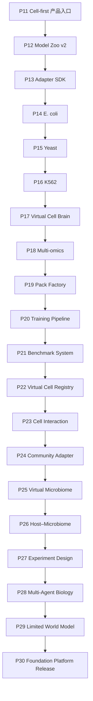

# PRAXIS-VirtualCell Phase 12–30 详细完成计划与验收对照表

> 文档状态：`OPERATIONAL_CHECKLIST — ACTIVE ENGINEERING/SCIENCE/POLICY LEDGER`
>
> 规范工作树：`/Volumes/T7/PRAXIS-virtualcell`
>
> 当前已完成工程 work unit：`Phase 25E`
>
> DOCS-CLOSURE completion：`b19c896202bea56f894d0ad540501331af42a40c`
>
> 已完成 work unit：`Phase 14E — E. coli K-12 knockout→growth contract`；
> starting SHA `0b193310009d6e4d2ebc0fc8abf95da20a56acdb`；shared-SDK prerequisite
> `c3401450fd79f7829c438d6b55c1902ea2f4cf5f`；branch
> `codex/p14e-ecoli-growth-contract`；completion code SHA
> `8778e93c31c2dfe1ef0f77f06e7a80a425633736`；tree
> `fa85e049bb36f3fbd8e6d4a7503e4b5837ed7c78`；状态 `COMPLETE`
>
> 已完成 work unit：`Phase 15E — S. cerevisiae S288C deletion→fitness contract`；
> starting SHA `0ff6870a70a04d71098a16875e633f909e31cc5a`；branch
> `codex/p15e-yeast-fitness-contract`；completion code SHA
> `62480a3951173a2aa7b006403af9b169521db138`；tree
> `64906691c4c989a843df4da97f0a93f32cd65ad2`；状态 `COMPLETE`
>
> 已完成 work unit：`Phase 16E — K562 Golden perturbation→delta-expression contract`；
> starting SHA `d1e2e37b69784bd2f440cba34f51cfb56dcc00b2`；branch
> `codex/p16e-k562-perturbation-contract`；completion code SHA
> `9f6b14ea84cb0884b2bde2ed4c67c73aeb5a37e2`；tree
> `098cd563e3d865e080a0d121727b987e2d40ed18`；状态 `COMPLETE`
>
> 已完成 work unit：`Phase 17 — PRAXIS Virtual Cell Brain contract`；starting SHA
> `ff525a0611901df422161a7143ebfe9d1e051008`；branch
> `codex/p17-virtual-cell-brain`；completion code SHA
> `16636f1b2c36e0a0fabb782a662b5b3b934891e0`；tree
> `321a59eed44c45bf2bb8798714352b3303b92e58`；状态
> `P17_CONTRACT_COMPLETE_REAL_MULTI_MODEL_ACCEPTANCE_PENDING_P18_ELIGIBLE`
>
> 已完成 work unit：`Phase 18 — Multi-omics Virtual Cell contract`；starting SHA
> `f253664239e4b1c9665301cf1bdf4e117a3e9c31`；branch
> `codex/p18-multiomics-cell-state`；completion code SHA
> `626c71ffd1ce18a5adc200f6a6e376e57b269beb`；tree
> `2b570398caff6cf955d789c3cb4a7a77dc13a082`；状态
> `P18_CONTRACT_COMPLETE_REAL_MULTIOMICS_MODEL_ACCEPTANCE_PENDING`
>
> 已完成 work unit：`Phase 19 — Controlled Pack Factory contract`；starting SHA
> `871c5a8a4265f5b8fe5c2c6e35d418644bf1c4be`；branch
> `codex/p19-controlled-pack-factory`；completion code SHA
> `42eabe63ea1a444d8b2ad14cecba6c9d6fa351d5`；tree
> `b4bd63833adc89bd1e30e9595d2cb6b38a3e005f`；状态
> `P19_CONTRACT_COMPLETE_REAL_EXTERNAL_FIXTURE_OPERATOR_SCIENCE_POLICY_NOT_RUN`
>
> 已完成 work unit：`Phase 20 — Virtual Cell Training Pipeline contract`；starting SHA
> `f53e29e5722a8fe48aa2eb6fe63be01f61b5cc9a`；branch
> `codex/p20-training-pipeline`；completion code SHA
> `a4003704b70f06eb65297ddd32e0695ae8ee146b`；tree
> `d12d64a7c8d013d8d299272eea88a4ce0431ccab`；source date epoch `1786040663`；状态
> `COMPLETE — CONTRACT_ONLY`；science `NOT_RUN`；policy `NO_NEW_DECISION`
>
> 已完成 work unit：`Phase 21A — Virtual Cell Benchmark System`；starting SHA
> `5f3fc2d88c20e8083fb66a4c3399c5fe148241be`；branch
> `codex/p21-benchmark-system`；completion code SHA
> `20ecc12542e5df40c90d1fc367dbe86b563478b8`；tree
> `ffcd261dd7d506d0ad852023afcba0f5c97a2d72`；source date epoch `1786050825`；
> engineering `COMPLETE — SYSTEM_ONLY`；science `NOT_RUN`；policy `NO_NEW_DECISION`
>
> 已完成 work unit：`Phase 22 — Curated Virtual Cell Registry`；actual starting docs-closure SHA
> `09792e13e29a76b5e4434507f3334eefb947789c`；P21A prerequisite code SHA
> `20ecc12542e5df40c90d1fc367dbe86b563478b8`；branch
> `codex/p22-virtual-cell-registry`；completion code SHA
> `bca5ad661856e8d9aa832c47f23c6ad7179ee0c9`；tree
> `f78476ac1dbe2f865e3c1bcdc71ecc512dbad22a`；source date epoch `1786056220`；
> engineering `COMPLETE — CONTRACT_ONLY`；science `NOT_RUN`；policy `NO_NEW_DECISION`
>
> 已完成 work unit：`Phase 23A — Cell Interaction Evidence contract`；actual starting
> P22 docs-closure SHA `2b5c28ac152857dfa1109de41ed5d5ddc7ab06a4`；branch
> `codex/p23-cell-interaction`；completion code SHA
> `2b894966cd00b2af2fafbf8f009566dd69f393a7`；tree
> `00bd98b0fd14091f4528115dcc66730264d5803a`；source date epoch `1786061504`；
> engineering `COMPLETE — CONTRACT_ONLY / SYNTHETIC_CONFORMANCE`；science `NOT_RUN`；
> policy `NO_NEW_DECISION`
>
> P23B 是独立可选窗口，保持 `AUTHORIZATION_REQUIRED / NOT_RUN`。P24 被定义为真实
> Community adapter，没有可与真实资产/固定模型分离并计作 P24 完成的本地
> contract-only work unit；当前为 `AUTHORIZATION_REQUIRED / NOT_RUN`
>
> 已完成 work unit：`Phase 25E — Virtual Microbiome fixed-scope contract`；observed active
> baseline `ae5e93571783cb3cf49a6e0fab531a89e963f7ec`；branch
> `codex/p25e-virtual-microbiome`；completion code SHA
> `039393e6be897b3014bb0b657d0a439d879578b6`；tree
> `b53e542940bf39fd44965fe55416798211ab580b`；source date epoch `1786171049`；
> engineering `COMPLETE — CONTRACT_ONLY / VALUE_FREE_ABSTENTION`；fixture evidence
> `SYNTHETIC_CONFORMANCE_ONLY`；science `NOT_RUN`；policy `NO_NEW_DECISION`
>
> 当前 Phase 11 产品代码锚点：`bf44aac25b993e49d0146ccd52dddad5c2fa14de`
>
> DOCS-CLOSURE parent：`b02d21985bcde50cf0758d339b05b13bb3e200a2`
>
> 当前状态核对日期：2026-08-08

本文是一份可以在整个项目周期中逐项对照的执行清单。它把
[P12–P30 权威执行路线](PHASE12-30-EXECUTION-PLAN-AND-PROMPTS.md)转换为：

```text
阶段前置条件
→ 授权门
→ 计划交付物
→ 工程验收
→ 科学验收
→ No-Go / abstain
→ 完成记录
```

本文自身不授权实施任何 Phase。P12、P13、P14E、P15E、P16E、P17、P18、P19、P20、
P21A、P22、P23A 和 P25E 已在持续本地授权内完成；该授权仍不包含
外置数据或权重、network、push、GitHub main/tag、`.53`、服务、发布、部署或真实
科学运行。P14E 已独立收口；P14R 仍需逐资产/窗口授权，P14B 仍只能在
正科学结果后由具名 operator 决定。P15E 已独立收口；P15R 仍需逐资产/窗口授权，
P15B 仍只能在正科学结果后由具名 operator 决定。P16E 已独立收口；P16R 仍需
逐资产/窗口授权，P16B 仍只能在正科学结果后由具名 operator 决定。P17 已完成
contract-only 工程闭包；真实多模型验收仍需至少两个 promoted capabilities。P18 已完成
typed multi-omics 输入合同；真实 Broker/Registry 兼容、模型执行与科学验收仍 pending。
P19 已完成受控 registration 工程合同，但 Git 外真实 fixture、新 output root、真实
operator/science/policy 均未运行；factory registration 不是模型兼容、执行或 promotion。阶段 scope、
P20 已完成 exact P19 registration-bound Training Pipeline contract，但只运行 repository tiny
fixtures；真实 candidate training、test/external read、benchmark/science/policy 均未运行。
P25E 只完成 fixed-scope/value-free contract，P24/P25R 仍未授权、未运行；下一 eligible
local unit 是 P26E contract/DAG/matching/abstain software，P26R 仍受 promoted prerequisites 阻塞。
阶段 scope、资产清单和可复制授权句仍以
[P12–P30 权威执行路线](PHASE12-30-EXECUTION-PLAN-AND-PROMPTS.md)为准。

准确产品承诺是：任意符合显式合同的数据可以制作成 VirtualCellPack 接入；只有
存在匹配、可执行且经过验证并获 product policy 批准的模型时才产生预测，否则明确
abstain。

---

## 1. 如何使用这份对照表

### 1.1 状态定义

work-unit 执行状态机使用以下状态；总进度表可另用 `NOT_STARTED/NOT_RUN/N/A`
等静态台账值：

| 状态 | 含义 |
|---|---|
| `READ_ONLY_HANDOFF` | 只读核对现场、完成证据和唯一下一 work unit |
| `AUTHORIZATION_REQUIRED` | 前置满足但缺少完整精确授权 |
| `AUTHORIZED` | 已取得唯一 starting SHA、scope 和操作边界，但尚未写代码 |
| `IN_PROGRESS` | 正在授权范围内实施和验证 |
| `VALIDATING` | 实施已停止，正在完成约定验证和 adversarial audit |
| `BLOCKED` | 缺少明确资产、权限、科学前置门或外部状态 |
| `SOFTWARE_COMPLETE_NEGATIVE_SCIENCE` | 软件和合同收口，但科学候选未胜 baseline 或未过 external gate |
| `COMPLETE` | 阶段定义的全部适用交付物、测试和完成报告已经收口 |
| `NEXT_ELIGIBLE_LOCAL_WORK_UNIT` | 当前 work unit 已完成，重新核对现场并继续最早 eligible 本地 E work unit |
| `RELEASED` | 仅适用于完成 P30 对应发布窗口后的正式状态 |

`SOFTWARE_COMPLETE_NEGATIVE_SCIENCE` 是诚实完成状态，不等于失败返工。它允许保留
软件基础设施和负结果，但不能产生科学 promotion，也不能被后续文档改写成正结果。

### 1.2 勾选规则

- `[ ]` 表示没有完成或没有现场证据；
- `[x]` 只能在完成报告中存在 exact SHA、fingerprint、测试或外部证据时填写；
- branch 名、文件存在、接口存在、模型卡存在和一次 smoke 均不能单独勾选科学门；
- 某阶段完成后，只填写该阶段的完成记录，不回写或覆盖旧阶段的不可变证据；
- 下一个 Phase 的 starting SHA 必须使用上一个代码阶段实际完成后的 40 位 SHA；
- run-only、operator-only 和部署子阶段可能不产生新代码 SHA，必须记录“代码 SHA
  未变化”和对应的 Git 外 result/policy/deployment identity。

### 1.3 三类“完成”必须分开

| 完成类型 | 证明内容 | 不能证明 |
|---|---|---|
| 软件完成 | 合同、实现、负例和回归测试通过 | 模型在真实数据上有效 |
| 科学完成 | 预声明 benchmark、CI、external/OOD 门通过 | 已被产品批准执行 |
| 产品完成 | 具名 operator 引用 exact evidence 作出 policy decision | 更宽物种、细胞或任务有效 |

---

## 2. 当前基线与总进度

### 2.1 当前事实

- Phase 11A 已完成数据中心化前端骨架；
- Phase 11B 已完成 Cell-first 白色聊天入口、Data Center、示例问题和直接报告；
- Cell preset 仍是 context preset，不是持久化或经过科学验证的 Virtual Cell；
- Data Center 中存在数据或 Pack，不等于存在匹配、可执行、验证过的模型；
- DOCS-CLOSURE 已在 `b19c896202bea56f894d0ad540501331af42a40c` 收口；
- Phase 12 已从该 SHA 完成 exact-scope 工程实现，completion code SHA 为
  `1a5464fb0d2d9e105058f6797d92efd69783e5b2`；
- P12 实现分离 model/artifact/environment/adapter/evidence/operator-policy
  identity，保持 v1 migration 为 legacy/incomplete/no-promotion，并以 append-only
  lifecycle 表达 catalog/readiness/revoke/supersede；
- P12 completion docs commit `f83c13db386cb552b3ce7a5643e5ffbead0ff573`
  是 P13 的实际 starting SHA；P13 不能错误地从 P12 code SHA 直接起算；
- Phase 13 已在 `codex/p13-model-adapter-sdk` 以 code SHA
  `744d0a28d2cfc13d1b10e85b133b6c13b9426174`（tree
  `198e623120688d3704b9312990ddaa93c9a7b0e6`）完成统一 Adapter SDK、prepared input、
  strict output envelope、deterministic conformance 与 runtime/report 接线；
- P13 默认生产 registry 仅注册 `predict_delta_expression → delta_expression`；growth
  和 fitness adapters 只存在于测试，未新增真实模型、数据、权重、science run 或
  operator decision；
- Phase 14E 已从 P13 docs-closure actual SHA
  `0b193310009d6e4d2ebc0fc8abf95da20a56acdb` 开始，经 shared-SDK prerequisite
  `c3401450fd79f7829c438d6b55c1902ea2f4cf5f`，在
  `codex/p14e-ecoli-growth-contract` 以 code SHA
  `8778e93c31c2dfe1ef0f77f06e7a80a425633736`（tree
  `fa85e049bb36f3fbd8e6d4a7503e4b5837ed7c78`）完成 exact K-12 MG1655
  knockout→growth 合同、负向 compatibility、prepared-bound conformance 与 fail-closed 边界；
- P14E 只使用纯合成合同 fixtures，未读取或运行真实 GEM/data/assets/solver，
  growth adapter 未进入默认 registry；P14R science 与 P14B policy 均为 `NOT_RUN`；
- Phase 15E 已从 P14E docs-closure actual SHA
  `0ff6870a70a04d71098a16875e633f909e31cc5a` 开始，在
  `codex/p15e-yeast-fitness-contract` 以 code SHA
  `62480a3951173a2aa7b006403af9b169521db138`（tree
  `64906691c4c989a843df4da97f0a93f32cd65ad2`）完成 exact S288C/R64
  deletion→fitness contract、negative compatibility、prepared-bound conformance 与
  fail-closed 边界；
- P15E 只使用纯合成 identity/contract fixtures，未读取或运行真实 deletion
  screen/model/GEM/assets；adapter 未进入默认 registry，没有 science、policy、release
  或版本 bump；P15R 为 `AUTHORIZATION_REQUIRED / NOT_RUN`，P15B 为 `NOT_RUN`；
- Phase 16E 已从 P15E docs-closure actual SHA
  `d1e2e37b69784bd2f440cba34f51cfb56dcc00b2` 开始，在
  `codex/p16e-k562-perturbation-contract` 以 code SHA
  `9f6b14ea84cb0884b2bde2ed4c67c73aeb5a37e2`（tree
  `098cd563e3d865e080a0d121727b987e2d40ed18`）完成 exact K562 Golden
  gene/gene-combination→5,045-feature delta-expression contract、negative compatibility、
  prepared-only conformance 与 fail-closed 边界；
- P16E 只读取已检入的小型 Golden text manifests 以冻结 identity，未读取或运行
  H5AD/NPY/checkpoint/Golden science；adapter 未进入默认 registry，没有 science、
  policy、release 或 version bump；P16R 为 `AUTHORIZATION_REQUIRED / NOT_RUN`，
  P16B 为 `NOT_RUN`；
- `praxis-vc pack list` 和 `GET /api/packs` 只复用既有链路返回路径脱敏白名单投影，
  不新增管理写 API；
- 未精确绑定现有 model identity 的 P8/P9 结果保留为 `unbound` migration receipt；
  没有真实科学运行或新的 operator decision；
- 历史 ref `codex/p12-cell-first-baseline` 是误命名恢复 ref，不定义阶段状态；
- staged/modified/deleted/untracked 保护清单不在本文固定，每轮必须从现场
  `git status --short` 重建；任何新路径默认受保护；
- Phase 17 已从 P16E docs-closure actual SHA
  `ff525a0611901df422161a7143ebfe9d1e051008` 开始，在
  `codex/p17-virtual-cell-brain` 以 code SHA
  `16636f1b2c36e0a0fabb782a662b5b3b934891e0`（tree
  `321a59eed44c45bf2bb8798714352b3303b92e58`）完成 direct-v2 Pack-aware、
  deterministic DAG/Brain/decision、plan-only Broker、non-authoritative LLM candidate
  和 JobStore v3 合同；
- 当前 registry 有 5 个 release、0 个 native release、0 个 promoted capability；因此
  P17 science 为 `NOT_RUN`、policy 为 `NO_NEW_DECISION`，所有真实 P17 direct-v2 请求均 abstain，
  real multi-model acceptance 仍 pending；
- Phase 18 已从 P17 docs-closure actual SHA
  `f253664239e4b1c9665301cf1bdf4e117a3e9c31` 开始，在
  `codex/p18-multiomics-cell-state` 以 code SHA
  `626c71ffd1ce18a5adc200f6a6e376e57b269beb`（tree
  `2b570398caff6cf955d789c3cb4a7a77dc13a082`）完成 exact Pack v0.3、typed
  modality slots、per-layer alignment、observation join/missingness、semantic identity 与
  matrix content/storage snapshot 合同；
- P18 只编译 contract-only abstention；caller-declared adapter identity 未经 Broker 或
  Registry 解析，未运行 wrapper/model/science，registry 保持 5 releases / 0 native /
  0 promoted，science `NOT_RUN`、policy `NO_NEW_DECISION`；
- Phase 19 已从 P18 docs-closure actual SHA
  `871c5a8a4265f5b8fe5c2c6e35d418644bf1c4be` 开始，在
  `codex/p19-controlled-pack-factory` 完成 receipt→candidate→review→validation→decision→
  registration、explicit store/index、v1-readable/v2-write index、read-only projection 与
  fail-closed commit 工程；completion code SHA/tree 是 `42eabe63ea1a444d8b2ad14cecba6c9d6fa351d5` /
  `b4bd63833adc89bd1e30e9595d2cb6b38a3e005f`；
- P19 未运行 Git 外真实 fixture、新 output root、真实 operator、science 或 product policy，
  也未训练或生成 checkpoint/evidence/promotion；P7 species 均为 routing-only，exact taxon
  只由 manifest 与 reviewer confirmation 绑定；
- Phase 20 已从 P19 docs-closure actual SHA
  `f53e29e5722a8fe48aa2eb6fe63be01f61b5cc9a` 开始，在
  `codex/p20-training-pipeline` 以 code SHA
  `a4003704b70f06eb65297ddd32e0695ae8ee146b`（tree
  `d12d64a7c8d013d8d299272eea88a4ce0431ccab`）完成 exact RegisteredPack-bound
  training job/result、fixed worker、safe checkpoint、candidate-only model identity 和
  atomic publish contract；
- P20 只运行 repository tiny fixtures；真实 candidate、test/external、benchmark/science
  均 `NOT_RUN`，policy `NO_NEW_DECISION`；
- Phase 21A 已从 P20 docs-closure
  `5f3fc2d88c20e8083fb66a4c3399c5fe148241be` 开始，以 code SHA
  `20ecc12542e5df40c90d1fc367dbe86b563478b8`、tree
  `ffcd261dd7d506d0ad852023afcba0f5c97a2d72`、source date epoch `1786050825`
  完成 frozen benchmark system 和 negative ledger；engineering
  `COMPLETE — SYSTEM_ONLY`，science `NOT_RUN`，policy `NO_NEW_DECISION`；
- Phase 22 已从 P21A docs-closure
  `09792e13e29a76b5e4434507f3334eefb947789c` 开始，以 code SHA
  `bca5ad661856e8d9aa832c47f23c6ad7179ee0c9`、tree
  `f78476ac1dbe2f865e3c1bcdc71ecc512dbad22a`、source date epoch `1786056220`
  完成 curated registry contract；engineering `COMPLETE — CONTRACT_ONLY`，science
  `NOT_RUN`，policy `NO_NEW_DECISION`。没有真实 release import/catalog/revoke/supersede，
  默认 P22 registry 不存在或为空；
- Phase 23A 已从 P22 docs-closure
  `2b5c28ac152857dfa1109de41ed5d5ddc7ab06a4` 开始，在
  `codex/p23-cell-interaction` 以 code SHA
  `2b894966cd00b2af2fafbf8f009566dd69f393a7`（tree
  `00bd98b0fd14091f4528115dcc66730264d5803a`；source date epoch `1786061504`）完成
  directed sender/receiver strict identity、same-experiment evidence identity、P13 adapter 和
  evidence-only projection contract；全部运行仅为 synthetic conformance；
- P23A 的 P22 release active/non-revoked state 与 exact P18 observation membership 明确
  未验证，真实 paired evidence/mapping、trusted P20/P21 bundle/artifact/execution、baseline
  comparison、paired CI、calibrated uncertainty 和 held-out OOD 均 `NOT_RUN`；science
  `NOT_RUN`，policy `NO_NEW_DECISION`；
- P23B 保持独立可选 `AUTHORIZATION_REQUIRED / NOT_RUN`；P24 是 real-only Community
  adapter work unit，缺少 exact assets/model/run authorization，故为
  `AUTHORIZATION_REQUIRED / NOT_RUN`，没有下一 eligible 的 P24 contract-only 子阶段；
- P14R/P14B、P15R/P15B 与 P16R/P16B 均保持各自的 exact external/operator 授权门，一个外部门
  不阻塞无依赖的 eligible 本地 E work unit。

### 2.2 全路线依赖



### 2.3 总进度表

`工程状态`、`科学门` 和 `产品 policy` 必须分别填写，不能用一个“完成”覆盖三者。

| Phase | 工程状态 | 科学门 | 产品 policy | 核心完成物或硬门 |
|---|---|---|---|---|
| P11 | `COMPLETE` | `NOT_CLAIMED` | `NOT_APPLICABLE` | Cell-first 产品入口和 P11 代码锚点 |
| DOCS-CLOSURE | `COMPLETE` | `NOT_APPLICABLE` | `NOT_APPLICABLE` | completion `b19c896...` |
| P12 | `COMPLETE` | `NOT_APPLICABLE` | `NO_NEW_DECISION` | 分层 identity、v1 no-promotion migration、append-only lifecycle、只读投影；completion `1a5464fb...` |
| P13 | `COMPLETE` | `NOT_RUN` | `NO_NEW_DECISION` | 统一 Adapter SDK、delta reference、conformance 与 runtime/report 接线；completion `744d0a28...` |
| P14E | `COMPLETE` | `NOT_APPLICABLE — CONTRACT_ONLY` | `NO_NEW_DECISION` | E. coli K-12 knockout→growth 合同与 fail-closed 工程边界；completion `8778e93c...` |
| P14R | `AUTHORIZATION_REQUIRED` | `NOT_RUN` | `NOT_APPLICABLE` | exact GEM/data/assets/output root/run window 后才可真实运行 |
| P14B | `NOT_RUN` | `READ_ONLY` | `NOT_RUN` | 仅在正科学结果后由具名 operator 决定 |
| P15E | `COMPLETE` | `NOT_APPLICABLE — CONTRACT_ONLY` | `NO_NEW_DECISION` | exact S288C deletion→fitness 合同、negative compatibility、preregistration 与 abstain；completion `62480a39...` |
| P15R | `AUTHORIZATION_REQUIRED` | `NOT_RUN` | `NOT_APPLICABLE` | exact deletion screen/model/assets/output root/run window 后才可真实运行 |
| P15B | `NOT_RUN` | `READ_ONLY` | `NOT_RUN` | 仅在正科学结果后由具名 operator 决定 |
| P16E | `COMPLETE` | `NOT_APPLICABLE — CONTRACT_ONLY` | `NO_NEW_DECISION` | exact K562 Golden delta contract、negative compatibility、prepared-only output 与 abstain；completion `9f6b14ea...` |
| P16R | `AUTHORIZATION_REQUIRED` | `NOT_RUN` | `NOT_APPLICABLE` | exact checkpoint/data/assets/output root/run window 后才可真实运行 |
| P16B | `NOT_RUN` | `READ_ONLY` | `NOT_RUN` | 仅在正科学结果后由具名 operator 决定 |
| P17 | `COMPLETE — CONTRACT_ONLY` | `NOT_RUN` | `NO_NEW_DECISION` | deterministic Virtual Experiment DAG/Brain 与 fail-closed abstain；completion `16636f1b...`；真实多模型验收 pending |
| P18 | `COMPLETE — CONTRACT_ONLY` | `NOT_RUN` | `NO_NEW_DECISION` | typed multi-omics input、exact join/missingness/alignment 与 immutable runtime snapshots；completion `626c71ff...`；真实模型验收 pending |
| P19 | `COMPLETE — CONTRACT_ONLY` | `NOT_RUN` | `NO_NEW_DECISION` | controlled receipt→RegisteredPack；completion `42eabe63...`；real external fixture/operator 未运行 |
| P20 | `COMPLETE — CONTRACT_ONLY` | `NOT_RUN` | `NO_NEW_DECISION` | exact RegisteredPack-bound training contracts、fixed `-I -S` worker、safe checkpoint/candidate identity；completion `a4003704...` |
| P21A | `COMPLETE — SYSTEM_ONLY` | `NOT_RUN` | `NO_NEW_DECISION` | frozen benchmark/evidence contracts 与 negative ledger；start `5f3fc2d88c20e8083fb66a4c3399c5fe148241be`；completion `20ecc12542e5df40c90d1fc367dbe86b563478b8` |
| P21B | `AUTHORIZATION_REQUIRED / NOT_RUN` | `NOT_RUN` | `NOT_APPLICABLE` | per-candidate run-only evidence |
| P21C | `AUTHORIZATION_REQUIRED / NOT_RUN` | `READ_ONLY / NOT_RUN` | `NOT_RUN` | per-scope operator-only policy |
| P22 | `COMPLETE — CONTRACT_ONLY` | `NOT_RUN` | `NO_NEW_DECISION` | exact One-Pack/P21B release closure、default-deny trust、append-only lifecycle、checkpoint 与 redacted Python projection；start `09792e13...`；completion `bca5ad66...`；默认 registry empty |
| P23A | `COMPLETE — CONTRACT_ONLY / SYNTHETIC_CONFORMANCE` | `NOT_RUN` | `NO_NEW_DECISION` | strict directed endpoint/same-experiment identities、P13 adapter、evidence-only projection；completion `2b894966...`；real registry/P18/data/model/baseline/CI/uncertainty/OOD gates 未运行 |
| P23B | `AUTHORIZATION_REQUIRED / NOT_RUN` | `NOT_RUN` | `NOT_RUN` | 可选 receiver response；独立授权，不是 P23A 自动下一步 |
| P24 | `AUTHORIZATION_REQUIRED / NOT_RUN` | `NOT_RUN` | `NOT_RUN` | 第一个真实 Community adapter；没有独立 P24 contract-only work unit |
| P25E | `COMPLETE — CONTRACT_ONLY / VALUE_FREE_ABSTENTION` | `NOT_RUN` | `NO_NEW_DECISION` | exact 2–3-member schema、唯一 positive 2-member synthetic freeze fixture、typed missing bindings、value-free abstain；completion `039393e6...` |
| P25R | `AUTHORIZATION_REQUIRED / NOT_RUN` | `NOT_RUN` | `NOT_APPLICABLE` | real assets、P24/P20/P21 model/mapping/protocol、write-new benchmark window 均未授权 |
| P25 policy / P21C | `AUTHORIZATION_REQUIRED / NOT_RUN` | `READ_ONLY / NOT_RUN` | `NOT_RUN` | 只可引用 exact immutable positive evidence 由具名 operator 决定 |
| P26E | `NEXT ELIGIBLE — CONTRACT_ONLY` | `NOT_RUN` | `NO_NEW_DECISION` | 只允许 contract/DAG/matching/abstain；不得伪造 promoted host/community release |
| P26R | `BLOCKED` | `NOT_RUN` | `NOT_RUN` | matching host/community 均 validated + promoted 且 matching release 存在 |
| P27A | `NOT_STARTED` | `REPLAY_NOT_RUN` | `NOT_APPLICABLE` | experiment-design software/replay |
| P27B | `OPTIONAL_NOT_RUN` | `SHADOW_NOT_RUN` | `NOT_APPLICABLE` | 可选具名专家 blind review |
| P27C | `OPTIONAL_NOT_RUN` | `PILOT_NOT_RUN` | `NOT_APPLICABLE` | 可选 prospective pilot |
| P28 | `NOT_STARTED` | `NOT_RUN` | `NOT_APPLICABLE` | 至少三个 executable + promoted 模型模块 |
| P29 | `NOT_STARTED` | `NOT_RUN` | `NOT_RUN` | 有限 typed biological subgraph |
| P30A | `NOT_STARTED` | `SEPARATE_BADGES` | `NOT_APPLICABLE` | 本地 RC |
| P30B1–B4 | `NOT_STARTED` | `SEPARATE_BADGES` | `RELEASE_WINDOWS` | CI、发布、staging、cutover/rollback |

---

## 3. 全阶段共同 Definition of Done

任何 Phase 标记为完成以前，适用项都必须勾选。

### 3.1 身份与合同

- [ ] starting SHA 是现场验证的唯一 40 位 SHA；
- [ ] schema、contract、Pack、model、adapter、environment 和 result 使用各自版本；
- [ ] 相同 canonical bytes/contract 产生相同 fingerprint；
- [ ] 任一受身份约束的 bytes 或语义变化产生新 identity；
- [ ] 历史 identity、job 和负结果没有被原地改写；
- [ ] unknown field、坏 hash、错 scope 和错版本 fail closed。

### 3.2 数据与科学

- [ ] 没有静默 normalization、补零、imputation、去重、重排或随机 split；
- [ ] feature namespace、order、mapping、unit、assembly 和 value semantics 显式；
- [ ] 按 biological group 切分并审计 leakage；
- [ ] baseline、主指标、方向、CI、OOD 和 external policy 在 test 前冻结；
- [ ] tuning 和 threshold 只使用 train/validation；
- [ ] external validation 默认 adaptation steps 为零；
- [ ] 未胜 baseline 或任一硬门失败时保留负结果并 abstain；
- [ ] synthetic/tiny fixture 只作为合同证据，不作为科学证据。

### 3.3 Agent 与 LLM

- [ ] LLM 只产生解析、候选计划或文字解释；
- [ ] LLM 不能修改数据、数值、compatibility、evidence、policy 或最终 verdict；
- [ ] LLM 关闭、超时或遭遇注入时，确定性数值和 verdict 不变；
- [ ] Agent plan 经 schema、scope、permission、resource 和 capability gate；
- [ ] rule、lookup、advisory 和真实模型在报告中明确区分。

### 3.4 工程与安全

- [ ] 先有失败测试，再有最小实现；
- [ ] 定向、受影响 core/legacy/frontend、Ruff 和 pip check 按范围通过；
- [ ] skip/deselect 没有被写成外部模型、GPU、LLM 或科学验证通过；
- [ ] path traversal、symlink escape、secret 泄露和覆盖已有 artifact 被拒绝；
- [ ] 大数据、权重和 checkpoint 没有进入 Git；
- [ ] source root 只读，output root 是独立 write-new 目录；
- [ ] 没有超出当前授权执行 push、main/tag、`.53` 或其他远程动作。

### 3.5 阶段收口

- [ ] 只 stage 当前授权范围内文件；
- [ ] 完成报告列出 starting SHA、completion SHA、branch 和 changed files；
- [ ] 完成报告列出全部 artifact/fingerprint 和测试；
- [ ] 完成报告准确区分软件结果、科学结果和产品 policy；
- [ ] 完成报告保留负结果、known limitations 和 abstain 行为；
- [ ] 记录下一 eligible work unit、其 actual starting SHA 读取规则与仍未授权的外部门；
- [ ] 完成后重新核对 Git 现场，并在持续本地授权内继续最早 eligible 的 E work unit；
- [ ] 仅在没有无依赖 eligible 本地 E work unit、且下一项撞上 exact
  external/remote/operator gate 时停止。

---

## 4. Milestone A：模型身份与三个窄域 Virtual Cell（P12–P16）

### Phase 12 — Virtual Cell Model Zoo v2

**状态：** `COMPLETE`

**执行身份：** starting SHA
`b19c896202bea56f894d0ad540501331af42a40c`；branch
`codex/p12-model-registry-v2`；completion code SHA
`1a5464fb0d2d9e105058f6797d92efd69783e5b2`。

**目标：** 在不下载或运行新权重的前提下，把现有 ModelCard、CapabilityRegistry 和
ModelBroker 扩展为不可变的模型、资产、环境、adapter、evidence 和 operator-policy
record identity；不作新的 operator promotion decision。

**前置与授权**

- [x] DOCS-CLOSURE completion 为
  `b19c896202bea56f894d0ad540501331af42a40c`；
- [x] 用户以该 SHA、exact allowlist 和操作边界明确授权 P12；
- [x] 分支为 `codex/p12-model-registry-v2`；
- [x] 权重、外置数据、network、training/GPU、push、`.53`、remote、service、
  deploy 和 main/tag 均保持禁止；
- [x] 本地 Phase 12 实现 commit 已形成；未执行 push、发布或部署。

下列交付物已由 completion code SHA、post-commit 验证和完成报告共同收口。

**交付物**

- [x] Model Registry v2 ADR；
- [x] v1 到 v2 状态迁移表；
- [x] model artifact identity：URI/cache key、size、SHA-256、media type、license、
  source 和安全加载策略；
- [x] environment identity：Python/package、lock/image digest、CPU/accelerator 和
  adapter 集；
- [x] validation evidence identity，绑定 Pack×model×environment×adapter×protocol；
- [x] registry state：`cataloged/artifact_ready/revoked/superseded`；
- [x] evidence state：`benchmark_passed/scientifically_validated/promotion_eligible`；
- [x] versioned/fingerprinted operator-policy record schema 和 no-promotion migration
  fixture；不作新的 operator decision；
- [x] revoke/supersede append-only 记录；
- [x] 路径脱敏的只读 CLI/API 投影；
- [x] 现有 5 张模型卡和 P8/P9 evidence 的兼容迁移 fixture。

实现候选使用的版本化身份包括：`vc.model-artifact.v1`、
`vc.model-environment.v1`、`vc.model-adapter.v1`、
`vc.model-validation-evidence.v1`、`vc.model-operator-policy.v1`、
`vc.model-release.v1`、`vc.model-registry-event.v1`、
`vc.model-registry-state.v1`、`vc.model-registry.v2`、
`vc.model-registry-catalog.v2`，以及 Pack-aware `vc.environment.v2`、
`vc.compatibility-report.v2`、`vc.execution-step.v2`、`vc.execution-plan.v2` 和
`vc.job-execution-identity.v2`。

adversarial audit 覆盖：native package 使用 canonical PEP 503 distribution
name/version，而 legacy runtime import-module name 原样分层保留；unsafe legacy raw
`model_version` 只保留内部 fingerprint，公开显示 `null`；v2 job identity 同时绑定
submitted/normalized request、canonical `plan_id` 和 step fingerprints；report 与
provenance 必须引用同一 plan，且两处 plan 使用同一字段白名单/路径脱敏投影。

**验收**

- [x] `vc.model-card.v1` 兼容；
- [x] planned/available 状态没有被迁移成 executable 或 validated；
- [x] P9 `available=false` 和负结果保持不变；
- [x] 坏 hash、身份错绑、evidence 错配、路径泄露和状态越级全部拒绝；
- [x] 相同 bytes 得到相同 fingerprint；
- [x] artifact/evidence bytes 变化得到新 identity；
- [x] 受影响测试、Ruff 和 pip check 通过。

**完成判定**

- `COMPLETE`：软件、迁移和负例全部通过；
- `BLOCKED`：v1 兼容无法保持或状态仍会自动提升；
- 不允许因为 registry 完成就声称新增真实模型能力。
- 当前没有运行真实 benchmark/external/OOD science；`benchmark_passed`、
  `scientifically_validated` 和 `promotion_eligible` 没有被 P12 创建；没有新的
  `production_promoted` operator decision。

---

### Phase 13 — Virtual Cell Model Adapter SDK

**状态：** `COMPLETE`

**执行身份：** starting SHA
`f83c13db386cb552b3ce7a5643e5ffbead0ff573`；branch
`codex/p13-model-adapter-sdk`；completion code SHA
`744d0a28d2cfc13d1b10e85b133b6c13b9426174`；tree
`198e623120688d3704b9312990ddaa93c9a7b0e6`。

**目标：** 建立按 task/output 注册的统一 Adapter SDK，使 Pack-aware strict path 接入
新 adapter 时无需新增 model/species 分支；显式保留 legacy/delta compatibility 分支。

**前置与授权**

- [x] P12 completion docs SHA `f83c13db386cb552b3ce7a5643e5ffbead0ff573`
  已记录并作为 P13 actual starting SHA；
- [x] P12 状态迁移和 registry tests 已通过；
- [x] 持续本地授权允许进入 `codex/p13-model-adapter-sdk`；
- [x] 未授权任何真实模型、数据或权重。

**交付物**

- [x] Adapter SDK ADR；
- [x] adapter schema/version/fingerprint；
- [x] 复用 `vc.model-feature-contract.v1` 的输入合同；
- [x] 严格 output envelope：task、output、shape、unit、finite number、uncertainty、
  OOD、abstain 和 provenance；
- [x] `predict_delta_expression → delta_expression` reference adapter；
- [x] adapter registry；
- [x] adapter fingerprint 接入 compatibility、plan 和 job execution identity，并经
  `adapter_output`/provenance 纳入 structured report fingerprint；
- [x] wrapper 只消费 Broker 准备好的输入和 hash-bound assets；
- [x] delta reference 与 dummy growth/fitness conformance adapters；dummy 仅用于测试；
- [x] legacy 和 P0 确定性报告兼容层。

**验收**

- [x] delta reference adapter 与 P6/P8 行为兼容；
- [x] 无 adapter 时 execution plan 为空；
- [x] 未注册 task/output、错 feature order、mapping drift、错 unit/shape/type 拒绝；
- [x] NaN、Inf、超大整数和 unknown field 拒绝；
- [x] 新测试 plugin 不修改 `route_table.py`、`case_dispatch.py` 或物种分支；
- [x] dummy adapter 没有进入生产 registry；
- [x] 相关契约、core、legacy 和 Ruff 通过。

**冻结证据**

- adapter fingerprint：
  `17afc27e56dba13567001ff1982cbf1660e2948fadf2147301a1d0dcf61aeb3d`；
- input contract fingerprint：
  `d10cf437291dc1ebb1689c3f4c5eea4d82af3842491c224172215faddca93078`；
- output contract fingerprint：
  `d863783786504ebf768cfd7e2fbad66cfd03a029deb1dee3543a9872712e363d`；
- completion test-fixture prepared-input fingerprint（`p13-reference`、K562/TP53、无 Pack）：
  `31d1859a226c50375b7f4d65b6307a9680d9e71e978f4f16e5eb053d90c5de3e`；
- 同一 fixture output fingerprint（raw delta `[0.25, -0.5]`）：
  `a6745427e8f0e9d516789ec9418a42fdb024e245d452b1ca4825c24398996ba2`；
- 同一 fixture conformance report fingerprint：
  `b40374d81f9ec3362d9950bffcfa97f123e46abc80f8b4b135fd5afa02bded18`；
- 上述三个 fixture fingerprints 是 execution-specific reproducibility evidence，不是
  adapter-global identity；request/Pack/compatibility/raw output 改变时必须改变；
- authoritative core：`1462 passed, 35 skipped, 9 deselected`；legacy：
  `1146 passed, 59 skipped, 105 deselected`；7-file directed gate：`265 passed`；
  Ruff、`pip check`、frontend typecheck/lint/build、packaging 与 post-commit checks 通过；
- exact-commit wheel SHA-256：
  `3658b6247a909d0351d760295e0bcbb8082eac930d96fdfe39e4377b591b4f23`；
  两次离线构建 byte-identical。

**完成判定**

- `COMPLETE`：SDK、reference adapter 和 conformance harness 全部通过；
- `BLOCKED`：仍需核心 runtime 的模型/物种专用分支；
- 本阶段实际结论为工程 `COMPLETE`、science `NOT_RUN`、policy
  `NO_NEW_DECISION`；默认 registry 只有 delta reference adapter，不能声称 growth
  或 fitness 已有生产 adapter 或真实模型。完整证据见
  `reports/phase13/PHASE13_COMPLETION.md`。

---

### Phase 14 — E. coli K-12 Virtual Cell

**状态拆分：** `P14E COMPLETE`；`P14R AUTHORIZATION_REQUIRED / NOT_RUN`；
`P14B NOT_RUN`

**P14E 执行身份：** starting SHA
`0b193310009d6e4d2ebc0fc8abf95da20a56acdb`；shared-SDK prerequisite
`c3401450fd79f7829c438d6b55c1902ea2f4cf5f`；branch
`codex/p14e-ecoli-growth-contract`；completion code SHA
`8778e93c31c2dfe1ef0f77f06e7a80a425633736`；tree
`fa85e049bb36f3fbd8e6d4a7503e4b5837ed7c78`。

`P14E` 只冻结 E. coli K-12 knockout→growth 的版本化输入/输出、adapter 与 fail-closed
合同，不读取或运行真实 GEM/data。下列真实资产、benchmark、external/OOD 和运行项目
属于 `P14R`，必须在 exact path/size/SHA-256/license/source/output root/run window 获得
新授权后才可勾选；`P14B` 只能消费正科学 evidence，由具名 operator 独立决定。

**唯一任务：**

```text
E. coli K-12 + exact GEM/medium/condition + gene knockout
→ growth / growth ratio
```

**P14E 合同工程前置**

- [x] P13 completion code SHA 已记录；
- [x] 从 Git history 读取 P13 docs-closure actual SHA
  `0b193310009d6e4d2ebc0fc8abf95da20a56acdb`，并以它创建
  `codex/p14e-ecoli-growth-contract`；
- [x] 只冻结窄 task/input/output/adapter/provenance 与 fail-closed tests，不读取或运行
  下列真实资产。

**P14R 前置与授权（P14E 不依赖这些资产）**

- [ ] GEM、growth/essentiality data 和 output root 获得逐文件精确授权；
- [ ] 每个资产记录 path、size、SHA-256、license、source 和 usage；
- [ ] source 只读，output write-new，网络策略明确；
- [ ] 用户明确授权 exact P14R asset/run window；不得用 P14E 分支授权代替。

**P14E 交付物**

- [x] 冻结要求调用方显式提供的 strain、assembly、GEM identity、medium/condition、
  gene namespace、knockout target、growth/growth-ratio output 和 unit；
- [x] 复用 P13 SDK 的 growth input/output adapter contract/conformance；无真实
  model/assets/data 时不加入默认生产 registry；
- [x] 纯合成合同 fixture 与 missing scope、namespace/unit/shape/type、unknown field、
  missing binding、OOD/abstain 负例；
- [x] P14E ADR、runbook、定向/回归测试与 engineering completion report；
- [x] P9 negative、delta default registry、legacy/P0 与 science/policy 状态保持不变。

**P14R 交付物（另行授权）**

- [ ] GEM artifact identity；
- [ ] 真实 growth/condition data Pack；
- [ ] `GemWrapper` 只消费显式绑定 GEM；
- [ ] biological-group split、baseline、主指标、CI 和 OOD protocol；
- [ ] gene mapping、leakage、mass/constraint audit；
- [ ] Broker/runtime prediction 或 abstain；
- [ ] 独立 dataset/platform 或实验批次零适配验证；
- [ ] task-scoped immutable capability evidence 或负结果。

**P14E 验收**

- [x] 不读取/运行真实 GEM/data/assets，不生成 benchmark/evidence/policy；
- [x] 缺 exact scope/binding、错 namespace/unit/shape/type 或 OOD 时 fail closed；
- [x] growth/fitness 测试合同不会进入默认生产 registry；
- [x] P13/P0/legacy/negative regressions、Ruff、packaging 按影响范围通过。

**P14E 冻结证据**

- adapter fingerprint：
  `0b26d81c99f3ed216f5dcc6c86814379b6997633c0a6c071109d3ed45918b1a9`；
- input-contract fingerprint：
  `6995a1c262367bbd510a488b80b2c01a15e18cd6c32169f3036045869218edfa`；
- output-contract fingerprint：
  `bfda36704cfd82006ec0a3bd1c772d62209eb8c860b7baffae982f150955f13f`；
- P14E contract file：`71 passed`；P14E + adjacent SDK/output flow：`148 passed`；
  safe nine-file directed gate：`360 passed`；safe legacy gate：
  `1147 passed, 58 skipped, 105 deselected`；
- full active-tree Ruff 与 `git diff --check` 通过；
- 证据仅证明 contract engineering：没有 Cobra/GEM/solver/science run、真实资产、
  benchmark evidence 或 operator policy。

**P14R 验收（另行授权）**

- [ ] target 不在 exact GEM namespace 时 abstain；
- [ ] 没有 textbook、mock 或隐式模型 fallback；
- [ ] deterministic FBA 如实标记 deterministic；
- [ ] 主指标严格胜 baseline 且 paired CI 支持改善；
- [ ] external adaptation 为零；
- [ ] strain、medium、condition 或 task 域外输入 abstain；
- [ ] flux 只作为 solver trace，不冒充已验证产品输出。

**完成与 policy**

- [x] P14E engineering report
  `reports/phase14e/PHASE14E_COMPLETION.md` 独立收口，不等待 P14R science；
- [ ] P14R 获授权并运行后才形成科学报告；若科学门失败，状态为
  `SOFTWARE_COMPLETE_NEGATIVE_SCIENCE`；
- [ ] 若 evidence 过门，另行执行 P14B operator-only policy decision；
- [ ] 没有 P14B 时不得写 `production_promoted=true`。

---

### Phase 15 — S. cerevisiae Virtual Cell

**状态拆分：** `P15E COMPLETE`；`P15R AUTHORIZATION_REQUIRED / NOT_RUN`；
`P15B NOT_RUN`

**P15E 执行身份：** starting SHA
`0ff6870a70a04d71098a16875e633f909e31cc5a`；branch
`codex/p15e-yeast-fitness-contract`；completion code SHA
`62480a3951173a2aa7b006403af9b169521db138`；tree
`64906691c4c989a843df4da97f0a93f32cd65ad2`。

**唯一任务：**

```text
exact S. cerevisiae strain/condition + gene deletion
→ deletion fitness
```

`P15E` 已在 contract-only、local-only 边界内完成；只冻结 S288C/R64 exact scope、
strict input/output、prepared-bound adapter、preregistration、OOD 与 abstain。P15R 的
真实资产/科学运行和 P15B 的 operator decision 均未授权、未运行。

**P15E 合同工程前置**

- [x] 从 Git history 读取 P14E actual docs-closure SHA
  `0ff6870a70a04d71098a16875e633f909e31cc5a`，并以它作为唯一 starting SHA；
- [x] P10 yeast tiny Pack 明确保持 synthetic contract fixture；
- [x] 重新读取 `git status --short`，只操作 exact allowlist；
- [x] 只使用合成 fixtures，未读取或运行真实 deletion screen/model/GEM/assets。

**P15E 交付物**

- [x] strain、assembly、SGD systematic ID、condition、control、unit 和 output 冻结；
- [x] 复用 P12 identities 与 P13 Adapter SDK，定义 deletion-fitness adapter、prepared
  input、strict output envelope、provenance、uncertainty/OOD 与 abstain 合同；
- [x] 冻结 future P15R 的 condition/replicate group、baseline、primary metric、paired
  CI、external/OOD 与 zero-adaptation preregistration；不得把 protocol 写成 evidence；
- [x] 纯合成、小型合同 fixtures 的 exact binding、deterministic conformance、负例和
  abstain；
- [x] adapter 不进入默认生产 registry，negative compatibility 固定为
  `p15r_not_authorized`，不生成 benchmark/evidence/policy/promotion；
- [x] [ADR-0012](ADR-0012-virtualcell-yeast-deletion-fitness-contract.md)、
  [runbook](runbooks/VIRTUALCELL-YEAST-DELETION-FITNESS-CONTRACT.md)、测试和
  [P15E completion report](../reports/phase15e/PHASE15E_COMPLETION.md) 已收口；
- [x] P15E 收口时如实记录 P16E 为下一 eligible gate；P16E 后续已从
  P15E docs-closure actual SHA 独立完成。

**P15E 冻结证据**

- public module：`praxis_virtualcell/model_zoo/yeast_deletion_fitness_contract.py`；
  tests：`praxis_virtualcell/tests/test_yeast_deletion_fitness_contract.py`；
- P15E contract tests：`98 passed`；safe directed gate：`458 passed`；safe legacy gate：
  `1147 passed, 58 skipped, 105 deselected`；
- authoritative Ruff 使用 `--extend-exclude old` 通过；format 与 `git diff --check` 通过；
- 两次 wheel byte-identical，SHA-256
  `7758c13bd5a53c74618d556b14c6e27e0492381162a9ab3364aee7dde5d2bb8d`；
- 严格 official build cache 因缺 `packaging==26.2` fail closed；系统全局 `pip check`
  被已知全局环境污染，不能作为 P15E 证据；
- 这些证据只证明 contract engineering，没有真实 asset/GEM/science、policy、release、
  version bump、push 或 deploy。

**P15R 前置、交付物与验收（另行授权）**

- [ ] deletion screen、固定模型、派生 assets 和 output root 获得逐文件 exact
  path/size/SHA-256/license/source/read-write policy/run-window 授权；
- [ ] 建立真实 deletion-fitness Pack、feature contract 与精确
  model/artifact/environment binding；
- [ ] condition/replicate group split、mean-fitness baseline、validation-only tuning 和
  预登记 seeds；
- [ ] 独立 condition/platform 零适配验证；
- [ ] Broker/runtime 报告、uncertainty/OOD 或 abstain；
- [ ] 只有主指标、paired CI 与 independent external gate 全部通过，才生成 exact-scope
  capability evidence；否则保留负结果并 abstain；

- [ ] exact SGD/assembly/strain gate；
- [ ] replicate/condition leakage 为零；
- [ ] external adaptation 为零；
- [ ] 主指标、paired CI、external gate 全部独立检查；
- [ ] 未覆盖 strain/condition/task 明确 abstain；
- [ ] 不继承 E. coli mapping、medium 或科学结论。

**P15R/P15B 完成与 policy**

- [x] P15E engineering report 独立收口，不等待 P15R science；
- [ ] 失败时记录 `SOFTWARE_COMPLETE_NEGATIVE_SCIENCE`；
- [ ] evidence 过门后，P15B 具名 operator 单独决定 product policy；
- [ ] P15B 不得修改 `scientifically_validated`。

---

### Phase 16 — Human/K562 Virtual Cell

**状态拆分：** `P16E COMPLETE`；`P16R AUTHORIZATION_REQUIRED / NOT_RUN`；
`P16B NOT_RUN`

**P16E 执行身份：** starting SHA
`d1e2e37b69784bd2f440cba34f51cfb56dcc00b2`；branch
`codex/p16e-k562-perturbation-contract`；completion code SHA
`9f6b14ea84cb0884b2bde2ed4c67c73aeb5a37e2`；tree
`098cd563e3d865e080a0d121727b987e2d40ed18`。

**唯一任务：**

```text
Golden Norman K562 perturbation
→ 5,045 ordered Ensembl features 的 delta_expression
→ condition-macro MSE
```

P16E 已在 contract-only、local-only 边界完成。它冻结 exact P8 Golden 小型文本
identities、K562/CVCL/GRCh38/scRNA/Ensembl 84、single/combination 分开 scope、
native delta semantics、neutral preregistration、prepared-only output 与 fail-closed abstain；不读取
H5AD/NPY/checkpoint，不运行 science。

**P16E 合同工程前置**

- [x] P15E completion code SHA `62480a3951173a2aa7b006403af9b169521db138`
  已记录；并从 P15E docs-closure 读取 actual starting SHA
  `d1e2e37b69784bd2f440cba34f51cfb56dcc00b2`；
- [x] 重新读取现场保护清单，只修改 exact allowlist；
- [x] 只使用 checked-in 小型 text manifests 和 synthetic wrapper fixtures；
- [x] P8 frozen split、feature order、metric、bootstrap 和 baseline 未修改。

**P16E 交付物**

- [x] `K562GoldenPerturbationScope`、validation/data/perturbation/execution/compatibility
  bindings、strict input/output 和 prepared model input schemas；
- [x] exact `NCBITaxon:9606`、K562/`CVCL_0004`、GRCh38/
  `GCA_000001405.15`、scRNA/`EFO:0008913`、Ensembl 84 和 5,045 ordered features；
- [x] single-gene/combination 分开 condition/ordered-target binding，不猜 symbol/version/
  ortholog；`A549` 只保留为 upstream metadata error；
- [x] native delta-expression only，不 normalization/reorder/fill/impute/deduplicate/
  silent absolute→delta；
- [x] future P16R 的 condition holdout、additive-ridge primary comparator、
  candidate-minus-additive paired bootstrap、contamination、independent K562 external、
  zero adaptation、separate-scope preregistration；不写 evidence/policy；
- [x] uncertainty neutral unavailable；OOD/非 success value-free abstain；公开 projection 只能
  exact prepared-bound；
- [x] compatibility 固定 `assets_verified=false`、`executable=false`、
  `reason=p16r_not_authorized`；adapter local-only，默认 registry 不变。
- [x] [ADR-0013](ADR-0013-virtualcell-k562-golden-delta-contract.md)、
  [runbook](runbooks/VIRTUALCELL-K562-GOLDEN-DELTA-CONTRACT.md)、测试和
  [P16E completion report](../reports/phase16e/PHASE16E_COMPLETION.md) 已收口。

**P16E 冻结证据**

- public module：`praxis_virtualcell/model_zoo/k562_golden_delta_contract.py`；tests：
  `praxis_virtualcell/tests/test_k562_golden_delta_contract.py`；
- P16E contract tests：`231 passed`；safe directed gate：`689 passed`；safe legacy gate：
  `1147 passed, 58 skipped, 105 deselected`；
- authoritative Ruff（`--extend-exclude old`）、format 与 `git diff --check` 通过；
- 两个 clean archive 的 local exact-commit wheel byte-identical：`1,108,165` bytes；
  SHA-256 `d333180996a4ed91161d364275589e992d0be634582cc83a57e9758b86c03c66`；
  `365` entries；`14` React entries；这些本地 build 值不是 release；
- science `NOT_RUN`；policy `NO_NEW_DECISION`；无 release/version bump/push/deploy。

**P16R 前置与授权（另行授权）**

- [ ] Golden Pack、candidate checkpoint、environment 和 external dataset 精确授权；
- [ ] exact read-only source roots、write-new output root、run window 和网络策略明确；
- [ ] 用户明确授权 P16R exact-asset science run。

**P16R 交付物**

- [ ] candidate/checkpoint/environment/adapter identity；
- [ ] 原生 delta-expression 语义，或 test 前冻结的 hash-bound conversion contract；
- [ ] no-change、global mean、additive ridge 和 candidate 走同一 runtime；
- [ ] checkpoint training-data、pretraining、split 和 cache contamination audit；
- [ ] stochastic candidate 至少三个预登记 seed；
- [ ] candidate-minus-additive paired condition bootstrap；
- [ ] 独立、语义兼容 K562 dataset/platform 零适配验证；
- [ ] uncertainty calibration 或明确 unavailable；
- [ ] single-gene 和 combination 分开评估、分开 evidence。

**冻结 comparator**

| Baseline | Golden test MSE |
|---|---:|
| no-change | `0.0062060923` |
| global mean | `0.0045820474` |
| additive ridge | `0.0032570634` |

**P16R 验收**

- [ ] additive ridge 是 primary comparator；
- [ ] candidate-minus-additive 95% CI 上界 `< 0`；
- [ ] contamination audit 通过；
- [ ] external gate 是 K562 独立 dataset/platform；
- [ ] donor 或其他 cell context 只作为 OOD，不替代 external gate；
- [ ] single-gene 与 combination 不互相借门；
- [ ] 未通过的 scope 保持 abstain。

**P16R/P16B 完成与 policy**

- [x] P16E engineering 已独立收口，不等待 P16R science；
- [ ] 负结果按 scope append-only 保存；
- [ ] 过门 scope 另行执行 P16B operator-only decision；
- [ ] 没有独立 P16B 时不得标记 production promotion。

---

## 5. Milestone B：编排、多组学、数据制作、训练和证据（P17–P22）

### Phase 17 — PRAXIS Virtual Cell Brain

**状态：** `P17_CONTRACT_COMPLETE_REAL_MULTI_MODEL_ACCEPTANCE_PENDING_P18_ELIGIBLE`

**目标：** 把科学问题编译为确定性、可审计和可重放的 Virtual Experiment DAG。

**前置与授权**

- [x] P16E completion code SHA `9f6b14ea84cb0884b2bde2ed4c67c73aeb5a37e2` 已记录；
- [x] actual starting SHA `ff525a0611901df422161a7143ebfe9d1e051008` 和
  `codex/p17-virtual-cell-brain` 授权已冻结；
- [ ] 若验收真实多模型组合，至少列出两个 P14B/P15B/P16B
  `production_promoted` decisions；
- [x] 当前 registry 为 5 releases / 0 native / 0 promoted，因此本 work unit 明确限定为
  contract-only，不运行真实多模型编排。

**交付物**

- [x] direct exact `vc.request.v2` Pack-aware 入口；
- [x] legacy 入口和冻结报告兼容；
- [x] immutable Brain/Virtual Experiment context；
- [x] deterministic task DAG；
- [x] 复用 CapabilityRegistry、ModelBroker 和 ExecutionPlan；
- [x] LLM candidate DAG 的 deterministic compiler/gates；candidate 始终非权威；
- [x] step 级 input/output identity；
- [x] conflict、partial failure、abstain 和 final verdict governance；
- [x] Brain/DAG fingerprint 写入 JobStore v3 job identity；
- [x] 第五 taxon Danio rerio（NCBITaxon:7955）tiny test fixture 仅在临时目录生成，
  从未注册为生产数据。

**验收**

- [x] canonical input/environment 相同得到相同 DAG/plan identity；
- [x] legacy projection、Pack、model 或 adapter 失败时不 fallback 到 mock；
- [x] LLM off/timeout/injection 时权威确定性结果不变；
- [x] conflict/partial/abstain 状态由确定性 decision 合同表达，candidate narrative
  不能掩盖或改写；
- [x] rule/advisory 不计作第二个模型；
- [ ] 真实多模型 claim 只在至少两个 promoted capability 参与必要组合任务时成立。

**完成判定**

- `COMPLETE`：合同和治理完成；
- 若缺两个 promoted capability，只能记录“contract complete；real multi-model
  acceptance pending”，不能声称 Brain 已完成真实多模型科学验收。

P17 contract-only 工程已按后一种状态完成；contracts、tests 与 artifact-ready packaging
均已收口。工程证据为：P17 tests `41 passed`；
adjacent `377 passed / 1 skipped`；safe gate
`1487 passed / 48 skipped / 387 deselected`；Ruff passed。exact code commit 的两次
clean-archive wheel byte-identical：`1,118,410` bytes、SHA-256
`bd3752b90a6d8e4d7a825b2f4925d00eb7e5204021fef3404b67e88f7a0e23bd`、
`366` entries、`14` React entries、`0` tests、`0` AppleDouble，并包含 Brain 模块；
official strict build 仍因 offline cache 缺 `packaging==26.2` fail closed。详见
[ADR-0014](ADR-0014-virtual-cell-brain.md)、
[P17 runbook](runbooks/VIRTUALCELL-VIRTUAL-EXPERIMENT-DAG.md) 和
[P17 completion report](../reports/phase17/PHASE17_COMPLETION.md)。science `NOT_RUN`，
policy `NO_NEW_DECISION`；未运行 P14R/P15R/P16R/B，也未 push、release、deploy 或
version bump。

---

### Phase 18 — Multi-omics Virtual Cell

**状态：** `P18_CONTRACT_COMPLETE_REAL_MULTIOMICS_MODEL_ACCEPTANCE_PENDING`

**目标：** 在保持 `vc.pack.v0.3` 语义的前提下建立真正的 typed multi-omics 模型输入。

**交付物**

- [x] `vc.multiomics-model-input.v1` 版本化合同；
- [x] ordered required/optional modality slots；
- [x] 每层独立 feature alignment 和 report；
- [x] observation membership、join 和 missingness policy；
- [x] target modality 和 typed bundle identity；
- [x] paired/partially-paired conformance fixtures；
- [x] optional modality 缺失行为由 exact input contract/adapter identity 显式声明；
- [ ] 如另获资产授权：单组学 baseline、multi-omics candidate、ablation 和 OOD protocol。

**验收**

- [x] required slots 缺任一项时无 execution step；
- [x] 不用任一 modality 交集放行 required slots；
- [x] 不造 observation、不补零、不 impute、不静默 normalization；
- [x] partially-paired 只使用真实 shared rows 或显式 missingness mask；
- [x] modality order、namespace、feature order、join/missingness 进入 fingerprint；
- [ ] real candidate 未胜单组学 baseline/CI/external gate 时只保留数据合同。

**完成判定**

- 合同可 `COMPLETE`；
- 真实 multi-omics 科学能力可独立为负结果，不能反向否定合同完成，也不能生成 promotion。

P18 已按第一种状态完成。exact code commit 为
`626c71ffd1ce18a5adc200f6a6e376e57b269beb`，tree 为
`2b570398caff6cf955d789c3cb4a7a77dc13a082`。合同把 exact request、Pack v0.3
manifest、ordered slots、observation semantics、view/join/missingness、per-layer alignment、
matrix content/storage 和 caller-declared adapter identity 交叉绑定；request 保留 Pack 源
target，只允许 identity 或显式一对一 alias 证明模型 feature identity，drop/aggregate
均 fail closed。Prepared runtime 使用 byte-backed defensive snapshots；矩阵本体不进入
JSON，但 shape/storage/content fingerprint 在消费边界重新核对。

工程证据：focused `44 passed`；adjacent `259 passed`；safe gate
`1531 passed / 48 skipped / 387 deselected`；Ruff、format、py_compile 和 diff checks
通过。两次 offline clean-archive wheel byte-identical：`1,132,811` bytes、SHA-256
`015724a90656706c0441e4f4f873ee51f8db87dfaae9de35a3e841e7c70b2b7c`、`367`
entries、`14` React entries、`0` tests、`0` AppleDouble。可选 MuData suite 因本地未安装
`mudata` 无法 collect；global `pip check` 受共享环境既有 invalid distributions/conflicts
污染，均未被误报为通过。详见 [ADR-0015](ADR-0015-multiomics-model-input.md)、
[P18 runbook](runbooks/VIRTUALCELL-MULTIOMICS-MODEL-INPUT.md) 和
[P18 completion report](../reports/phase18/PHASE18_COMPLETION.md)。

P18 没有调用 Broker、CapabilityRegistry、wrapper 或 model，没有训练、GPU、外置资产、
Golden/GEM/Norman science、evidence、promotion、push、release 或 deploy；science
`NOT_RUN`，policy `NO_NEW_DECISION`，真实 multi-omics model acceptance 仍 pending。

---

### Phase 19 — 受控 Pack Factory

**状态：** `P19_CONTRACT_COMPLETE_REAL_EXTERNAL_FIXTURE_OPERATOR_SCIENCE_POLICY_NOT_RUN`

**唯一闭环：**

```text
upload receipt
→ candidate manifest/mapping
→ explicit metadata review
→ strict validation
→ named operator approval
→ RegisteredPack
```

**交付物**

- [x] receipt immutable raw-bytes identity；
- [x] taxon、assembly、cell identity、modality、namespace、value semantics、
  condition/control、unit、split 和 leakage group 显式确认；
- [x] inferred metadata/mapping 只作为候选；
- [x] mapping version/hash 和未映射、重复、out-of-domain、顺序报告；
- [x] 完整 validation report，包含 `taxon_review_binding` 且 warning 不当 pass；
- [x] named registration-only operator decision 绑定 exact candidate/review/report fingerprints；
- [x] upload、candidate、review、validation、decision、RegisteredPack 和 supersede 分层；
- [x] 本地 operator CLI/library，显式 absolute index 与由 `PackFactoryStore.create()` write-new 初始化、exact marker 验证通过的 store；
- [x] 公共 API/UI 只读、root-free，并 redacted reviewer/operator raw ID、rationale 与 reason；
- [ ] 经精确授权的 Git 外 tiny fixture 插件性证明（`NOT_RUN`，无 exact asset/output root 授权）。

**验收**

- [x] 任一关键 metadata/mapping 未确认时不能 register；
- [x] 原始上传 bytes 不变，且必须是 Pack 实际 data asset；
- [x] 相同输入和确认内容得到相同 candidate/Pack fingerprint；
- [x] 源 bytes、metadata、mapping 或 decision 改变得到新 identity 或冲突失败；
- [x] traversal、symlink、坏 hash、taxon review drift、未知字段和重复 key 拒绝；
- [x] P7 species 只作 routing hint；coarse bacteria 不推断 exact taxon；
- [x] index v2 兼容读 v1，旧 path-only register 退役；pending commit 对 consumer fail closed；
- [x] UI/API 区分 receipt、candidate、factory-registered、model-compatible 和 executable；
- [x] synthetic fixture 不被写成科学证据，真实外置 fixture 明确 `NOT_RUN`。

**禁止**

- [x] 确认没有训练、checkpoint、model card、benchmark、evidence 或 promotion；
- [x] 确认没有自动 normalization、补零、去重、重排、随机 split 或 identifier conversion。

P19 从 P18 docs-closure
`871c5a8a4265f5b8fe5c2c6e35d418644bf1c4be` 开始，在
`42eabe63ea1a444d8b2ad14cecba6c9d6fa351d5`（tree
`b4bd63833adc89bd1e30e9595d2cb6b38a3e005f`）完成。Focused `23 passed / 1 skipped`；combined
focused+adjacent `108 passed / 1 skipped`；safe gate `1,554/49/387`；legacy
`1,143/58/105`。当前合同把 Pack index
write 到 store registration append 之间视为 pending；consumer 必须验证 store 中完整 chain，
缺失或不一致时 fail closed，双向一致后才 committed。`vc.pack-index.v2` 写入 factory
registration/store provenance，同时继续只读兼容 v1 legacy entries；v1 不会被追认为
factory-approved。

Public `GET /api/pack-factory` 无写 route，删除 local roots、reviewer/operator raw IDs、
rationale 与 reason，
并固定 `model_compatible=null`、`executable=false`、science/promotion false。完整边界见
[ADR-0016](ADR-0016-controlled-pack-factory.md)、
[runbook](runbooks/VIRTUALCELLPACK-CONTROLLED-PACK-FACTORY.md) 与
[P19 completion report](../reports/phase19/PHASE19_COMPLETION.md)。

---

### Phase 20 — Virtual Cell Training Pipeline

**状态：** `COMPLETE — CONTRACT_ONLY`；science `NOT_RUN`；policy `NO_NEW_DECISION`

**唯一闭环：**

```text
RegisteredPack
→ frozen training job
→ fixed trusted deterministic worker (`python -I -S`)
→ candidate checkpoint
→ training result
→ candidate model identity
```

**交付物**

- [x] `vc.training-job.v1`；
- [x] RegisteredPack、feature/alignment、split/leakage、trainer、code、environment、
  seed、hyperparameters 和 resource limits 全绑定；
- [x] leakage audit 在 trainer 读取 label 前执行；
- [x] 同步 CLI/library runner；
- [x] trainer 只读 allowlisted Pack/labels；
- [x] 安全 checkpoint 格式；
- [x] 临时目录完成 hash/manifest 后 atomic no-replace 发布；
- [x] `vc.training-result.v1`；
- [x] candidate ModelCard/ModelArtifact identity；
- [x] failure、cancel、timeout 和 partial-output cleanup；
- [x] tiny deterministic contract-only dry-run。

**验收**

- [x] 只有 P19 RegisteredPack 能进入 runner；
- [x] 关键输入任一变化都会改变 identity；
- [x] 相同 tiny input/seed 可重放；
- [x] arbitrary uploaded code、path escape、secret leak 和 overwrite 被拒绝；
- [x] failure/cancel/timeout 不发布 partial checkpoint；
- [x] tiny 指标没有进入 evidence ledger；
- [x] P21B 前没有真实 candidate training 或 test/external 读取。

**禁止**

- [x] 无真实训练、自动调参、分布式/GPU scheduler；
- [x] 无 `scientifically_validated`、`promotion_eligible` 或 `production_promoted`。

P20 从 `f53e29e5722a8fe48aa2eb6fe63be01f61b5cc9a` 开始，在
`a4003704b70f06eb65297ddd32e0695ae8ee146b`（tree
`d12d64a7c8d013d8d299272eea88a4ce0431ccab`，epoch `1786040663`）完成。Live open/validation
只覆盖 exact manifest、split，以及 audit 后实际消费的 train feature/label bytes；stored P19
full tree 仅为历史 provenance，其他 assets 从不打开。固定 worker 以 `-I -S` 运行，但不声明
OS sandbox。

Focused `56 passed`；P19+P20 `99 passed / 1 skipped`；safe
`1,610 passed / 49 skipped / 387 deselected`；legacy
`1,147 passed / 58 skipped / 105 deselected`；static clean。Wheel `1,178,805` bytes，SHA-256
`2273ee71fb58fef543eae358d3df2aefccec42e80fe72a23380200718c223d79`，`370` entries /
`14` React / `0` tests / `0` AppleDouble。Pipeline
`dd7dbe480c3f000e5345b35fc6358fe2cc1b4377b035c31809d584ce3c869134` 与 worker
`4de1ba3b67a67ea24c16b7664058939ae3a634e06cf11601a528aca4c465f02b` 均与 wheel 内 bytes
完全一致。该 wheel 只证明 exact local source/toolchain 可复现，不是 pinned dependency closure
或 clean-install evidence。

---

### Phase 21 — Virtual Cell Benchmark System

**状态：** P21A engineering `COMPLETE — SYSTEM_ONLY`；science `NOT_RUN`；policy
`NO_NEW_DECISION`。P21B/P21C `AUTHORIZATION_REQUIRED / NOT_RUN`。P22 contract-only
随后完成，但没有运行 P21B/P21C 或制造 evidence/policy。

#### P21A — 系统与冻结协议

- [x] `benchmark protocol/run/result/promotion-evidence` 合同；
- [x] protocol 在 candidate result 前冻结；
- [x] Pack、split、feature/output、metric/direction、baseline、CI、seeds、OOD、
  threshold partition 和 external policy 全绑定；
- [x] 正式 adapter/Broker/runtime typed receipt 合同（未执行真实模型）；
- [x] validation-only threshold；
- [x] P9 biological-group leakage audit 和 condition bootstrap 复用；
- [x] calibration、coverage、selective risk、wrong accept 和 unnecessary abstain；
- [x] 多维 capability profile，不生成 composite score；
- [x] append-only negative ledger；
- [x] 只读兼容重放保持 P8 historical null/unbound 与 P9 exact negative/unbound；
- [x] runner 不能写 `production_promoted`。

P21A 的 synthetic positive fixtures 只验证合同，绝不是科学 evidence。本阶段没有真实
candidate run、test/external、资产、权重、训练、GPU、network、operator、promotion、
release 或 deploy。任何 P21B 执行都必须由外部可信边界独立固定 composite execution
identity；content fingerprint 只证明内容身份，不构成 issuer authentication。

#### P21B — 单个真实 candidate run-only

- [ ] 单独授权一个 exact candidate/task/scope；
- [ ] protocol fingerprint 已冻结；
- [ ] 输入资产和 output root 逐项精确授权；
- [ ] 只使用 P20 runner；
- [ ] 训练和评估走正式 adapter/runtime；
- [ ] test/external 后不改 split、metric、baseline、CI 或 gate；
- [ ] 只生成 immutable benchmark/scientific/promotion-eligible evidence；
- [ ] 代码、Git、branch 和 workspace 文件保持不变；
- [ ] 负结果仍写入 ledger 并保持 abstain。

#### P21C — 独立 operator policy decision

- [ ] 具名 operator；
- [ ] exact evidence fingerprints；
- [ ] exact capability scope；
- [ ] 只读 evidence，禁止重跑和调参；
- [ ] write-new policy output；
- [ ] 所有科学、license、scope 门全过才可 `production_promoted=true`；
- [ ] declined decision 和原因同样 append-only；
- [ ] operator 不修改 `scientifically_validated`。

**完成判定**

- P21A 完成代表 benchmark 系统完成；
- P21B/P21C 可以按 candidate 重复，但每次必须独立授权；
- 没有 P21C 时，promotion-eligible 仍不是产品 promotion。

---

### Phase 22 — Curated Virtual Cell Registry

**状态：** engineering `COMPLETE — CONTRACT_ONLY`；science `NOT_RUN`；policy
`NO_NEW_DECISION`。Actual start `09792e13e29a76b5e4434507f3334eefb947789c`；completion
code/tree `bca5ad661856e8d9aa832c47f23c6ad7179ee0c9` /
`f78476ac1dbe2f865e3c1bcdc71ecc512dbad22a`；epoch `1786056220`。

**目标：** 建立 operator-curated、content-addressed Virtual Cell Registry，不做开放
Marketplace。

**前置**

- [x] P21A benchmark-system completion code SHA
  `20ecc12542e5df40c90d1fc367dbe86b563478b8`；
- [x] 实际 repository/docs 起点固定为 P21A docs-closure
  `09792e13e29a76b5e4434507f3334eefb947789c`；
- [x] 没有 positive P21B evidence/P21C policy 时只收口 registry 合同，没有制造
  validated/promoted release；
- [ ] 若未来导入真实 release，仍须一个 exact-scope P21B evidence、对应 P21C policy
  和独立 operator import/decision authorization；P14–P16 direct evidence route 不属于 v1。

**交付物**

- [x] strict `vc.virtual-cell-release.v1` schema/fingerprint；
- [x] species/cell context 与 exact one-Pack/P19 registration、P12 model release、adapter、
  environment identity closure；
- [x] exact P21B bundle/execution identity、validation evidence 和 P21C policy refs；
- [x] capability scope 与 OOD/abstain policy fingerprints；
- [x] license/source/publisher/reviewer；
- [x] approve_catalog/quarantine/revoke/supersede 与 append-only audit；
- [x] explicit absolute write-new、content-addressed、原子本地 registry；
- [x] allowlisted/reviewed wrapper approval contract；registry 不 import 或执行 entrypoint；
- [x] 路径脱敏、nonexecuting、read-only Python public projection/query；
- [ ] HTTP registry API；
- [ ] Data Center 使用真实 release；
- [ ] Chat/job 绑定 exact release identity；
- [ ] UI 分列显示 cataloged、installed、compatible、executable、validated、promoted；
- [ ] multi-Pack、direct P14/P15/P16 evidence route 或 non-P21B import。

**验收**

- [x] 同 ID/version 不接受不同 bytes；
- [x] import 重验 schema/hash/dependency/wrapper approval/P21B evidence/P21C policy，并把
  license/source metadata identity 与 credential-free HTTPS URI syntax 纳入 exact import identity；
  不 fetch source，也不做 live license/source truth verification；
- [x] default-deny operator allowlists 与 stable authorization references 覆盖 import/decision；
- [x] trusted checkpoint 之后的 suffix 每次读取重新验证 authorization provenance；
- [x] quarantined/revoked/superseded release 不进入默认 public catalog，public projection
  固定 `executable=false`；installed/model/environment/adapter compatibility 保持 unknown/null；
- [x] registry approval 不创建或提升 evidence/promotion；
- [x] append-only log 不改写既有 release/decision bytes；
- [x] 无 remote plugin 自动下载、任意用户代码 import 或 wrapper execution；
- [ ] runtime execution-plan 过滤接线；
- [ ] JobStore 历史 job revoke/supersede 集成验证；
- [ ] 用户选择 cell 与 execution identity 一致。

本次所有 positive import/lifecycle path 都只是 pytest 临时目录中的 synthetic conformance。
没有真实 imported、cataloged、quarantined、revoked 或 superseded release，默认 P22 registry
未配置/不存在或为空；P12 ModelRegistryV2 仍是独立的 5 legacy releases / 0 native / 0
promoted 状态。Content hash 只证明内容身份，不认证 issuer。Operator allowlists 和 monotonic
checkpoint 必须在 registry 外独立持久化；suffix 会按 stable authorization reference 重验，
但在外部 checkpoint 前进前，攻击者若连同 registry/head 回滚到最近受信 checkpoint，仍可能
无法检出。

完整边界见 [ADR-0019](ADR-0019-curated-virtual-cell-registry.md)、
[P22 runbook](runbooks/VIRTUALCELL-CURATED-REGISTRY.md) 和
[P22 completion report](../reports/phase22/PHASE22_COMPLETION.md)。

---

## 6. Milestone C：细胞交互、群落与宿主系统（P23–P26）

### Phase 23 — Cell Interaction Model

**状态：** `COMPLETE — CONTRACT_ONLY / SYNTHETIC_CONFORMANCE`；science `NOT_RUN`；
policy `NO_NEW_DECISION`。Completion code SHA/tree/epoch 为
`2b894966cd00b2af2fafbf8f009566dd69f393a7` /
`00bd98b0fd14091f4528115dcc66730264d5803a` / `1786061504`。这只收口本地 strict
schema、P13 adapter 和 evidence-only synthetic conformance；不证明任何真实
sender/receiver release、Pack/context、interaction evidence/data、asset 或执行。

#### P23A — interaction evidence

```text
sender cell → receiver cell
→ interaction_evidence_score
```

**已完成的本地合同与 synthetic conformance**

- [x] strict、frozen、direction-sensitive sender/receiver schema 绑定 P22 release closure、
  Pack/context fingerprint 和显式 P18 typed identity reference；
- [x] indivisible same-experiment identity 冻结 dataset/platform/evidence、donor/sample/well、
  condition、dose/time、role、ligand/receptor/evidence namespace 与 mapping fingerprint，且
  schema 不提供跨 dataset 静默配对字段；
- [x] 复用 P13 prepared-input/output/projection contract；未建立平行 runtime，也未注册到
  default adapter registry；
- [x] scorer fixture 冻结 no-interaction、receiver-only、LR-coexpression baseline 名称和
  sender/receiver/ligand/donor/dataset/platform/dose-time OOD axes，但全部真实验证 gate 固定
  为 false；
- [x] projection 仅允许 unit-interval `interaction_evidence_score`；receiver response、effect
  size、causal claim、legacy co-culture payload 和额外字段全部 fail closed；
- [x] `synthetic_conformance` projection/abstain、identity drift、non-finite score、OOD、provenance 和 no-I/O
  negative conformance 通过；synthetic record role 明确为
  `synthetic_conformance_not_evidence`。

**未运行的真实输入、执行与科学门**

- [ ] 在 active、non-revoked P22 registry state 中重验 sender/receiver release；当前合同值
  `registry_state_verified=false`；
- [ ] 对 P18 model input/view 的 exact observation membership 做真实验证；当前
  `p18_contract_verified=false`、`observation_membership_verified=false`；
- [ ] 获得并校验真实同实验 paired/co-culture/spatial evidence 与 ligand/receptor/evidence
  mapping asset；当前 asset/linkage verification 为 false；
- [ ] 绑定并重验 trusted P20/P21 bundle、固定 model artifact 与 P21B execution；当前相关
  trust/execution/authorization flags 全为 false；
- [ ] 执行 no-interaction、receiver-only、LR-coexpression baseline comparison、paired CI、
  calibrated uncertainty 和 held-out sender/receiver/ligand/donor/dataset/platform/dose-time OOD；
- [ ] 产生任何 scientific evidence、promotion eligibility 或 product policy decision。

**本地验证与 packaging evidence**

- focused：`107 passed` / `41.71s`；affected：`495 passed, 1 skipped` / `116.55s`；
  safe：`1,787 passed, 49 skipped, 387 deselected` / `367.11s`；legacy：
  `1,147 passed, 58 skipped, 105 deselected` / `57.38s`；static checks `PASS`；
- module/test SHA-256：
  `d1ba8d8054bf91c4a54a215c331fef65557df3954dba730998821ea9f70743cd` /
  `269c387423a41864031bb54fbbc692b84da0cbae5137db9fd6cbc077302d3081`；
- 两个独立 Git archive build 的 wheel byte-identical；`1,226,514` bytes；SHA-256
  `e78f40f0f4fe7354e3c660d6612a8ee60a1b2dd61af2fc606a67d01e67ac601e`；`373`
  entries / `14` React / `0` tests / `0` AppleDouble；ZIP 和 source/wheel source-hash
  checks `PASS`；
- exact local toolchain：Python `3.13.12`、build `1.5.0`、setuptools `70.2.0`、
  packaging `26.0`、Node `25.8.2`、npm `11.11.1`、Vite `8.1.2`。该证据不等于
  dependency closure、clean install、release 或真实 science run。

#### P23B — receiver response，可选且独立

- [x] P23A contract-only 已完成；
- [ ] 另有干预数据；
- [ ] estimand、assumptions、confounder policy 和 causal-language policy 冻结；
- [ ] baseline、metric/CI 和 external gate 冻结；
- [ ] 未满足 assumptions 或任一 gate 时 `prediction=null/abstain`；
- [x] P23A output contract 已禁止把 evidence 冒充 P23B response；真实 P23B 仍未授权。

**完成判定**

- P23A 可以独立完成；
- P23B 不是 P23A 的自动下一步，必须单独授权。

---

### Phase 24 — First Real Community Adapter

**状态：** `AUTHORIZATION_REQUIRED / NOT_RUN`。P24 的定义交付物是真实双成员
Community adapter；P10 v1 regression 本身只是其验收保护，不构成独立 P24
contract-only work unit。没有 exact real assets、trusted fixed model 和 run window
授权时，不得把 P24 标为 next eligible 本地实现。

**前置**

- [x] 默认 starting baseline 已明确为 P23A completion code SHA
  `2b894966cd00b2af2fafbf8f009566dd69f393a7`；只有另行完成可选 P23B 才可改用其 SHA；
- [x] 不使用模糊的“P23 完成 SHA”；
- [ ] P10 v1 no-model regression 已冻结；
- [ ] 固定模型来自 P20/P21，真实双成员资产另有精确授权。

**唯一任务：**

```text
2 个明确成员 + well-mixed medium + abundance/time
→ 下一时点 abundance 或 exact exchange/growth response
```

**交付物**

- [ ] 真实双成员 mono/co-culture time series；
- [ ] medium、growth/biomass 和 extracellular metabolomics/exchange；
- [ ] metabolite ontology/mapping identity；
- [ ] 窄范围 dFBA 或预注册 ODE adapter；
- [ ] member Pack 和 fingerprint 每次重验；
- [ ] exact abundance sum、unit/ID literal match 和 single-member equivalence；
- [ ] no-interaction、independent/sum-of-monocultures baseline；
- [ ] co-culture condition、medium、abundance、time OOD；
- [ ] 必要的 mass/element/charge/thermodynamic/solver identity 检查；
- [ ] P20/P21 产生的固定模型，P24 自身不训练。

**验收**

- [ ] P10 toy balance 只作为合同测试；
- [ ] P10 `vc.community-*.v1` serialization/fingerprint/no-model 语义逐字节保持；
- [ ] P10 manifest 的 `scientifically_validated=false` 不原地修改；
- [ ] 无 promoted adapter 时仍返回 `prediction=null` 和
  `community_model_unavailable`；
- [ ] 域外、mapping/unit 冲突或 solver 失败时 abstain；
- [ ] 主指标/CI、约束和独立 co-culture gate 全过才生成 promotion-eligible evidence；
- [ ] product policy 仍需独立 P21C。

---

### Phase 25 — Virtual Microbiome Prototype

**分层状态（2026-08-08）：**

```text
P25E engineering: COMPLETE — CONTRACT_ONLY / VALUE_FREE_ABSTENTION
fixture evidence: SYNTHETIC_CONFORMANCE_ONLY
P25R science: AUTHORIZATION_REQUIRED / NOT_RUN
P25 product policy: NO_NEW_DECISION（独立 P21C）
completion code: 039393e6be897b3014bb0b657d0a439d879578b6
```

P25E 根据持续本地授权先冻结 scope/schema/endpoint/typed missing bindings 和 fail-closed
software；它不绕过 P24 real-only gate，也不使 P25 science complete。下列真实 asset/model/
benchmark 项仍属于 P25R。

**唯一任务：**

```text
固定 2–3 成员定义群落 + medium/diet component + time
→ strain-level abundance dynamics
```

**交付物**

- [x] 独立 `vc.virtual-microbiome-*.v1` scope/endpoint/adapter-requirement/request/plan/result；
- [x] ordered 2–3 member Pack/taxonomy/assembly/strain/abundance/medium/time identity；
- [x] 一个且仅一个 primary end-time abundance endpoint，secondary 不得救门；
- [x] P24 adapter/model/environment/mapping/protocol/evidence/policy typed missing closure；
- [x] exact request、Pack bytes 或 scope 漂移时 value-free abstain；
- [x] P10 `vc.community-*.v1` source bytes、golden fingerprints 和 no-model semantics 回归保护；
- [ ] strain-resolved member Pack、initial abundance、medium、compartment 和 time；
- [ ] 标准 metabolite namespace/version/unit/mapping；
- [ ] mono/co-culture、growth/biomass 和 extracellular metabolomics；
- [ ] 复用 P24 adapter/model identity；
- [ ] biological-group train/validation/test split；
- [ ] persistence、independent monoculture 和 no-interaction baseline；
- [x] 一个且仅一个 primary abundance endpoint contract；
- [ ] secondary metabolite/SCFA 的 assay、LOD、unit、mapping 和 multiplicity policy；
- [ ] mass/element/charge、solver、calibration 和 OOD；
- [ ] 独立 condition/batch 零适配验证。

**验收**

- [ ] primary endpoint 对 baseline 的 paired CI 通过；
- [ ] 独立批次或条件复现；
- [x] contract/result 层 secondary 不能挽救失败的 primary；
- [x] member/medium/abundance/time 域外或 stale identity abstain；
- [ ] 失败不改写 P24 窄能力；
- [ ] 不称人类微生物组、空间模型或通用 community world model；
- [ ] 通过也只生成 promotion-eligible evidence，policy 另用 P21C。

---

### Phase 26 — Host–Microbiome Virtual Cell

**分层状态：** `P26E NEXT ELIGIBLE — CONTRACT_ONLY`；`P26R BLOCKED`（前置 capability
尚未形成）

P26E 只允许完成 contract、time-unrolled DAG、exact matching requirement 和 abstain software。
没有下列硬前置时不得产生 execution steps、prediction、science evidence 或 policy。

#### P26 前置能力循环（不是新 Phase 编号）

当前 P12–P25 主链没有自动产生与肠上皮、类器官或其他目标宿主问题匹配的人源宿主
capability。若 P22 Registry 中不存在这样的 exact-scope release，必须在进入 P26
以前，为该宿主任务分别获得授权并重用：

```text
P19  制作并注册 matching host Pack
→ P20 冻结 matching host training job/model identity
→ P21B 运行 frozen candidate/evidence protocol
→ P21C 由具名 operator 决定 exact-scope product policy
→ P22 导入 matching host Virtual Cell release
```

这是一组可重复的既有阶段工作窗口，不创建 `P25H`、`P26A` 等新正式 Phase 编号，
也不能用 P16 K562 或任意 human dataset 替代。

**硬前置门**

- [ ] P22 中存在与目标宿主生物学匹配的 Virtual Cell release；
- [ ] exact-scope host capability `scientifically_validated=true`；
- [ ] exact-scope host capability `production_promoted=true`；
- [ ] exact-scope P25 community capability `scientifically_validated=true`；
- [ ] exact-scope P25 community capability `production_promoted=true`；
- [ ] 所需宿主是问题相关 cell/Pack，不能用 K562 等无关 context 替代；
- [x] 任一项缺失时 P26E 必须 non-executable/abstain；
- [ ] 任一项缺失时 P26R 保持 `BLOCKED`，不得开始真实 execution。

**交付物**

- [ ] 一个 host cell type、一个定义群落、一个 compartment/time window 和一个任务；
- [ ] metabolite、cytokine、receptor、compartment、dose、unit 和 time 跨域接口；
- [ ] microbe→mediator→host 和 host→community 方向；
- [ ] 配对 host response/community measurement，优先真实 intervention；
- [ ] consent、privacy、usage 和 access governance；
- [ ] donor/batch/experiment 防泄漏；
- [ ] host-only、microbiome-only、简单加和和 interaction baseline；
- [ ] co-simulation time-scale、exchange、convergence 和 failure trace；
- [ ] held-out donor/batch 或独立 dataset 零适配验证；
- [ ] conflict、missing mediator 和 unit mismatch 的 partial/abstain。

**验收**

- [ ] 一个任务的主指标和 CI 过门；
- [ ] mediator chain 和每个 model step 可追溯；
- [ ] 无 intervention evidence 不写 causal；
- [ ] privacy/consent gate 通过；
- [ ] 不推广为器官、全身、个体 digital twin 或临床疗效。

---

## 7. Milestone D：实验设计、多 Agent、有限 world model 与发布（P27–P30）

### Phase 27 — Agentic Experiment Design

**状态：** `NOT_STARTED`

#### P27A — software / historical replay

- [ ] `vc.virtual-experiment.v1`；
- [ ] question、hypothesis、scope、perturbation、control、replicate、batch、endpoint、
  cost、constraint 和 evidence；
- [ ] LLM 只起草，确定性代码验证单位、变量、对照、资源和安全；
- [ ] ActiveLearning action/cost/batch/control/feasibility 合同；
- [ ] 候选实验限于已验证模型域；
- [ ] 不读取 test outcome 选实验；
- [ ] random、uncertainty-only、diversity 和 expert-rule baseline；
- [ ] historical offline replay；
- [ ] human approval required 状态。

#### P27B — shadow expert review

- [ ] P27A completion SHA 和 frozen shadow protocol；
- [ ] 具名专家、冲突披露、blind rubric 和 acceptance gate；
- [ ] LLM proposal、expert score 和 operator verdict 分开；
- [ ] run-only，代码和 Git 不变；
- [ ] 未过门停在 P27A；
- [ ] 通过只得到 shadow-reviewed，不称 prospective。

#### P27C — prospective pilot

- [ ] P27B result、预注册 protocol/analysis 和具名 operator；
- [ ] ethics、biosafety、机构和人员批准；
- [ ] exact external actions、budget、stop rules、incident/rollback；
- [ ] 每次外部动作由具名人员批准；
- [ ] Agent 不采购、不直接控制设备、不扩大 action space；
- [ ] 结果正负都 append-only；
- [ ] 只授予 exact protocol prospective evidence，不称 autonomous scientist。

**完成判定**

- P27A、P27B、P27C 是三个独立成熟度等级；
- 完成记录必须写明实际达到的最高等级；
- 低等级结果不能被高等级名称包装。

---

### Phase 28 — Multi-Agent Virtual Biology

**状态：** `NOT_STARTED`

**硬前置门**

- [ ] 至少三个 exact-task、exact-scope、实际 executable 且
  `production_promoted` 的模型模块；
- [ ] P27 实际等级和 artifact 已明确；
- [ ] model card、rule、lookup 和 advisory 不计入三个真实模型。

**交付物**

- [ ] agent role/tool capability contract；
- [ ] 复用现有 model/adapter/experiment schema；
- [ ] permission、budget、timeout、retry、cancel 和 resource limits；
- [ ] deterministic orchestrator DAG；
- [ ] LLM delegation 只作候选；
- [ ] evidence conflict 和 abstain；
- [ ] Literature Agent 只提供带引用上下文；
- [ ] single-agent、monolithic 和 multi-agent 对照；
- [ ] role/tool ablation；
- [ ] late、conflict、malicious JSON、tool unavailable 和 partial failure 测试。

**验收**

- [ ] 科学 endpoint 胜简单编排 baseline；或
- [ ] 若只主张 orchestration 工程价值，预注册 non-inferiority 且同时证明 cost、
  coverage、fault recovery 或 provenance 至少一项收益；
- [ ] trace 可 replay；
- [ ] Agent 共识不成为科学真相；
- [ ] 不控制外部实验设备；
- [ ] 只使用 P27 实际达到的等级，不把 replay 写成 shadow/prospective。

---

### Phase 29 — Limited Biological World Model Candidate

**状态：** `NOT_STARTED`

**目标：** 只实现一个有限生物域、真实 connected typed subgraph，不补造完整生命层级。

**交付物**

- [ ] state/action/observation/time contract；
- [ ] 真实存在的最小 connected typed subgraph；
- [ ] 每个 node/edge 标明 model、mechanistic solver、lookup 或 advisory；
- [ ] 一个有限场景、状态变量、干预集合和预测时窗；
- [ ] 真实 longitudinal/intervention data；
- [ ] donor/dataset/platform/condition OOD split；
- [ ] persistence、linear、additive、mechanistic 和 modular baseline；
- [ ] one-step、rollout、calibration、OOD、conservation 和 internal
  counterfactual-consistency evaluation；
- [ ] data、weight、environment、compute 和 result identity；
- [ ] external-data evidence 或负结果。

**验收**

- [ ] 至少一个跨相邻尺度的预注册真实 benchmark；
- [ ] 外部数据主指标和 CI 胜 baseline；
- [ ] rollout 稳定、conservation 和 OOD gate 通过；
- [ ] 无 intervention evidence 不称 causal；
- [ ] 无 organism model 时 organism edge 为 unavailable；
- [ ] 失败时 research/disabled/abstain；
- [ ] 不称通用生命模型、机制真理或任意细胞预测器。

---

### Phase 30 — Foundation Platform Release

**状态：** `NOT_STARTED`

P30 把 Software GA 和 science-qualified capability badge 分开。以下每个发布窗口都需要
独立授权，前一个窗口不能自动授权后一个。

#### P30A — local RC closure

- [ ] P29 completion SHA；
- [ ] 版本号按 `docs/VERSIONING.md` 更新且不复用 `v1.6.0`；
- [ ] release notes、migration、SBOM/lock、artifact manifest；
- [ ] wheel/OCI 等 release artifacts 可重建；
- [ ] core、legacy、frontend、Ruff、pip check 和 packaging 全通过；
- [ ] 软件能力和 science-qualified capabilities 分表；
- [ ] 本地 RC exact SHA 和 digest 记录；
- [ ] 不 push、不改 main/tag、不部署。

#### P30B1 — push RC and exact-SHA CI

- [ ] 只 push P30A exact RC branch；
- [ ] GitHub exact-SHA CI 全绿；
- [ ] 不修改 main/tag；
- [ ] 不部署。

#### P30B2 — fast-forward main, tag and artifacts

- [ ] expected current main SHA 精确匹配；
- [ ] main 只允许 fast-forward 到已验证 RC；
- [ ] 创建新的 annotated tag，不移动任何旧 tag；
- [ ] 发布 exact artifact 和 release notes；
- [ ] 核对 main、peeled tag、source 和 digest；
- [ ] 不部署。

#### P30B3 — immutable staging

- [ ] exact user@host；
- [ ] P30B2 exact main SHA/tag；
- [ ] immutable artifact URI/path 和 digest；
- [ ] 全新版本专用 deploy ref、staging dir、backup dir 和 spare port；
- [ ] 不复用旧 deploy ref，不覆盖 p9/p11 或历史服务；
- [ ] manifest、health git_sha、API/CLI/UI、权限、监控、日志和备份通过；
- [ ] 不切 production。

#### P30B4 — production cutover and real rollback

- [ ] 维护窗口和旧/新服务身份；
- [ ] 审查过的 rollback 命令；
- [ ] 切流前记录 PID、port、artifact digest 和恢复点；
- [ ] production smoke、错误率、延迟、资源和日志通过；
- [ ] 完成一次真实 rollback；
- [ ] 按批准结果保持旧版或重新切回新版；
- [ ] 任一门失败时恢复旧服务并停止。

**最终完成判定**

- `RELEASED / Software GA`：P30A–P30B4 全部适用窗口完成；
- `Science-qualified badge`：至少三个真实物种分别有 exact-task、independent
  external evidence 和独立 `production_promoted` decision，且至少一个窄 community
  capability 有独立真实验证和 product promotion；
- badge 必须列出 scope、版本、证据日期和失效/撤销策略；
- 软件 GA 不自动证明三物种、community 或 world-model 科学能力；
- 未获科学资格的能力继续诚实 abstain。

---

## 8. 阶段完成记录总表

只有实际证据存在时才填写。

| Work unit | 工程状态 | 科学门 | 产品 policy | Starting SHA | Completion / unchanged SHA | Evidence / policy / release identity |
|---|---|---|---|---|---|---|
| DOCS-CLOSURE | `COMPLETE` | `N/A` | `N/A` | `b02d21985bcde50cf0758d339b05b13bb3e200a2` | `b19c896202bea56f894d0ad540501331af42a40c` | docs-only allowlist、diff checks、clean post-commit status 和完成报告 |
| P12 | `COMPLETE` | `N/A — no science run` | `NO_NEW_DECISION` | `b19c896202bea56f894d0ad540501331af42a40c` | `1a5464fb0d2d9e105058f6797d92efd69783e5b2` | `reports/phase12/PHASE12_COMPLETION.md`; wheel SHA-256 `d6e431dd5f1f175eaec9b605e25df4e47864194932f86ca9dfa5c8cc4be63543` |
| P13 | `COMPLETE` | `NOT_RUN` | `NO_NEW_DECISION` | `f83c13db386cb552b3ce7a5643e5ffbead0ff573` | `744d0a28d2cfc13d1b10e85b133b6c13b9426174` | `reports/phase13/PHASE13_COMPLETION.md`; tree `198e623120688d3704b9312990ddaa93c9a7b0e6`; adapter `17afc27e...`; wheel `3658b624...` |
| P14E | `COMPLETE` | `N/A — contract only` | `NO_NEW_DECISION` | `0b193310009d6e4d2ebc0fc8abf95da20a56acdb` | `8778e93c31c2dfe1ef0f77f06e7a80a425633736` | `reports/phase14e/PHASE14E_COMPLETION.md`; prerequisite `c3401450...`; tree `fa85e049...`; adapter `0b26d81c...` |
| P14R | `AUTHORIZATION_REQUIRED` | `NOT_RUN` | `N/A` | — | unchanged | exact GEM/data/assets/output root/run window 未授权 |
| P14B | `NOT_RUN` | `READ_ONLY` | `NOT_RUN` | — | unchanged | 仅在正科学结果与具名 operator 决定后可运行 |
| P15E | `COMPLETE` | `N/A — contract only` | `NO_NEW_DECISION` | `0ff6870a70a04d71098a16875e633f909e31cc5a` | `62480a3951173a2aa7b006403af9b169521db138` | `reports/phase15e/PHASE15E_COMPLETION.md`; tree `64906691...`; wheel `7758c13b...` |
| P15R | `AUTHORIZATION_REQUIRED` | `NOT_RUN` | `N/A` | — | unchanged | exact deletion screen/model/assets/output root/run window 未授权 |
| P15B | `NOT_RUN` | `READ_ONLY` | `NOT_RUN` | — | unchanged | 仅在正科学结果与具名 operator 决定后可运行 |
| P16E | `COMPLETE` | `N/A — contract only` | `NO_NEW_DECISION` | `d1e2e37b69784bd2f440cba34f51cfb56dcc00b2` | `9f6b14ea84cb0884b2bde2ed4c67c73aeb5a37e2` | tree `098cd563...`; wheel `1,108,165` bytes / `d333180996a4...` / `365` entries / `14` React entries |
| P16R | `AUTHORIZATION_REQUIRED` | `NOT_RUN` | `N/A` | — | unchanged | exact checkpoint/data/assets/output root/run window 未授权 |
| P16B | `NOT_RUN` | `READ_ONLY` | `NOT_RUN` | — | unchanged | 仅在正科学结果与具名 operator 决定后可运行 |
| P17 | `COMPLETE — CONTRACT_ONLY` | `NOT_RUN` | `NO_NEW_DECISION` | `ff525a0611901df422161a7143ebfe9d1e051008` | `16636f1b2c36e0a0fabb782a662b5b3b934891e0` | tree `321a59ee...`; report `reports/phase17/PHASE17_COMPLETION.md`; wheel `1,118,410` bytes / `bd3752b90a6d...` / `366` entries; real multi-model acceptance pending |
| P18 | `COMPLETE — CONTRACT_ONLY` | `NOT_RUN` | `NO_NEW_DECISION` | `f253664239e4b1c9665301cf1bdf4e117a3e9c31` | `626c71ffd1ce18a5adc200f6a6e376e57b269beb` | tree `2b570398...`; report `reports/phase18/PHASE18_COMPLETION.md`; wheel `1,132,811` bytes / `015724a90656...` / `367` entries; real multi-omics model acceptance pending |
| P19 | `COMPLETE — CONTRACT_ONLY` | `NOT_RUN` | `NO_NEW_DECISION` | `871c5a8a4265f5b8fe5c2c6e35d418644bf1c4be` | `42eabe63ea1a444d8b2ad14cecba6c9d6fa351d5` | tree `b4bd6383...`; report `reports/phase19/PHASE19_COMPLETION.md`; real external fixture/output root/operator/science/policy not run |
| P20 | `COMPLETE — CONTRACT_ONLY` | `NOT_RUN` | `NO_NEW_DECISION` | `f53e29e5722a8fe48aa2eb6fe63be01f61b5cc9a` | `a4003704b70f06eb65297ddd32e0695ae8ee146b` | tree `d12d64a7...`; report `reports/phase20/PHASE20_COMPLETION.md`; exact-local-toolchain wheel `1,178,805` bytes / `2273ee71...` / `370` entries; real candidate/test/external/science not run |
| P21A | `COMPLETE — SYSTEM_ONLY` | `NOT_RUN` | `NO_NEW_DECISION` | `5f3fc2d88c20e8083fb66a4c3399c5fe148241be` | `20ecc12542e5df40c90d1fc367dbe86b563478b8` | tree `ffcd261d...`；epoch `1786050825`；frozen benchmark system、negative ledger；synthetic conformance only |
| P21B | `AUTHORIZATION_REQUIRED / NOT_RUN` | `NOT_RUN` | `N/A` | — | unchanged | exact candidate/assets/protocol/output authorization absent |
| P21C | `AUTHORIZATION_REQUIRED / NOT_RUN` | `READ_ONLY / NOT_RUN` | `NOT_RUN` | — | unchanged | exact evidence/scope/named-operator authorization absent |
| P22 | `COMPLETE — CONTRACT_ONLY` | `NOT_RUN` | `NO_NEW_DECISION` | `09792e13e29a76b5e4434507f3334eefb947789c` | `bca5ad661856e8d9aa832c47f23c6ad7179ee0c9` | tree `f78476ac1dbe2f865e3c1bcdc71ecc512dbad22a`；epoch `1786056220`；report `reports/phase22/PHASE22_COMPLETION.md`；focused `35 passed`；affected `289 passed / 1 skipped`；safe `1,680/49/387`；legacy `1,147/58/105`；wheel `1,217,155` bytes / `3f978e9f3eb06ea17017c1838002762f28ae717ee08d987cfb8ea059162a2485` / `372` entries；source `9678b2460aff6738935a2728e12abf398985c4475d66be96d37a721a21bf62ff`；default registry empty；synthetic conformance only |
| P23A | `COMPLETE — CONTRACT_ONLY / SYNTHETIC_CONFORMANCE` | `NOT_RUN` | `NO_NEW_DECISION` | `2b5c28ac152857dfa1109de41ed5d5ddc7ab06a4` | `2b894966cd00b2af2fafbf8f009566dd69f393a7` | tree `00bd98b0fd14091f4528115dcc66730264d5803a`；epoch `1786061504`；focused `107 passed`；affected `495 passed / 1 skipped`；safe `1,787/49/387`；legacy `1,147/58/105`；wheel `1,226,514` bytes / `e78f40f0f4fe7354e3c660d6612a8ee60a1b2dd61af2fc606a67d01e67ac601e` / `373` entries；module/test SHA-256 `d1ba8d8054bf91c4a54a215c331fef65557df3954dba730998821ea9f70743cd` / `269c387423a41864031bb54fbbc692b84da0cbae5137db9fd6cbc077302d3081`；synthetic only |
| P23B | `AUTHORIZATION_REQUIRED / NOT_RUN` | `NOT_RUN` | `NOT_RUN` | — | unchanged or separate | optional receiver-response window；independent authorization absent |
| P24 | `AUTHORIZATION_REQUIRED / NOT_RUN` | `NOT_RUN` | `NOT_RUN` | `2b894966cd00b2af2fafbf8f009566dd69f393a7`（default baseline） | unchanged | real-only Community adapter；exact assets/model/run authorization absent；no independent contract-only work unit |
| P25E | `COMPLETE — CONTRACT_ONLY / VALUE_FREE_ABSTENTION` | `NOT_RUN` | `NO_NEW_DECISION` | `ae5e93571783cb3cf49a6e0fab531a89e963f7ec` | `039393e6be897b3014bb0b657d0a439d879578b6` | tree `b53e542940bf39fd44965fe55416798211ab580b`；epoch `1786171049`；focused `21`、P25E+P10 adjacent `60`；safe `1,809/49/387`；legacy `1,147/58/105`；wheel `1,234,438` bytes / `c8529477974c6379f75bee05e4b0b589e3a03ed70302617ab46461954915d77e` / `374` entries；fixture `SYNTHETIC_CONFORMANCE_ONLY`；P10 v1 preserved；all results abstain |
| P25R | `AUTHORIZATION_REQUIRED / NOT_RUN` | `NOT_RUN` | `N/A` | — | unchanged | exact real assets/model/mapping/protocol/output authorization absent |
| P25 policy / P21C | `AUTHORIZATION_REQUIRED / NOT_RUN` | `READ_ONLY / NOT_RUN` | `NOT_RUN` | — | unchanged | exact positive evidence and named-operator authorization absent |
| P26E | `NEXT ELIGIBLE — CONTRACT_ONLY` | `NOT_RUN` | `NO_NEW_DECISION` | P25E docs closure | pending | contract/DAG/matching/abstain only |
| P26R | `BLOCKED` | `NOT_RUN` | `NOT_RUN` | — | — | exact validated+promoted host/community and matching release absent |
| P27A | `NOT_STARTED` | `REPLAY_NOT_RUN` | `N/A` | — | — | — |
| P27B | `OPTIONAL_NOT_RUN` | `SHADOW_NOT_RUN` | `N/A` | — | unchanged | — |
| P27C | `OPTIONAL_NOT_RUN` | `PILOT_NOT_RUN` | `N/A` | — | unchanged | — |
| P28 | `NOT_STARTED` | `NOT_RUN` | `N/A` | — | — | — |
| P29 | `NOT_STARTED` | `NOT_RUN` | `NOT_RUN` | — | — | — |
| P30A | `NOT_STARTED` | `SEPARATE` | `N/A` | — | — | RC digest |
| P30B1 | `NOT_STARTED` | `SEPARATE` | `RELEASE_WINDOW` | — | unchanged | exact-SHA CI |
| P30B2 | `NOT_STARTED` | `SEPARATE` | `RELEASE_WINDOW` | — | main/tag SHA | release digest |
| P30B3 | `NOT_STARTED` | `SEPARATE` | `RELEASE_WINDOW` | — | unchanged | staging identity |
| P30B4 | `NOT_STARTED` | `SEPARATE` | `RELEASE_WINDOW` | — | unchanged | cutover/rollback evidence |

---

## 9. 跨阶段 evidence 与负结果台账

### 9.1 Fingerprint / evidence / policy 台账

| Exact capability scope | Pack | Model | Adapter | Environment | Protocol/result | Scientific state | Operator policy |
|---|---|---|---|---|---|---|---|
| — | — | — | — | — | — | — | — |

同一 capability scope 如有新版本，新增一行，不覆盖旧行。

### 9.2 负结果与 abstain 台账

| Phase/work unit | Exact scope | 失败的 gate | Result fingerprint | 保留的科学结论 | Runtime abstain reason |
|---|---|---|---|---|---|
| P9 historical | Norman external validation | candidate 未胜 no-change | 见 P9 冻结报告 | `available=false` | 无 promotion |
| — | — | — | — | — | — |

负结果台账不能删除；新候选只能新增新 identity 和新行。

---

## 10. 每阶段完成报告模板

```text
Phase:
Work unit:
Status:
Outcome: completed_positive | completed_negative | blocked
Starting SHA:
Completion SHA or unchanged code SHA:
Branch:

Authorized scope:
Explicit non-goals:
Changed files:
Protected files/state:

Schemas/contracts:
Data/Pack fingerprints:
Model/adapter/environment fingerprints:
Benchmark/result fingerprints:
Operator policy fingerprint:

Tests:
- red/fail-closed:
- directional:
- core:
- legacy:
- frontend:
- Ruff/pip check:
- packaging:
- remote/LLM/GPU/external explicitly not run:

Scientific result:
- exact task/scope:
- baseline:
- primary metric/direction/CI:
- external/OOD:
- benchmark_passed:
- scientifically_validated:
- promotion_eligible:
- production_promoted:
- abstain behavior:

Negative results retained:
Known limitations:
GitHub/push/main/tag state:
.53/remote state:
Go condition satisfied:
Next eligible work unit:
Next exact authorization sentence:
```

---

## 11. 当前推进点

P14E 已从 `0b193310009d6e4d2ebc0fc8abf95da20a56acdb` 开始，经 prerequisite
`c3401450fd79f7829c438d6b55c1902ea2f4cf5f`，以 completion code SHA
`8778e93c31c2dfe1ef0f77f06e7a80a425633736` 和 tree
`fa85e049bb36f3fbd8e6d4a7503e4b5837ed7c78` 完成 contract-only 工程收口。P14R 仍为
`AUTHORIZATION_REQUIRED / NOT_RUN`，P14B 仍为 `NOT_RUN`。

P15E 已从 P14E docs-closure
`0ff6870a70a04d71098a16875e633f909e31cc5a` 开始，以 completion code SHA
`62480a3951173a2aa7b006403af9b169521db138` 和 tree
`64906691c4c989a843df4da97f0a93f32cd65ad2` 完成 contract-only 工程收口。P15R 仍为
`AUTHORIZATION_REQUIRED / NOT_RUN`，P15B 仍为 `NOT_RUN`。

P16E 已从 P15E docs-closure
`d1e2e37b69784bd2f440cba34f51cfb56dcc00b2` 开始，以 completion code SHA
`9f6b14ea84cb0884b2bde2ed4c67c73aeb5a37e2` 和 tree
`098cd563e3d865e080a0d121727b987e2d40ed18` 完成 contract-only 工程收口。P16R 仍为
`AUTHORIZATION_REQUIRED / NOT_RUN`，P16B 仍为 `NOT_RUN`，science 未运行，policy 无新决定。

P17 已从 P16E docs-closure `ff525a0611901df422161a7143ebfe9d1e051008`
开始，以 completion code SHA `16636f1b2c36e0a0fabb782a662b5b3b934891e0` 和 tree
`321a59eed44c45bf2bb8798714352b3303b92e58` 完成 contract-only 工程收口。当前
registry 为 5 releases / 0 native / 0 promoted，故所有真实 P17 direct-v2 请求 abstain，science
`NOT_RUN`、policy `NO_NEW_DECISION`，真实多模型验收仍 pending。

P18 已从 P17 docs-closure `f253664239e4b1c9665301cf1bdf4e117a3e9c31`
开始，以 completion code SHA `626c71ffd1ce18a5adc200f6a6e376e57b269beb` 和 tree
`2b570398caff6cf955d789c3cb4a7a77dc13a082` 完成 contract-only typed multi-omics
输入工程收口。真实 Broker/Registry/model/science 未运行，science `NOT_RUN`、policy
`NO_NEW_DECISION`，真实 multi-omics model acceptance 仍 pending。

P19 已从 P18 docs-closure
`871c5a8a4265f5b8fe5c2c6e35d418644bf1c4be` 开始完成 controlled Pack Factory
contract-only 工程。Final code SHA/tree 已冻结为
`42eabe63ea1a444d8b2ad14cecba6c9d6fa351d5` /
`b4bd63833adc89bd1e30e9595d2cb6b38a3e005f`；外置 real tiny
fixture、新 output root、真实 operator/science/policy 未运行。

P20 已从 P19 docs-closure
`f53e29e5722a8fe48aa2eb6fe63be01f61b5cc9a` 开始，以 completion code SHA
`a4003704b70f06eb65297ddd32e0695ae8ee146b` 和 tree
`d12d64a7c8d013d8d299272eea88a4ce0431ccab` 完成 contract-only Training Pipeline。
真实 candidate/test/external/science 未运行，policy 无新决定。

P21A 已从 `5f3fc2d88c20e8083fb66a4c3399c5fe148241be` 开始，以 code SHA
`20ecc12542e5df40c90d1fc367dbe86b563478b8`、tree
`ffcd261dd7d506d0ad852023afcba0f5c97a2d72`、epoch `1786050825` 完成 system-only
工程；science `NOT_RUN`，policy `NO_NEW_DECISION`。P21B/P21C 均
`AUTHORIZATION_REQUIRED / NOT_RUN`。

P22 已从 P21A docs-closure `09792e13e29a76b5e4434507f3334eefb947789c`
开始，以 code SHA `bca5ad661856e8d9aa832c47f23c6ad7179ee0c9`、tree
`f78476ac1dbe2f865e3c1bcdc71ecc512dbad22a`、epoch `1786056220` 完成 contract-only
curated registry。它只组合并重验既有 immutable P19/P12/P21 evidence/policy identity；
没有真实 import/catalog/revoke/supersede，默认 registry empty，science `NOT_RUN`，policy
`NO_NEW_DECISION`。

P23A 已从 P22 docs-closure `2b5c28ac152857dfa1109de41ed5d5ddc7ab06a4`
开始，以 code SHA `2b894966cd00b2af2fafbf8f009566dd69f393a7`、tree
`00bd98b0fd14091f4528115dcc66730264d5803a`、epoch `1786061504` 完成 directed
sender/receiver identity、same-experiment evidence identity、P13 adapter 和 evidence-only projection 的
strict contract/synthetic conformance。真实 active/non-revoked P22 state、exact P18 membership、
paired evidence/mapping、trusted P20/P21 bundle/artifact/execution、baseline/paired CI、真实
uncertainty 和 held-out OOD 均未运行；science `NOT_RUN`、policy `NO_NEW_DECISION`。

P23B 仍是独立可选 `AUTHORIZATION_REQUIRED / NOT_RUN`。P24 的定义是 first real
Community adapter；P10 no-model regression 不是独立 contract-only work unit，因此 P24 在
exact assets/model/run window 缺失时为 `AUTHORIZATION_REQUIRED / NOT_RUN`，不是下一
eligible 本地 contract-only 实现。P21B/P21C、外置资产、真实模型/训练、GPU、network、
push、发布、部署和 operator promotion 仍不在授权范围。

可直接跨对话使用的顺序推进提示词见：

[Phase 12–30 顺序推进总提示词](PHASE12-30-SEQUENTIAL-MASTER-PROMPT.md)。
