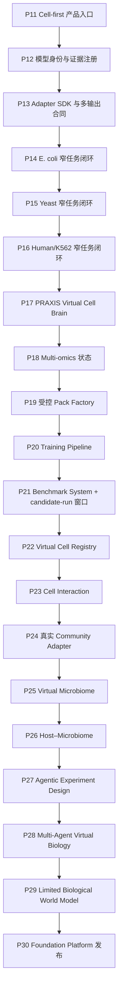

# PRAXIS-VirtualCell Phase 12–30 可执行路线图与逐阶段授权提示词

> 文档状态：`PLANNING_ONLY — NOT AN IMPLEMENTATION AUTHORIZATION`
>
> 当前 Phase 11 产品代码基线：`bf44aac25b993e49d0146ccd52dddad5c2fa14de`
>
> DOCS-CLOSURE parent：`b02d21985bcde50cf0758d339b05b13bb3e200a2`
>
> DOCS-CLOSURE completion / P12 starting SHA：
> `b19c896202bea56f894d0ad540501331af42a40c`
>
> 已完成 work unit：`P12 — Virtual Cell Model Zoo v2`；completion code SHA
> `1a5464fb0d2d9e105058f6797d92efd69783e5b2`
>
> 当前 work unit：`P13 — Model Adapter SDK`；状态 `ELIGIBLE`
>
> 规范工作树：`/Volumes/T7/PRAXIS-virtualcell`
>
> 历史误命名恢复 ref：`codex/p12-cell-first-baseline`（名称不再代表 Phase 12 状态）
>
> 已记录部署锚点：`http://10.102.106.53:18080`
>
> 当前状态核对日期：2026-08-06
>
> P12 completion identity：实现 commit、post-commit 验证与
> `reports/phase12/PHASE12_COMPLETION.md` 共同证明

本文把 “An agentic foundation platform for programmable virtual cells across
species and biological systems.” 愿景转换为可逐阶段授权、实施、验证和停止的
路线图。本文自身不授权任何实现；当前持续本地授权由接手总提示词提供。该授权仍不
包含下载数据/权重、真实训练、push、GitHub main/tag、`.53` 写入、服务、发布或部署。

## 1. 最终目标与准确产品承诺

长期目标是：

> An agentic foundation platform for programmable virtual cells across species
> and biological systems.

在到达足够证据之前，对外承诺必须保持为：

> 任意符合显式合同的数据可以制作成 VirtualCellPack 接入；只有存在匹配、可执行且
> 经过验证并获 product policy 批准的模型时才产生预测，否则明确 abstain。

“foundation model”“任意细胞预测器”不是当前产品事实；P29 只允许形成有限、
exact-scope 的 Biological World Model research capability。Phase 编号是路线标签，
不是产品版本、API 协议、schema 或模型版本。

## 2. Phase 11 产品基线、已完成 P12 与当前 P13 work unit

### 2.1 当前身份

| 对象 | 精确身份 |
|---|---|
| 规范工作树 | `/Volumes/T7/PRAXIS-virtualcell` |
| 外置 Git metadata | `/Users/mzy/Projects/.PRAXIS-virtualcell-gitdir` |
| DOCS-CLOSURE parent | `b02d21985bcde50cf0758d339b05b13bb3e200a2` |
| DOCS-CLOSURE completion | `b19c896202bea56f894d0ad540501331af42a40c` |
| P12 starting SHA | `b19c896202bea56f894d0ad540501331af42a40c` |
| 产品代码提交 | `bf44aac25b993e49d0146ccd52dddad5c2fa14de` |
| 历史恢复 ref | `codex/p12-cell-first-baseline`（创建时误把 Cell-first 收口称为 P12；不得移动或删除，但不再定义阶段编号） |
| P12 completion code SHA | `1a5464fb0d2d9e105058f6797d92efd69783e5b2` |
| P12 完成分支 | `codex/p12-model-registry-v2` |
| 当前 work-unit 状态 | P13 `ELIGIBLE` |
| 工作树保护清单 | 不在文档中固定；每轮从现场 `git status --short` 重新生成，任何新路径默认受保护 |
| `.53` preview | `/home/zkyd/data1/mzy/praxis-virtualcell-preview/p11` |
| `.53` deploy checkout | `codex/deploy-v1.6.0` at `bf44aac25b993e49d0146ccd52dddad5c2fa14de`；仅 `?? vc_api.log` |
| `.53` wheel SHA-256 | `bbe81a631c2dcf265dab9ca5b1254775fbbf0952220d0604dbbb3610d79e2d0d` |
| `.53` recovery bundle | `/home/zkyd/data1/mzy/praxis-virtualcell-preview/p11/deploy/praxis-p11-bf44aac.bundle`，`10,394,471` bytes，SHA-256 `547f53dd2a9de9d0261834af596a96f51ad1cd245cfdd922747cadc7e79bdf34` |
| `.53` rollback artifact candidate | `p9`，P10 SHA `5f2eb940c07f2cae5b664f35a57c407026d66587`；尚未做真实 rollback 演练 |
| GitHub main | `8e0d06348ebdf22e076037e6d661094ae877c5d1` |
| GitHub `v1.6.0` | annotated tag object `2059721acdb280c57fec2659f015a1b3b513a51a`，peeled commit `8e0d06348ebdf22e076037e6d661094ae877c5d1` |
| 当前代码版本字符串 | `1.6.0`，但 `bf44aac...` 不是已发布 `v1.6.0` tag 的内容 |

没有创建 Git tag。根据 `docs/VERSIONING.md`，tag 只能在独立发布授权中创建，不能用
本地 tag 冒充 GitHub 已发布版本。当前代码/部署身份已由 exact SHA、wheel 和 recovery
bundle 锚定，但恢复分支本身不是不可移动 release。DOCS-CLOSURE 已由
`b19c896...` 和完成报告收口；当前 P12 completion 仍必须由现场 Git identity、
allowlisted diff、验证结果、一次获准本地 commit 和 post-commit 状态共同证明。
`.53` preview 也不等于 GitHub main/tag 发布。`bf44aac...`
继续暴露 `1.6.0` 构成版本漂移，下一次稳定候选必须使用新的 SemVer，绝不能移动或
复用已有 `v1.6.0` tag。

当前阶段重新定义为：

```text
P11A  数据中心化前端骨架
P11B  Cell-first 白色聊天入口、Data Center、示例问题和直接报告
P12   Virtual Cell Model Zoo v2（COMPLETE at 1a5464fb...）
P13   当前本地 work unit：Model Adapter SDK（ELIGIBLE）
```

Phase 身份由本文和完成证据定义，不由历史 branch 名称推导。

### 2.2 Phase 11 实际完成内容

- 白色、cell-first 首页；
- 首页常用 context preset：K562、PBMC、mouse T cell、E. coli；
- Data Center 中的 cell context 搜索与物种筛选；
- 选择 cell 后进入 ChatGPT 类单一聊天框；
- 每个所选 cell 显示后端 preset 提供的示例问题；
- 示例点击只填充输入，不自动执行；
- 前端调用现有解析和执行 API，直接展示报告或 abstain；
- 最近报告、报告下载、module routing、data/execution identity、evidence、trace 和
  provenance；
- UI 常驻声明 LLM 只解析/解释，不能参与数值模拟或最终裁决；
- 前端 E2E `12/12`、typecheck、lint、build 和 bundle budget 通过；
- `.53` health/root/assets、12 个 cell preset、4 个 dataset、3 个 Pack 和一次
  offline job 已验证。

### 2.3 Phase 11 没有完成的内容

- cell preset 不是持久化或经过验证的 Virtual Cell；
- Data Center 只显示 context preset 和同物种资源计数，没有把 dataset/Pack/model
  绑定到所选 cell；
- 新聊天任务当前不提交 `pack_id + pack_version`，仍走显式 legacy 执行路径；
- 没有 Pack Factory、schema mapping、真实 QC、operator-approved register；
- 没有持久化 VirtualCell、Virtual Cell Builder 或发布合同；
- 没有新增真实模型、权重、训练、校准或科学验证；
- `.53` 当前 `mode=offline`、`llm_enabled=false`；
- 目录、Pack、模型卡或示例问题存在，都不能推出可执行或科学有效。

因此，当前准确结论是：

> Phase 11 已完成可信的 Cell-first 产品入口。Phase 12 正在验证 model、artifact、
> environment、adapter、evidence 和 operator-policy record 的分层身份及 Pack-aware
> fail-closed 接线；在 completion SHA 形成前不能写为完成。当前没有新增真实模型、
> 科学 evidence 或 product promotion。

### 2.4 本次编号纠正

为避免历史文档、branch 名和新授权互相污染，采用以下映射：

| 旧路线标签 | 当前正式标签 |
|---|---|
| 旧 P12 Cell-first | P11B Cell-first 产品收口 |
| 旧 P13 Model Zoo v2 | P12 Model Zoo v2 |
| 旧 P14 Adapter SDK | P13 Adapter SDK |
| 旧 P15 E. coli | P14 E. coli |
| 旧 P16 Yeast | P15 Yeast |
| 旧 P17 Human/K562 | P16 Human/K562 |
| 旧 P18 Brain | P17 Brain |
| 旧 P19 Multi-omics | P18 Multi-omics |
| 旧 P20 Pack Factory 部分 | P19 受控 Pack Factory |
| 旧 P20 Training 部分 | P20 Training Pipeline |
| P21–P30 | 编号保持不变 |

历史 commit、artifact、branch 和报告不重命名、不改写；新授权和新完成报告只使用当前
正式标签。Phase 编号变化不改变任何旧 SHA、fingerprint 或科学结论。

## 3. 为什么必须按下面顺序执行



关键依赖：

1. P12 先拆开 catalog、资产、环境、adapter、执行与科学晋级身份；
2. P13 才能消除当前只支持 `delta_expression` 的执行硬编码；
3. P14–P16 每个物种只先完成一个窄任务，科学结论互不继承；
4. P17 只有在至少两个真实能力可由 Broker 调用后，才有多模型编排意义；
5. P18 才建立真实、typed multi-omics 模型输入；
6. P19 先把 upload receipt 变成经过显式 metadata/mapping review、strict validate
   和 operator approval 的 RegisteredPack；receipt 不能直接训练；
7. P20 再建立 training job/result、checkpoint、环境和重放合同，但不运行真实候选；
8. P21 建统一 benchmark/evidence 平台，真实训练与评估只能在 protocol 冻结后用
   独立 P21B 授权执行；
9. P22 只登记已经有不可变身份和证据的 Virtual Cell release；
10. P23–P26 从单细胞到相互作用、群落和宿主接口逐层增加合同；
11. P27–P29 是研究能力，负结果或未晋级不阻止软件平台继续诚实发布；
12. P30 将软件 GA 与科学能力晋级分开裁决。

## 4. 所有阶段共同的不变量

### 4.1 身份、计算结果、科学证据和产品策略永久分离

```text
pack_valid

registry state:
  cataloged / artifact_ready / revoked / superseded

computed compatibility:
  model_compatible / environment_compatible / executable

scientific evidence:
  benchmark_passed / scientifically_validated / promotion_eligible

product policy:
  production_promoted
```

这些不是一条可以自动向上推进的枚举链。一次运行成功、资产存在或 operator 点击
批准，都不能自动创建科学证据。

| 层 | 状态 | 唯一含义 |
|---|---|---|
| Pack | `pack_valid` | 当前 Pack bytes、schema 和科学语义合同通过 |
| Registry | `cataloged / artifact_ready` | identity 已登记；后者只说明经 hash 重验的资产可取用 |
| Registry | `revoked / superseded` | 产品策略禁止新运行，或由新 identity 取代；历史运行不改写 |
| Computed | `model_compatible` | 精确 request×Pack×model×adapter 输入输出关系满足 |
| Computed | `environment_compatible / executable` | 当前资产、依赖、资源和 runtime adapter 可执行 |
| Evidence | `benchmark_passed` | 预声明内部/held-out protocol 的硬门通过 |
| Evidence | `scientifically_validated` | scope 匹配的独立 dataset/platform 或实验复制证据通过 |
| Policy input | `promotion_eligible` | benchmark runner 只读计算出的不可变、可供人工审查的资格证据 |
| Policy | `production_promoted` | 独立 operator 引用 exact evidence 后作出的窄域上线决定 |

`production_promoted` 不得先于所要求的 validation evidence，也不能反向把
`scientifically_validated=false` 改成 true。撤销只改变未来产品策略，不删除负结果
或改写历史 execution identity。P12/P21 ADR 必须先冻结这些新语义和 v1 兼容迁移。

### 4.2 数据与 feature

- 不静默归一化、补零、去重、重排、随机 split 或同源转换；
- 任何必要变换必须由 version/hash 绑定的合同明确声明；
- feature order、namespace、assembly、unit 和 value semantics 必须进入 identity；
- 大数据、checkpoint 和模型权重不进入 Git。

### 4.3 模型与科学验证

- task、output、input adapter、output adapter、Pack、模型、环境和证据必须双向绑定；
- test/external 结果出现前冻结 split、主指标、baseline、seed 和 promotion gate；
- 按 biological group 切分并审计 donor/condition/replicate/batch 泄漏；
- tuning 和 threshold 只能使用 train/validation；
- 外部验证默认 adaptation steps 为零；
- 主指标必须严格胜过预声明简单 baseline，paired CI 也必须支持改善；
- stochastic model 至少运行三个预登记 seed；确定性模型不得伪造随机波动；
- 失败和负结果原样保留；registry 身份不伪造变化，production policy 不晋级并按
  精确 scope abstain。

### 4.4 Agent 与 LLM

- LLM 可以解析、提出计划候选、解释和润色；
- LLM 不能创建数据真相、修改数值预测、兼容性、科学证据、product promotion 或
  最终 verdict；
- Agent plan 必须经确定性 schema、权限、资源和 capability gate 编译；
- Agent 数量、讨论轮次和一致意见不构成科学证据。

### 4.5 工程与发布

- 每阶段必须从唯一 40 位 SHA 开始；
- 先写失败测试，再做最小实现；
- 只实施当前阶段，不提前实现下一阶段；
- 普通 skip/deselect 不得解释为 LLM、GPU、remote 或科学验证通过；
- 本地 commit、push、GitHub main/tag、外置资产写入和 `.53` 操作分别授权；
- 每阶段结束必须报告文件、测试、artifact hash、负结果、已知限制、HEAD 和下一条
  精确授权句。

### 4.6 外置资产授权必须精确

本路线中的 `<批准的外置资产根>` 等占位符不是授权。任何真实数据、模型、权重、
checkpoint 或 remote 运行必须由单独授权替换为：

- exact 绝对路径和逐文件清单；
- 每个输入的 size、SHA-256、license、source 和允许用途；
- source root 只读；
- 独立、全新、明确的 output root，只允许 write-new，不覆盖已有 artifact；
- 是否允许网络；未明确时按禁止网络处理；
- 是否允许训练/调参；未明确时只允许固定 artifact 的验证；
- secret、个人数据、受限人源数据的访问和导出边界。

所有阶段开始时必须重新执行 `git status --short`，动态生成
staged/modified/deleted/untracked 清单。除当前授权 exact allowlist 外，所有用户
文件都受保护，不得 stage、commit、覆盖或格式化。授权草案中的
`<现场 exact 保护路径>` 未逐项填写即无效；现场无保护路径时也必须明确写 `none`。

## 5. 阶段总览与 Go/No-Go

| Phase | 最小可交付结果 | 进入下一阶段的 Go 条件 | No-Go 时的诚实结果 |
|---|---|---|---|
| 12 | 模型身份、资产、环境、adapter、evidence 分层 | v1 兼容，状态不再混用 | 保持旧 zoo，只提供迁移报告 |
| 13 | 版本化 Adapter SDK 和 conformance harness | delta reference adapter 回归通过 | 未注册 task/output 继续空 plan |
| 14 | E. coli K-12 growth 窄闭环 | 主指标、CI 与独立 cohort 门通过 | 不产生 production promotion，继续 abstain |
| 15 | yeast deletion fitness 窄闭环 | 独立 condition/platform 门通过 | 不产生 production promotion，继续 abstain |
| 16 | K562 perturbation delta-expression 窄闭环 | 同口径胜 baseline + external gate | candidate 保持未晋级 |
| 17 | 可审计多模型 Virtual Experiment DAG | 缺模型、冲突和 LLM 注入均 fail-closed | 只执行单模型或 abstain |
| 18 | 一份真实多组学状态与模型证据 | 胜单组学 baseline 或诚实负结果 | 只保留数据合同 |
| 19 | 受控 upload receipt → RegisteredPack 闭环 | metadata/mapping/operator review 可重放 | receipt 保持 quarantine，不注册 |
| 20 | training job/result、checkpoint 和 tiny deterministic dry-run | 合同级训练重放和失败原子性通过 | 不运行真实候选、不生成 evidence |
| 21 | 统一 benchmark/evidence ledger + 独立 candidate-run 窗口 | protocol/result/负结果可复现 | 保留分散 benchmark；candidate 不晋级 |
| 22 | 可版本化 Virtual Cell Registry | job 精确绑定 release identity | 只读 catalog，不允许执行 |
| 23 | 一个窄 cell-cell interaction 模型 | held-out pair/context 过门 | 只显示 evidence，不预测 |
| 24 | 一个真实 CommunityModelAdapter | 共培养外部条件胜独立成员 baseline | P10 no-model abstain 保持 |
| 25 | 一个定义群落 microbiome prototype | 独立批次/条件过门 | 不称 microbiome predictor |
| 26 | 一个窄 host–microbiome 联合任务 | held-out donor/batch 过门 | 分别返回 host/community 结果 |
| 27 | 分级人工审批的实验设计建议 | replay→shadow→prospective 分别授权、逐级过门 | 停在已通过等级 |
| 28 | 受约束的多 Agent 编排 | 科学任务胜 baseline，或预注册非劣且另有工程收益 | 回退到确定性单 workflow |
| 29 | 有限 typed biological subgraph candidate | 外部数据胜 baseline 且 OOD abstain | 标记 research/disabled |
| 30 | Software GA；科学能力另发 qualification badge | exact-SHA 发布、部署和回滚全门 | 只发布 RC 或继续 preview |

## 6. Phase 12：Virtual Cell Model Zoo v2

### 目标

把当前 `ModelCard + CapabilityRegistry + ModelBroker` 扩展成不可变的模型、
artifact、environment、adapter、evidence 和 operator-policy record 身份层，但本
阶段不新增、下载或运行真实权重，也不作新的 operator promotion decision。

### 完成快照

P12 以 `b19c896202bea56f894d0ad540501331af42a40c` 为唯一起始 SHA，在
`codex/p12-model-registry-v2` 上以
`1a5464fb0d2d9e105058f6797d92efd69783e5b2` 完成以下分层合同：

- `vc.model-artifact.v1`、`vc.model-environment.v1`、`vc.model-adapter.v1`；
- `vc.model-validation-evidence.v1`、`vc.model-operator-policy.v1`；
- `vc.model-release.v1`、`vc.model-registry-event.v1`、
  `vc.model-registry-state.v1` 和 `vc.model-registry.v2`；
- Pack-aware `vc.environment.v2`、`vc.compatibility-report.v2`、
  `vc.execution-step.v2`、`vc.execution-plan.v2` 和
  `vc.job-execution-identity.v2`；
- 路径脱敏白名单投影 `vc.model-registry-catalog.v2`，复用
  `praxis-vc pack list` 与 `GET /api/packs`，不增加管理写接口；
- `vc.model-card.v1` 迁移只产生 `legacy_incomplete` release，不创建 evidence 或
  policy；无法精确绑定 model identity 的 P8/P9 历史结果保存为
  `binding_status=unbound` 的 migration receipt，P9 `available=false` 保持不变；
- native environment 的 package identity 使用 canonical PEP 503 distribution name
  和显式 version；legacy runtime import-module name 原样分层保留，不能相互归一化；
- native `model_version` 必须是 path-safe public identifier；unsafe legacy raw version
  只留在内部 immutable identity，公开投影显示 `null`；
- v2 JobStore identity 同时绑定 submitted request、normalized request、canonical
  `plan_id` 和 execution-step fingerprints；JobStore 要求 report/provenance 引用同一
  plan，并把两处 plan 都替换为相同的字段白名单、路径脱敏投影，不从 live registry
  回写历史；
- lifecycle 通过不可变事件 append/reduce 表达
  `cataloged/artifact_ready/revoked/superseded`，不原地改写 release、历史 job 或负结果。

本阶段没有访问外置资产、网络、训练、GPU、remote、`.53` 或服务；没有运行真实
科学候选，也没有作出新的 operator promotion decision。完整验证见
`reports/phase12/PHASE12_COMPLETION.md`；P13 是下一 eligible 本地 work unit。

### P12 定义时的原始缺口

以下条目是本阶段开始时冻结的问题陈述；当前是否已解决仍以最终验证和完成报告为准。

- P6 已把 model-card registry、computed compatibility、environment compatibility、
  executable plan 和 `scientifically_validated=false` 分开；P12 不得否认或合并这些
  已有边界；
- model card 虽已包含 asset/resource/uncertainty/OOD，但没有不可变 artifact/
  validation evidence registry 和独立 product-promotion policy；
- environment 只记录模块可 import 和资源名，没有依赖版本、lock/image digest；
- validation evidence 尚未精确绑定 Pack×model×environment×adapter×protocol；
- `scientifically_validated` 在 P6 compatibility 中固定 false。

### 依次实施

1. 先写 Model Registry v2 ADR 和状态迁移表；
2. 保持 `vc.model-card.v1` 兼容，只有不兼容字段才新建 schema；
3. 新增独立、不可变的 model artifact identity：URI/相对 cache key、size、SHA-256、
   media type、license、source 和安全加载策略；
4. 新增 environment identity：Python/package 版本、lockfile 或 image digest、
   accelerator/CPU 声明和 adapter 集；
5. 新增 validation evidence identity，绑定 Pack、model、environment、adapter、
   benchmark protocol、baseline、metric 和 result hash；
6. registry 只保存 `cataloged/artifact_ready/revoked/superseded`；`compatible` 与
   `executable` 每次按 request×Pack×model×environment×adapter 重新计算；
7. evidence 保存 `benchmark_passed/scientifically_validated/promotion_eligible`；
   定义 versioned/fingerprinted operator-policy record schema，要求
   `production_promoted` 引用 exact evidence；迁移 fixture 固定 no-promotion，
   本阶段不作新的 operator decision；
8. 增加撤销/supersede 记录，不原地改旧 identity；
9. API/CLI 只读投影不得暴露本地 asset path；
10. 用现有 5 张卡和 P8/P9 evidence 做 legacy/incomplete/no-promotion 迁移 fixture，
    不升级任何科学或产品结论。

### 验收门

- v1 registry 全量兼容测试；
- unknown field、坏 hash、身份错绑、evidence 错配、路径泄漏、状态越级全部拒绝；
- 相同 bytes/contract 得到相同 fingerprint；
- 任一 artifact/evidence bytes 改变产生新 identity；
- 当前 planned/available 卡和 P9 `available=false` 等原始状态不被迁移脚本自动提升；
- core、legacy、Ruff、pip check 和发行物身份测试按影响范围通过。

### 本阶段不做

不实现 Adapter SDK，不下载/运行 GEARS/scGPT/Geneformer，不修改权重，不训练模型，
不改变 `.53`，不发布 Model Marketplace。

### 可复制授权提示词（模板留存；当前 P12 已有独立精确授权）

以下文本保留为审计模板，不替代当前授权，也不能重复或扩大当前 P12 scope。

```text
授权以 `<现场验证的 DOCS-CLOSURE exact 40 位 completion SHA>` 作为 Phase 12
（Virtual Cell Model Zoo v2）唯一起始 SHA，创建
`codex/p12-model-registry-v2`。

允许修改：`<逐项 exact 文件或模块 allowlist>`。
唯一目标：实现模型卡、artifact、environment、adapter、validation evidence 和
operator-policy record 的分层 identity，保持 v1 兼容迁移，增加 append-only
revoke/supersede、路径脱敏的只读 CLI/API、ADR、runbook 和直接相关测试；不作任何
新的 operator promotion decision。

明确禁止：Phase 13 Adapter SDK、E. coli/yeast/human 模型、训练、Marketplace、
world model、新模型/权重下载或运行，以及把 planned/available/card/asset 状态升级
为 executable、benchmark_passed、scientifically_validated 或 production_promoted。

external assets=no；source root/output root=N/A；network=no；
training/tuning/GPU=no；local commit=`<yes/no>`；push=no；GitHub main/tag=no；
.53/remote/service/deploy=no；destructive actions=no。
现场 protected staged/modified/deleted/untracked：`<逐项 exact 路径；若无写 none>`。

先写失败测试再做最小实现。不得修改 PRAXIS-2、
`/Volumes/T7/PRAXIS-virtualcell/old/**` 或三个 APFS 安全副本；不得 stage/commit
任何不在 exact allowlist 内的文件。阶段结束必须报告 exact HEAD、
schema/fingerprint、测试、负例、已知限制和下一阶段精确授权句。
任一占位符未替换时，本模板均为 NOT ACTIVE。
```

## 7. Phase 13：Virtual Cell Model Adapter SDK

### 目标

建立按 task/output 显式注册的 Adapter SDK，使深度学习、机制和数学模型使用同一
Broker/ExecutionPlan 接入，而不是在核心 runtime 增加模型或物种专用分支。

### 依次实施

1. 写 Adapter SDK ADR，冻结 adapter schema/version/fingerprint；
2. 复用 `vc.model-feature-contract.v1` 和 P5 alignment provenance 定义 input：
   Pack modality、observation/control/split、feature order、alignment report、单位
   和显式 transform；不得创建平行 mapping/alignment 合同；
3. 定义 output envelope：task/output、shape、单位、finite number、uncertainty、
   OOD、abstain 和 execution provenance；adapter 不能签发、修改或推断科学 evidence；
4. 将现有 `predict_delta_expression → delta_expression` 收敛为 reference adapter；
5. 建 adapter registry，并把 adapter fingerprint 写入 compatibility、plan、job 和
   report identity；Broker 只把 registry 中已核验的只读 `evidence_refs` 注入 plan；
6. 让 wrapper 只接收 Broker 准备好的输入和 hash-bound assets；
7. 清除 ensemble、reliability 和 report 对 `prediction.delta` 的不必要硬编码；
8. 建 conformance harness：dummy delta、growth、fitness 输出只用于合同测试；
9. 未注册 task/output、错误单位/shape/type、NaN/Inf/超大整数、未知字段、错 feature
   order 和 mapping hash drift 均 fail-closed；
10. 保留无 Pack legacy adapter 和 P0 确定性报告兼容性。

### 验收门

- delta reference adapter 与现有 P6/P8 行为字节或显式兼容；
- dummy growth/fitness 只证明 SDK 合同，不进入生产 registry；
- 无 adapter 时 execution plan 为空且不调用 mock；
- adapter input/output fingerprint 进入 execution identity；
- 新 plugin 不需要修改 `route_table.py`、`case_dispatch.py` 或核心模型分支；
- 全部相关契约、回归、core、legacy 和 Ruff 通过。

### 本阶段不做

不接真实 E. coli/yeast/human 模型，不下载权重，不训练，不科学晋级，不做 UI
Marketplace。

### 历史可复制授权提示词

P12 completion 已形成，当前持续本地授权已覆盖 P13 工程工作。以下模板仅作为历史
scope 参考，不扩大外部资产、网络、真实模型、训练、发布或部署权限。

```text
授权以 `<Phase 12 完成 SHA>` 作为 Phase 13（Virtual Cell Model Adapter SDK）
唯一起始基线，创建 `codex/p13-model-adapter-sdk`，仅实现版本化 input/output adapter
合同、adapter registry、delta-expression reference adapter、Broker/ExecutionPlan/
job identity 接线、conformance harness、ADR、runbook 和测试；允许用测试内 dummy
adapter 验证 delta_expression、growth、fitness 的严格 envelope，但不得加入生产
模型或 mock fallback。必须拒绝未注册 task/output、错 feature order、未声明 mapping、
错单位/shape、未知字段、NaN/Inf 和不匹配 uncertainty/OOD；不得在核心 runtime、
route table 或 case dispatch 增加模型/物种专用分支。不得实施 Phase 14 或以后阶段，
不得下载/运行数据或权重。本地 commit 仅在本阶段精确授权明确为 yes 时允许；不 push，不修改 GitHub main/tag，
不写入或操作 .53，不修改 PRAXIS-2 或 `old/**` 历史工作树；不得暂存/提交任何不在本阶段 exact allowlist 内的 staged/modified/deleted/untracked 文件；授权必须逐项填写现场保护路径（若无则写 none）。阶段结束报告 exact HEAD、adapter
schema/fingerprint、回归证据和下一条授权句。
```

## 8. Phase 14：第一个真实 Virtual Cell — E. coli K-12

### 最小科学目标

只完成一个窄任务：

```text
E. coli K-12 + 明确 medium/condition + gene knockout
→ growth / growth ratio
```

gene expression 和 resistance phenotype 不作为 P14 通过条件；没有独立模型和证据时
继续 abstain。内部 flux 可以作为 solver trace 和约束审计，不是 P14 产品预测输出，
除非以后另有独立验证和授权。

### 依次实施

1. 冻结 strain、assembly、GEM、medium、gene namespace、output unit 和任务边界；
2. 选择许可清晰的真实 GEM 与 growth/essentiality evidence；只有符合 §4.6 的精确
   授权后才可放入 Git 外只读 source 和独立 write-new output roots；
3. 用 P12 artifact identity 绑定 SBML/GEM 模型资产，另建真实 growth/condition
   data Pack；不能把模型资产塞进不兼容的 H5AD Pack，也不能把
   `p8-bacteria-tiny` synthetic scRNA 当 GEM；
4. 实现 growth input/output adapter；
5. `GemWrapper` 必须消费 model release 显式绑定的 SBML/GEM，并同时核对请求所用
   data Pack，不允许隐式 textbook fallback；
6. 预声明 held-out gene/condition biological groups、baseline、主指标和 CI；
7. 运行 exact gene mapping、leakage、mass/constraint 和 OOD 审计；
8. 通过同一 Broker/runtime 产生 prediction 或 abstain；
9. 在独立 dataset/platform 或独立实验批次上零适配验证；
10. 只有主指标、paired CI 和独立 cohort 门都通过，才生成 task-scoped immutable
    capability evidence；P22 以前不创建 Virtual Cell release，也不修改 Data Center。

### 验收门

- Pack/model/environment/adapter/evidence 全部 fingerprint 绑定；
- target 不在精确 GEM namespace 时 abstain；
- 外部验证 adaptation 为零；
- 主指标严格胜预声明 baseline 且 CI 支持改善；
- deterministic FBA 如实声明 deterministic，不伪造 calibration；
- strain、medium、condition 或 task 域外输入明确 abstain；
- 失败也视为阶段完成，但不生成 `promotion_eligible/production_promoted`；registry
  身份不改写，production plan 继续 abstain。

### 不可声称

FBA growth 不是 transcriptome response；K-12 单一 GEM 不代表任意 bacteria Pack；
deterministic 不等于正确；P9 的转录组负结果不验证本 GEM。

### 可复制授权提示词

```text
授权以 `<Phase 13 完成 SHA>` 作为 Phase 14（E. coli K-12 Virtual Cell v1）
唯一起始基线，创建 `codex/p14-ecoli-growth`，仅实现一个窄任务：
“批准的 E. coli K-12 strain/GEM/medium/condition 下 gene knockout → growth/growth
ratio”。仅在另行授权用 exact 绝对路径、逐文件 size/SHA-256/license/source 列出
输入，并指定只读 source root、全新 write-new output root、禁止覆盖和网络策略后，
才允许使用 Git 外 GEM、growth/essentiality 数据和派生 artifact；
Git 只提交合同、小 fixture、hash、代码、测试、ADR 和 runbook，不提交大数据或权重。
必须让模型消费显式绑定的 GEM，禁止 textbook fallback、symbol/ortholog 猜测、静默
单位转换和 mock；预声明 biological-group split、baseline、主指标、CI、OOD 和
promotion gate，并在独立 dataset/platform 或实验批次零适配验证。若任一门失败，
阶段仍收口，但不得生成 production promotion，prediction 继续 abstain。不得实施
yeast、human、gene-expression、resistance、community 或
训练平台。本地 commit 仅在本阶段精确授权明确为 yes 时允许；除非另发精确资产/remote 授权，不访问或写 .53；
不 push，不修改 GitHub main/tag、PRAXIS-2 或 `old/**` 历史工作树；不得暂存/提交任何不在本阶段 exact allowlist 内的 staged/modified/deleted/untracked 文件；授权必须逐项填写现场保护路径（若无则写 none）。阶段结束报告 exact HEAD、所有
asset/result hash、科学结论，并生成 P14B operator-decision 授权句。
```

### P14B 可复制授权提示词：独立 product-policy decision

```text
授权具名 operator `<姓名/角色>` 以 `<P14 完成 SHA>`、`<exact capability evidence
fingerprint>` 和 `<exact validation/result fingerprints>` 为唯一只读输入，审查
E. coli growth exact scope 的全部预声明硬门。禁止重跑、调参、替换 evidence、
修改代码或 Git；只允许在 `<必须填写的 exact absolute policy output path>` write-new
一份 immutable operator decision，不得覆盖。只有 benchmark、paired CI、independent
external、OOD、license 和 scope 门全部通过时才可写
`production_promoted=true`；否则写明 declined/reason，不能修改
`scientifically_validated`。不得 push、操作 .53、main/tag、PRAXIS-2 或 `old/**` 历史工作树；
不得暂存/提交任何不在本阶段 exact allowlist 内的 staged/modified/deleted/untracked 文件；授权必须逐项填写现场保护路径（若无则写 none）。
```

## 9. Phase 15：Yeast Virtual Cell

### 最小科学目标

限定一个 strain/condition 和一个任务：

```text
S. cerevisiae gene deletion
→ deletion fitness
```

### 依次实施

1. 冻结 strain、assembly、SGD systematic ID、condition、control、unit 和 output；
2. 选择许可清晰的真实 deletion screen，不复用 P10 synthetic yeast fixture 作为证据；
3. 建真实、版本化 Pack 和 feature contract；
4. 实现 deletion-fitness adapter，不在一个阶段同时扩 growth 等其他输出；
5. 冻结 biological condition/replicate split、mean-fitness 等简单 baseline 和主指标；
6. validation-only tuning，stochastic candidate 至少三个 seed；
7. 增加独立 condition/platform 零适配验证；
8. 通过 Broker/runtime 生成报告、uncertainty/OOD 或 abstain；
9. 只有主指标、paired CI 和独立 condition/platform 同时过门，才产生该精确
   strain/condition/task 的 promotion-eligible evidence。

### 验收门

- P10 yeast tiny Pack 继续标记 contract fixture；
- exact SGD/assembly/strain gate；
- replicate/condition leakage 为零；
- external adaptation 为零；
- 未覆盖 strain/condition/task 明确 abstain；
- 不继承 E. coli 的 mapping、medium 或科学结论。

### 可复制授权提示词

```text
授权以 `<Phase 14 完成 SHA>` 作为 Phase 15（S. cerevisiae Virtual Cell v1）
唯一起始基线，创建 `codex/p15-yeast-fitness`，仅实现一个预先冻结的
S. cerevisiae strain/condition 下 gene deletion → deletion fitness 任务。
仅在另行授权用 exact 绝对路径、逐文件 size/SHA-256/license/source 列出输入，并
指定只读 source root、全新 write-new output root、禁止覆盖和网络策略后，才允许
使用 Git 外真实 deletion screen、固定模型和派生 artifact；P10 yeast tiny Pack
必须继续标为 synthetic contract
fixture。必须使用 exact assembly/SGD systematic IDs、显式 condition/control/unit、
biological-group split、validation-only tuning、预声明 baseline/主指标/CI/OOD；
未胜 baseline 或 external gate 时不得生成 product promotion，并保持 abstain。
不得实施 human、
multi-omics、training pipeline、community 或 world model。本地 commit 仅在本阶段精确授权明确为 yes 时允许；
无另行授权不访问或写 .53，不 push，不修改 GitHub main/tag、PRAXIS-2 或
`/Volumes/T7/PRAXIS-virtualcell/old/**`；不得暂存/提交任何不在本阶段 exact
allowlist 内的 staged/modified/deleted/untracked 文件；授权必须逐项填写现场保护
路径（若无则写 none）。阶段结束报告 exact HEAD、
asset/result hash、负结果，并生成 P15B operator-decision 授权句。
```

### P15B 可复制授权提示词：独立 product-policy decision

```text
授权具名 operator `<姓名/角色>` 以 `<P15 完成 SHA>`、`<exact capability evidence
fingerprint>` 和 `<exact validation/result fingerprints>` 为唯一只读输入，审查
S. cerevisiae deletion-fitness exact scope 的全部预声明硬门。禁止重跑、调参、
替换 evidence、修改代码或 Git；只允许在
`<必须填写的 exact absolute policy output path>` write-new 一份 immutable operator
decision，不得覆盖。只有 benchmark、paired CI、independent external、OOD、license
和 scope 门全部通过时才可写 `production_promoted=true`；否则写明 declined/reason，
不能修改 `scientifically_validated`。不得 push、操作 .53、main/tag、PRAXIS-2 或
`old/**` 历史工作树；不得暂存/提交任何不在本阶段 exact allowlist 内的 staged/modified/deleted/untracked 文件；授权必须逐项填写现场保护路径（若无则写 none）。
```

## 10. Phase 16：Human/K562 Virtual Cell

### 最小科学目标

沿用 Golden Norman 的同一口径：

```text
K562 + gene/gene-combination perturbation
→ 5,045 个有序 Ensembl feature 的 delta_expression
→ condition-macro MSE
```

### 依次实施

1. 冻结候选模型、checkpoint、环境、adapter 和下列 exact Golden artifact identity；
2. 不修改 P8 split、feature order、metric、bootstrap 或三个 baseline；
3. 候选必须原生输出相同 delta-expression 语义；若原生输出不同，必须在读取
   test/external 结果前冻结 hash-bound、control-defined conversion contract，并单独
   证明其语义，不得临时把 absolute expression 宽松转换成 delta；
4. no-change、global mean、additive ridge 和候选全部走同一 Broker/runtime；
5. tuning 只使用 30 个 validation condition，不读取 116 个 test condition 调参；
6. 审计 checkpoint 的训练数据、预训练语料、split 和缓存，拒绝 Norman test/external
   contamination；
7. stochastic candidate 至少三个 seed 并记录运行差异；
8. additive ridge 是 primary comparator；对 candidate-minus-additive 的 paired
   condition bootstrap，95% CI 上界必须 `< 0`；
9. 增加至少一个语义兼容、独立 dataset/platform 的 K562 零适配验证；donor 或其他
   cell context 只能作为 OOD evidence，不能代替该 external gate；
10. uncertainty 必须校准，或明确 unavailable；
11. single-gene 与 gene-combination 分开计算和晋级，任何一类不得借另一类过门；
12. 只有主指标、CI、contamination audit 和 external gate 全过，才产生对应精确
    K562 task/scope 的 promotion-eligible evidence。

### 已冻结 baseline

| Baseline | Golden test MSE |
|---|---:|
| no-change | `0.0062060923` |
| global mean | `0.0045820474` |
| additive ridge | `0.0032570634` |

这些分数不能自动验证 GEARS/scGPT。GEARS native absolute-expression Pearson 与上述
delta-expression MSE 不可混表。

### 已冻结 Golden identity

| Artifact | Frozen identity |
|---|---|
| manifest schema | `vc.golden-artifact-manifest.v1` |
| Golden benchmark code baseline | `b6cf226382cb841fb50e70875c82d1804ae5681e` |
| P8 product closure | `480706fbf58343565532debeca70c4de093b045f` |
| canonical contract | `f34afa761239abc97033c78bb9d0c29a1c36a4c7d1a106a9cbbaa805a5196ff5` |
| Pack fingerprint | `42165e430bab3474cdc9e607770ff5e204608c4243f84e492c08e2c6442c55ee` |
| no-change result | `38182a3fdb24666b8d76d9b118d2de4fd8cfd998ae025a54d7fecc42e09f7b5e` |
| global-mean result | `2b757d3e2d4e657f9bdc3aa890ee6d84ae5096661246ff4f881045676bb98d3a` |
| additive-ridge result | `b82dc7ab26c6f6fdef4414f6b05c51edb32b2a35e4c00f45824cc839ab9cf1a9` |
| evaluation result | `1cc1110a75183f1b271a8caf34db9998046f93bd42abda278f725879d38eb79c` |

### 可复制授权提示词

```text
授权以 `<Phase 15 完成 SHA>` 作为 Phase 16（Human/K562 Virtual Cell v1）
唯一起始基线，创建 `codex/p16-k562-perturbation`，仅实现 Golden Norman/K562
精确域内的 gene/gene-combination → 5,045-feature delta_expression 任务。
仅在另行授权用 exact 绝对路径、逐文件 size/SHA-256/license/source 列出 Golden
Pack、候选 checkpoint/环境和 external dataset，并指定 source 只读、全新 write-new
output root、禁止覆盖和网络策略后，才允许访问这些资产。所有 Pack、feature order、
checkpoint、adapter、environment、metric 和 result 必须 fingerprint 绑定；不得修改
P8 冻结 split、baseline、metric 或 bootstrap。候选必须原生匹配 delta semantics，
或使用在 test 前冻结的 hash-bound control-defined conversion contract；必须审计
训练数据/split/cache，排除 Norman test/external contamination。additive ridge 是
primary comparator，candidate-minus-additive 的 paired condition bootstrap 95% CI
上界必须 `< 0`；独立 external gate 必须是语义兼容的 K562 dataset/platform，donor
或其他 cell context 只能作为 OOD evidence。single-gene 与 combination 分开晋级。
任何主门失败都不得生成 product promotion。不得宣称任意 human cell、primary cell
或 donor，
不得实施 P17 Brain、multi-omics、training 或 Marketplace。本地 commit 仅在本阶段精确授权明确为 yes 时允许；
无另行精确 remote/asset 授权不操作 .53，不 push，不修改 GitHub main/tag、
PRAXIS-2 或 `old/**` 历史工作树；不得暂存/提交任何不在本阶段 exact allowlist 内的 staged/modified/deleted/untracked 文件；授权必须逐项填写现场保护路径（若无则写 none）。阶段结束报告 exact HEAD、模型/环境/
result hash、科学结论，并生成 P16B operator-decision 授权句。
```

### P16B 可复制授权提示词：独立 product-policy decision

```text
授权具名 operator `<姓名/角色>` 以 `<P16 完成 SHA>`、`<single-gene/combination
分别列明的 exact capability evidence fingerprints>` 和 `<exact validation/result
fingerprints>` 为唯一只读输入，分别审查 K562 single-gene 与 combination scope。
禁止重跑、调参、替换 evidence、修改代码或 Git；只允许在
`<必须填写的 exact absolute policy output path>` write-new immutable operator
decision，不得覆盖。每个 scope 只有在 additive-ridge superiority、paired CI、
contamination audit、independent K562 external、OOD、license 全过时才可分别写
`production_promoted=true`；失败 scope 必须 declined/abstain，不能借另一 scope
过门，也不能修改 `scientifically_validated`。不得 push、操作 .53、main/tag、
PRAXIS-2 或 `old/**` 历史工作树；不得暂存/提交任何不在本阶段 exact allowlist 内的 staged/modified/deleted/untracked 文件；授权必须逐项填写现场保护路径（若无则写 none）。
```

## 11. Phase 17：PRAXIS Virtual Cell Brain

### 目标

把自然语言问题编译成一个可审计、可重放的 Virtual Experiment，而不是让 LLM
直接选择结果：

```text
Scientific Question
→ parsed direct-v2 request
→ deterministic task DAG
→ Pack/model/environment/adapter compatibility
→ one or more executable steps
→ governance/critic
→ report or abstain
```

### 依次实施

1. 新增 direct-v2 Pack-aware 入口，保留 legacy 入口和冻结报告兼容性；
2. 定义不可变 Brain/Virtual Experiment context，绑定 request、cell context、Pack、
   model、environment、adapter、policy 和 DAG fingerprint；
3. 复用现有 `CapabilityRegistry`、`ModelBroker` 和 `ExecutionPlan`，不建第二套路由/
   模型注册系统；
4. task decomposition 可由确定性规则产生；LLM 只能提出候选 DAG；
5. 所有 LLM 候选必须经 schema、权限、依赖、scope、预算和 capability gate 编译；
6. DAG step 只能调用已注册 adapter，输入/输出身份逐边绑定；
7. critic 只检查证据、冲突和叙述忠实性，不能重写数值；
8. 最终 verdict、partial result、abstain 和 conflict disposition 由确定性治理产生；
9. job identity 增加 Brain/DAG fingerprint；
10. 在测试临时目录生成一个第五 taxon tiny Pack，证明 direct-v2 扩展无需增加
    物种分支；无模型时必须形成身份完整的空 plan/abstain。

### 验收门

- 相同 canonical input 和环境产生相同 DAG/plan identity；
- legacy 投影失败、Pack 未注册、模型/adapter 缺失时不得 fallback 到 mock/case；
- LLM 关闭、超时、恶意注入或提出越 scope step 时，确定性结果不变；
- 单 step 失败不会被其他 Agent 的叙述掩盖；
- 多模型只表示真实执行的多个 step，不能把 rule/advisory 冒充预测器；
- 至少两个 P14–P16 exact-scope、production-promoted 能力完成一项确有必要的组合
  任务，否则 P17 只能收口合同。

### 可复制授权提示词

```text
授权以 `<Phase 16 完成代码 SHA>` 作为 Phase 17（PRAXIS Virtual Cell Brain）
唯一起始代码基线，并逐项列出至少两个 exact-scope P14B/P15B/P16B
`production_promoted` decision 的 read-only path/size/SHA-256/fingerprint 及其
underlying evidence identities；少于两个时只授权合同收口，不得验收
真实多模型组合。创建 `codex/p17-virtual-cell-brain`，仅实现 direct-v2 Pack-aware
入口、不可变 Brain/Virtual Experiment context、确定性 task DAG、现有 Capability
Registry/ModelBroker/ExecutionPlan 复用、step 级 execution identity、冲突/部分失败/
abstain 治理、报告接线、ADR、runbook 和测试。LLM 只能提出候选分解和解释，所有
step 必须经确定性 schema/scope/permission/resource/capability gate；不得让 LLM
修改数据、数值、scientific evidence、product promotion 或最终 verdict，不得新建
第二套 registry/router。
允许测试在临时目录生成一个第五 taxon tiny fixture 证明无需核心物种分支；不得
把它登记为生产数据。无匹配模型必须空 plan/abstain。不得实施 multi-omics、
training、Marketplace、cell interaction 或
community。本地 commit 仅在本阶段精确授权明确为 yes 时允许；不新增外置权重，无另行授权不操作 .53，不 push，
不修改 GitHub main/tag、PRAXIS-2 或 `old/**` 历史工作树；不得暂存/提交任何不在本阶段 exact allowlist 内的 staged/modified/deleted/untracked 文件；授权必须逐项填写现场保护路径（若无则写 none）。
阶段结束报告 exact HEAD、DAG/Brain identity、LLM 数值不变性和下一授权句。
```

## 12. Phase 18：Multi-omics Virtual Cell

### 目标

在不改变 P5 `vc.pack.v0.3` 语义的前提下，建立真正的联合模型输入和
Multi-Omics Cell State Representation。

### 依次实施

1. 冻结 `vc.multiomics-model-input.v1` 或等价合同；
2. 不把多个 modality 塞入现有单值 `input_modality`；使用兼容的新 request/bundle
   schema 显式列出有序 modality slots、required/optional、feature-contract fingerprint、
   representation 和 observation join policy；
3. 每层独立运行现有 feature alignment，并保留独立 alignment report；
4. typed bundle 绑定 Pack、modality view、真实 observation membership、
   missingness policy 和 target modality；
5. required slot 必须全部满足，不能用任一 modality 集合交集放行；
6. partially-paired 只选择真实 shared rows，或交给明确支持 missingness mask 的
   adapter；不得造行或 impute；
7. 建 paired 和 partially-paired tiny plugin conformance tests；
8. 选择一份真实多组学数据和一个窄任务时，预注册单组学 baseline、multi-omics
   candidate、ablation、主指标和 OOD；
9. 只有 candidate 胜单组学 baseline、CI 和 external gate，才生成对应
   promotion-eligible evidence；P22 前不创建 Virtual Cell release。

### 验收门

- modality 顺序、namespace、feature order、join/missingness policy 全部进 fingerprint；
- 缺 required modality、ambiguous join、隐式 imputation/normalization 和跨 modality
  猜 target 时无 execution step；
- optional modality 缺失只有在 model card/adapter 明确支持时才可执行；
- real benchmark 未过门时只可声称 multi-omics 数据/输入合同可用。

### 可复制授权提示词

```text
授权以 `<Phase 17 完成 SHA>` 作为 Phase 18（Multi-omics Virtual Cell）
唯一起始基线，创建 `codex/p18-multiomics-cell-state`，仅在保持 P5
`vc.pack.v0.3` 兼容的前提下实现联合模型输入合同、有序 required/optional modality
slots、逐层 feature alignment、observation join/missingness policy、typed bundle、
adapter/Broker identity、paired/partially-paired conformance tests、ADR 和 runbook。
禁止补造 observation、自动补零/impute、静默 normalization、跨 modality 猜 target
或用任一集合交集放行 required slots。只有另行授权列出 exact 只读绝对路径、
逐文件 size/SHA-256/license/source/usage、固定候选模型、全新 write-new output
root、禁止覆盖和网络策略后，才可用一份真实 multi-omics dataset 做一个窄任务；
必须在结果前冻结单组学 baseline、ablation、主指标、CI、external 和 OOD，本阶段
不得训练/调参；未过门不得生成 promotion。不得实施 Phase 19 Pack Factory、
Phase 20 training、Marketplace、cell interaction 或 community。本地 commit 仅在本阶段精确授权明确为 yes 时允许；
大数据/权重不入 Git，无另行
授权不操作 .53，不 push，不修改 GitHub main/tag、PRAXIS-2 或 `old/**` 历史工作树；不得暂存/提交任何不在本阶段 exact allowlist 内的 staged/modified/deleted/untracked 文件；授权必须逐项填写现场保护路径（若无则写 none）。阶段结束报告 exact HEAD、所有合同/hash、
负结果和下一授权句。
```

## 13. Phase 19：受控 Pack Factory

### 目标

只建立数据接入到 RegisteredPack 的受控闭环：

```text
upload receipt
→ candidate Pack authoring
→ explicit metadata/mapping review
→ strict validation
→ operator approval
→ register
```

P19 不训练模型，不创建 checkpoint，不读取 test/external 结果，不生成 benchmark、
scientific evidence 或 product promotion。它只证明新数据能在不修改核心 runtime 的
前提下，经人确认后成为严格 Pack。

### 依次实施

1. receipt 只作为不可变原始字节身份；
2. 用户/操作员显式确认 taxon、assembly、cell identity、modality、feature namespace、
   value semantics、condition/control、unit、split 和 leakage group；
3. 系统只能提出 candidate manifest/mapping，任何 inferred 字段都必须标为候选并由人
   确认，不得静默成为数据真相；
4. feature mapping 必须显式、版本化、hash-bound，并记录未映射、重复和顺序；
5. strict validate 后显示完整 validation report，不把 warning 隐藏成 pass；
6. 只有具名 operator 对 exact candidate fingerprint 作出 approve 决定后才可 register；
7. 原始 upload、candidate、validation report、operator decision、RegisteredPack 和
   supersede identity 分开；
8. 管理写操作第一版只做本地 operator CLI/library；公共 API 保持只读；
9. 用一个获准的 Git 外 tiny fixture 证明新增物种或 cell dataset 无需修改核心 runtime；
10. candidate 或 validation 失败时保留 receipt/报告，绝不自动进入模型。

### 验收门

- upload→candidate→review→register 不修改核心 runtime；
- metadata、mapping、unit、control、split/leakage group 任一未确认时不能 register；
- 原始上传字节保持不变，candidate/Pack 派生关系可追溯；
- 同一输入与确认内容产生相同 candidate/Pack fingerprint；
- 任一源字节、metadata、mapping 或 operator decision 改变产生新 identity；
- traversal、symlink escape、坏 hash、错 taxon/assembly、未知字段和重复 key 拒绝；
- fixture 只证明 authoring/validation 插件性，不构成真实 dataset 或科学能力；
- receipt、candidate、RegisteredPack、model-compatible 和 executable 在 UI/API 中分开。

### 可复制授权提示词

```text
授权以 `<Phase 18 完成 SHA>` 作为 Phase 19（受控 Pack Factory）唯一起始基线，
创建 `codex/p19-pack-factory`，仅实现
upload receipt → candidate manifest/mapping → 显式 metadata 确认 → strict validate
→ 具名 operator-approved register 的本地 CLI/library 最小闭环，以及 candidate/
validation/operator-decision/RegisteredPack 的版本化 identity、只读产品投影、ADR、
runbook 和测试。不得让 inferred metadata/mapping 静默成为真相，不得自动归一化、
补零、去重、重排、随机 split 或同源转换。只允许在另行逐项填写
`<exact read-only tiny fixture path + size + SHA-256 + license/source/usage>` 和
`<exact new write-only Pack Factory output root>` 后，用一个 Git 外 tiny fixture
证明接入无需修改核心 runtime；不得覆盖、不得联网、不得把 fixture 当科学证据。
本阶段不得训练、创建 checkpoint、生成 model card、benchmark/scientific evidence
或 production promotion，不实施 Phase 20 Training Pipeline、Marketplace、community
或 world model。本地 commit 仅在本阶段精确授权明确为 yes 时允许；无另行授权不操作 .53，不 push，
不修改 GitHub main/tag、PRAXIS-2 或 `old/**` 历史工作树；不得暂存/提交任何不在
本阶段 exact allowlist 内的 staged/modified/deleted/untracked 文件；授权必须逐项
填写现场保护路径（若无则写 none）。
阶段结束报告 exact HEAD、receipt/candidate/Pack/operator-decision fingerprints、
安全负例和 Phase 20 精确授权句。
```

## 14. Phase 20：Virtual Cell Training Pipeline

### 目标

在只消费 P19 RegisteredPack 的前提下建立：

```text
RegisteredPack
→ frozen training job
→ deterministic/sandboxed trainer execution
→ candidate checkpoint
→ training result
→ candidate model identity
```

P20 只实现 training/fine-tuning 合同、同步 runner 和 tiny deterministic dry-run。
它不运行真实候选训练，不读取真实 test/external 结果，不产生 benchmark、
`scientifically_validated`、`promotion_eligible` 或 `production_promoted`。真实候选
只能在 P21A 冻结 protocol 后，通过独立 P21B run-only 授权执行。

### 依次实施

1. `vc.training-job.v1` 绑定 RegisteredPack、feature/alignment、split/leakage audit、
   trainer revision、代码 SHA、环境、seed、hyperparameters 和 resource limits；
2. leakage audit 必须在 trainer 读取 label 前完成；
3. 先实现同步 CLI/library runner，不先做分布式 scheduler、GPU 队列或自动调参；
4. trainer 只能读取 allowlisted Pack/labels，不能执行用户上传的任意代码；
5. checkpoint 使用允许的安全格式，输出先进入新临时目录，完成 hash/manifest 后原子
   发布；
6. `vc.training-result.v1` 绑定 checkpoint size/hash、日志摘要、资源、指标和
   training-job fingerprint；
7. candidate ModelCard/ModelArtifact identity 必须双向绑定 Pack、checkpoint、
   trainer 和 environment，但保持 candidate/cataloged，不自动进入生产 registry；
8. 失败、取消、超时或残缺 job 不留下可注册 candidate；
9. 用仓库 tiny fixture 和确定性 trainer 证明身份、取消、失败、重放和原子性；
10. tiny 指标明确标为 contract-only，不进入 evidence ledger。

### 验收门

- 只有 P19 RegisteredPack 可进入 runner；
- Pack/split/feature/code/env/seed/hyperparameter/checkpoint 任一变化改变 identity；
- 同输入/seed 的 deterministic fixture 可重放；
- label leakage、路径逃逸、任意代码、secret 泄露、checkpoint 覆盖全部拒绝；
- 失败/取消/超时不会发布部分 checkpoint 或 candidate card；
- dry-run 不产生 benchmark/scientific evidence 或 product policy；
- P21B 之前没有真实训练、test/external 读取或 candidate promotion。

### 可复制授权提示词

```text
授权以 `<Phase 19 完成 SHA>` 作为 Phase 20（Virtual Cell Training Pipeline）
唯一起始基线，创建 `codex/p20-training-pipeline`，仅实现版本化 training job/result、
RegisteredPack/feature/alignment/split/leakage/trainer/code/environment/seed/
hyperparameter/checkpoint/model-card 双向身份、同步 CLI/library runner、安全 checkpoint、
失败/取消/超时、临时目录到原子发布、tiny deterministic dry-run、ADR、runbook 和测试。
trainer 只能读 allowlisted RegisteredPack/labels，leakage audit 必须在读取 label 前
通过，上传内容不得作为任意代码执行。只允许在
`<必须填写的 exact absolute tiny dry-run output root>` write-new tiny fixture
candidate，不读取外置真实数据/权重、不覆盖已有 artifact、不访问网络。不得运行
真实候选、读取真实 test/external、benchmark、自动调参、分布式/GPU scheduler，
不得生成 scientifically_validated、promotion_eligible 或 production_promoted；
真实 candidate 必须等待 P21A 冻结 protocol 和独立 P21B run-only 授权。本阶段不得
实施 Phase 21 Benchmark、Marketplace、community 或 world model。本地 commit 仅在本阶段精确授权明确为 yes 时允许；
无另行授权不操作 .53，不 push，不修改 GitHub main/tag、PRAXIS-2 或 `old/**` 历史工作树；
不得暂存/提交任何不在本阶段 exact allowlist 内的 staged/modified/deleted/untracked 文件；授权必须逐项填写现场保护路径（若无则写 none）。
阶段结束报告 exact HEAD、training/checkpoint/model identities、安全负例和
Phase 21A 精确授权句。
```

## 15. Phase 21：Virtual Cell Benchmark System

### 目标

把 P8/P9 的严格方法抽象成通用 benchmark protocol、run、result 和 promotion
evidence，而不是改写其冻结统计实现。

### 依次实施

1. protocol 在候选结果出现前冻结 Pack/dataset、group split、feature/output contract、
   主指标及方向、baseline、CI、stochastic-model seeds、threshold partition、
   OOD 轴和 external
   adaptation policy；
2. benchmark run 再绑定 candidate checkpoint、adapter、environment 和 code；
3. 评估必须通过正式 adapter/Broker/runtime，不走模型专用 direct-to-score；
4. fit 只读 train，阈值只读 validation，test/external 只做冻结评估；
5. 复用 P9 biological-unit/replicate leakage audit 和 condition-level bootstrap；
6. 报告 calibration、coverage、selective risk、wrong accept、unnecessary abstain；
7. 将 `benchmark_passed`、`scientifically_validated`、`promotion_eligible` 和
   `production_promoted` 分开；
8. 内部 held-out 通过只生成 `benchmark_passed`；
9. 独立 dataset/platform、零适配且 scope 匹配后，才可生成
   `scientifically_validated`；
10. runner 只可从冻结硬门计算 immutable `promotion_eligible`，不能直接设置
    `production_promoted`；
11. `production_promoted` 必须由独立 operator 引用 exact evidence 决定；
12. 保存 append-only 负结果、operator decision 和撤销证据。

### Capability Score 设计

默认输出多维 capability profile，不用一个总分隐藏失败：

- predictive performance；
- calibration；
- selective risk/coverage；
- OOD coverage；
- external replication；
- evidence grade。

如未来确需 composite score，权重、缺失值规则和版本必须冻结，且总分不能替代任何
硬 promotion gate。

### 验收门

- 至少重放 P8 成功 baseline artifact 和 P9 失败 artifact；
- P9 失败状态保持不变；
- benchmark protocol/result 被篡改时拒绝；
- baseline、CI、external 或 leakage 任一不满足时 production plan 过滤 candidate；
- 失败结果不可覆写或删除。

### P21A 可复制授权提示词：系统与冻结协议

```text
授权以 `<Phase 20 完成 SHA>` 作为 Phase 21（Virtual Cell Benchmark System）
唯一起始基线，创建 `codex/p21-benchmark-system`，仅实现严格、版本化的 benchmark
protocol/run/result/promotion-evidence 合同，复用 P8/P9 统计和 leakage 审计，建立
正式 adapter/runtime evaluation、validation-only threshold、paired CI、calibration、
risk-coverage、OOD、external zero-adaptation 和 append-only negative ledger。
必须把 registry state、computed compatibility、benchmark_passed、
scientifically_validated、promotion_eligible 和 operator production_promoted 分开；
runner 不得创建 product promotion。默认输出多维 capability profile，不用单一总分
绕过硬门。先用 P8 成功 baseline 与 P9 失败结果做兼容重放，P9 `available=false`/
`scientifically_validated=false` 不得改变。只允许在
`<必须填写的 exact absolute P8/P9 replay output root>` write-new 兼容重放 result，
不读取新外置真实数据/权重、不运行真实 candidate；
不得覆盖已有 artifact，不访问网络。大数据/权重不入 Git。不得实施 Marketplace、
cell interaction、community 或 world model。本地 commit 仅在本阶段精确授权明确为 yes 时允许；无另行授权不操作
.53，不 push，不修改 GitHub main/tag、PRAXIS-2 或 `old/**` 历史工作树；不得暂存/提交任何不在本阶段 exact allowlist 内的 staged/modified/deleted/untracked 文件；授权必须逐项填写现场保护路径（若无则写 none）。阶段结束报告 exact HEAD、protocol/result
hash、成功与负结果，并生成填入 exact asset manifest 的 P21B 授权句。
```

### P21B 可复制授权提示词：单个真实候选训练与 evidence run

```text
授权以 `<P21A 完成 SHA>`、冻结的 `<benchmark protocol fingerprint>` 和
`<candidate task/scope>` 作为唯一输入，仅运行一个 candidate。输入授权必须逐项
列出只读 source 的 exact 绝对路径、size、SHA-256、license、source/usage，
以及 `<必须填写的 exact absolute candidate output root>`；不得覆盖，不访问网络，
除非本句另列精确域名/
文件。仅使用 P20 runner 按 frozen protocol 训练固定 candidate，并通过正式
adapter/Broker/runtime 评估；不得在 test/external 后调参、换 split、metric、
baseline、CI 或 gate。runner 只能写 immutable benchmark/scientific/
promotion_eligible evidence，绝对不能写 production_promoted decision。任一
leakage、baseline、CI、external、OOD、hash 或 scope 门失败都保留负结果、不晋级且
production plan abstain。本窗口是 run-only：禁止修改代码、Git、branch 或 tracked/
untracked workspace file，只允许上述 Git 外 output root write-new。不得实施
Phase 21C/22 或其他 candidate，不 push，不修改 GitHub main/tag，不操作 .53、
PRAXIS-2 或 `old/**` 历史工作树；不得暂存/提交任何不在本阶段 exact allowlist 内的 staged/modified/deleted/untracked 文件；授权必须逐项填写现场保护路径（若无则写 none）。结束时报告未变的 code SHA、完整
training/evaluation/evidence identity 和科学结论，并生成 P21C 授权句。
```

### P21C 可复制授权提示词：通用独立 operator policy decision

```text
授权具名 operator `<姓名/角色>` 以 `<当前 code SHA>`、`<P14/P15/P16/P21B/P24/P25
等阶段生成的 exact protocol/run/result/scientific/promotion_eligible fingerprints>`、
`<逐项 exact read-only artifact path + size + SHA-256>` 和
`<exact capability scope>` 为唯一只读输入。
禁止重跑、调参、替换/修改 evidence、修改代码、Git、branch 或 workspace file；
只允许在 `<必须填写的 exact absolute policy output path>` write-new 一份 immutable
operator decision，不得覆盖、不得联网。只有冻结 protocol 要求的 benchmark、
external、CI、calibration/OOD、license 和 scope 门全部通过时才可写
`production_promoted=true`；否则必须 declined/abstain。operator decision 不得创建
或修改 `scientifically_validated`。不得实施 Phase 22，不 push，不修改 main/tag，
不操作 .53、PRAXIS-2 或 `old/**` 历史工作树；不得暂存/提交任何不在本阶段 exact allowlist 内的 staged/modified/deleted/untracked 文件；授权必须逐项填写现场保护路径（若无则写 none）。结束时报告未变的 code SHA、underlying
evidence fingerprints 和 exact operator-decision fingerprint。该模板可在 P24/P25
产生合格 evidence 后复用；每次只决定一个 exact scope。
```

## 16. Phase 22：Curated Virtual Cell Registry

### 目标

第一版只实现 operator-curated、content-addressed Virtual Cell Registry，不做开放
上传市场、评分、支付或任意插件自动安装。

### Virtual Cell release 内容

- species/cell context identity；
- one or more Pack ID/version/fingerprint；
- model release、adapter、environment requirement；
- benchmark protocol/result/scientific evidence 和独立 operator product-policy decision；
- capability scope、OOD/abstain policy；
- license/source/publisher/reviewer；
- approved/quarantined/revoked/superseded 状态；
- append-only audit history。

### 依次实施

1. 冻结 Virtual Cell release schema 和 fingerprint；
2. 复用 PackIndex 的原子写入、冲突拒绝和每次读取重验模式；
3. 同一 ID/version 不允许不同 bytes；
4. import 时重验所有 schema/hash/license/dependency/adapter approval；
5. wrapper entrypoint 作为代码执行边界，必须 allowlist/review；
6. 公共 API 只读、路径脱敏；
7. 管理员可 import、控制 catalog visibility、revoke/supersede，并导入已签发的
   product-policy decision；registry 操作本身不得生成、提升或改写 scientific
   evidence/production promotion；
8. Data Center 改为读取真实 Virtual Cell release，不再只显示 context preset；
9. 新聊天绑定 exact release，job execution identity 锁定全部 Pack/model/evidence；
10. UI 分列显示 cataloged、installed、compatible、executable、validated。

### 验收门

- revoked/quarantined artifact 永不进入 execution plan；
- registry approval 不自动意味着资产安装、模型兼容或科学验证；
- release import/approve/revoke 不能把 `benchmark_passed`、
  `scientifically_validated` 或 `production_promoted` 从 false 变 true；
- 历史 job 不因 release revoke/supersede 被改写；
- 无任意 remote plugin 自动下载/import；
- 用户选择的 cell 与实际 execution identity 一致。

### 可复制授权提示词

```text
授权以 `<P21A benchmark-system code SHA>` 作为 Phase 22（Curated Virtual Cell
Registry）唯一起始代码基线，并以 `<逐项列明的 P14/P15/P16 capability/scientific
evidence fingerprints + 对应 P14B/P15B/P16B policy fingerprints，或 P21B
evidence fingerprints + 对应 P21C policy fingerprints>` 及其 exact read-only
path/size/SHA-256 作为只读导入身份，创建
`codex/p22-virtual-cell-registry`，仅实现 content-addressed
Virtual Cell release schema、operator-curated import/catalog-approval/revoke/supersede、
license/source/reviewer、依赖图、append-only audit、原子本地 registry、路径脱敏
只读 API，以及 Data Center/聊天/job execution identity 对 exact release 的绑定。
第一版不得做开放 Marketplace、评分、支付、任意用户插件、自动下载或自动 import；
wrapper entrypoint 必须 allowlist/review。registry 只可导入已存在的 immutable
evidence 和 operator policy decision，不得自行创建/提升科学验证或
production promotion。必须分列显示 registry approval、asset installed、
compatible、executable、benchmark passed、scientifically validated 和 production
promoted，
revoked/quarantined release 不得进入 plan，历史 job identity 不得重写。本地
commit 仅在本阶段精确授权明确为 yes 时允许；不新增外置数据/权重，无另行授权不操作 .53，不 push，不修改 GitHub
main/tag、PRAXIS-2 或 `old/**` 历史工作树；不得暂存/提交任何不在本阶段 exact allowlist 内的 staged/modified/deleted/untracked 文件；授权必须逐项填写现场保护路径（若无则写 none）。不得实施 P23
interaction、community 或 world model。阶段结束报告 exact HEAD、registry/
release fingerprint、权限负例、E2E 和下一授权句。
```

## 17. Phase 23：Cell Interaction Model

### P23A 最小科学目标

第一版限定为一对有方向的：

```text
sender cell → receiver cell
→ interaction_evidence_score
```

P23A 只能输出证据分数，不能输出 receiver response、effect size 或因果表述。
`receiver_response_delta` 必须作为独立 P23B，经另行授权、干预数据、estimand 和
assumption contract 后才可研究。

### 依次实施

1. 定义 sender/receiver Virtual Cell release/Pack/context identity；
2. 显式绑定同实验 donor/sample/well、condition、dose/time 和 role；
3. 冻结 ligand/receptor/evidence namespace 和 mapping asset；
4. 复用 P18 role-aware modality 和 P13 adapter，不建平行模型系统；
5. 接入至少一份真实同实验 co-culture、spatial 或 sender/receiver evidence 数据；
6. 禁止把无关数据集中的 sender/receiver 静默配对；
7. 比较 no-interaction、receiver-only 和简单 ligand-receptor coexpression baseline；
8. 做 held-out sender、receiver、ligand、donor、dataset/platform 和 dose/time OOD；
9. 只对精确 scope 产生 evidence score，其他情况 abstain；
10. 固定模型 artifact 必须已由 P20/P21 流程产生和评估；P23A 不自行训练、调参或
    绕过 benchmark system。

### 当前代码边界

现有 Kang PBMC ligand×receptor 共表达和 co-culture proxy 只能作为 legacy
advisory/基线，不能称真实共培养、信号转导或因果模型。

### 验收门

- 同实验 linkage 可验证；
- 主指标和 paired CI 胜简单 baseline；
- finite output、uncertainty、OOD 和 execution identity 完整；
- 没有真实 paired evidence 或未胜 baseline 时 `prediction=null`/abstain。

### P23A 可复制授权提示词

```text
授权以 `<Phase 22 完成 SHA>` 作为 Phase 23A（Cell Interaction Evidence Model v1）
唯一起始基线，创建 `codex/p23-cell-interaction`，仅实现一个有方向的
sender→receiver interaction task，严格绑定两个 Virtual Cell release/Pack、
同实验 donor/sample/well、condition/dose/time、ligand/receptor namespace、
mapping、adapter、固定模型和证据。输出仅为 `interaction_evidence_score`，不得增加
receiver response、effect size 或因果用语。仅在另行授权用 exact 绝对路径、逐文件
size/SHA-256/license/source 列出输入，并指定只读 source root、全新 write-new
output root、禁止覆盖和网络策略后，才允许使用 Git 外真实 paired/co-culture/
spatial evidence 和固定模型 artifact；禁止跨无关数据集伪配对。模型必须来自
P20/P21 流程，本阶段不训练或调参。必须比较
no-interaction、receiver-only 和 LR-coexpression baseline，并做 held-out
sender/receiver/ligand/donor/dataset/dose-time OOD、CI 和 abstain。不得把现有
legacy 共表达 proxy 冒充真实模型，不实施 P24 community、microbiome 或 world
model。本地 commit 仅在本阶段精确授权明确为 yes 时允许；无另行授权不操作 .53，不 push，不修改 GitHub main/tag、
PRAXIS-2 或 `old/**` 历史工作树；不得暂存/提交任何不在本阶段 exact allowlist 内的 staged/modified/deleted/untracked 文件；授权必须逐项填写现场保护路径（若无则写 none）。阶段结束报告 exact HEAD、paired
evidence/result hash、科学边界和下一授权句。
```

### P23B 可复制授权提示词：receiver response（独立可选）

```text
授权以 `<P23A 完成 SHA>`、`<冻结的 receiver-response protocol fingerprint>` 和
`<exact P21B candidate/evidence identity>` 作为 Phase 23B 唯一输入，创建
`codex/p23b-receiver-response`，只为一个预声明
sender intervention → receiver_response_delta 任务实现严格 interaction contract/
adapter/Broker/report 接线、直接相关测试、ADR 和 runbook；本地 commit 仅在本阶段
精确授权明确为 yes 时允许；
不得修改无关核心 runtime 或其他物种/任务。必须在结果前冻结
estimand、intervention、control、dose/time、receiver feature/output、identification
assumptions、confounder policy、baseline、主指标/CI、external gate 和 causal
language policy；必须使用同实验干预与 receiver measurement。输入资产授权须逐项
列出只读绝对路径、size/SHA-256/license/source/usage，以及
`<必须填写的 exact absolute P23B output root>`；不得覆盖、不得默认联网。训练/调参
只能通过单独 P21B 授权，本阶段只接入固定
candidate 并执行冻结评估。无干预证据、assumption 不满足或任一 gate 失败时只能保留
P23A evidence score，prediction=null/abstain，绝不写因果；product promotion 仍需
独立 P21C/operator decision。不得实施 P24 或以后
阶段，不 push，不修改 main/tag，不操作 .53、PRAXIS-2 或 `old/**` 历史工作树；不得暂存/提交任何不在本阶段 exact allowlist 内的 staged/modified/deleted/untracked 文件；授权必须逐项填写现场保护路径（若无则写 none）。
```

## 18. Phase 24：First Real Community Adapter

### 最小科学目标

保留 P10 `vc.community-pack.v1`，新增一个窄范围真实 adapter：

```text
2 个明确成员 + well-mixed medium + abundance/time
→ 下一时间点 abundance 或明确 exchange/growth response
```

必须逐字节保持 P10 `vc.community-exchange-ledger.v1`、
`vc.community-exchange-validation.v1`、`vc.community-execution-plan.v1` 和
`vc.community-run-result.v1` 的 no-model 语义。可执行路径只能使用新的 v2 或独立
schema/version 和独立 evidence；不得复用 v1 名称改变语义。

这里的“first real adapter release”不等于 `vc.community-*.v1` schema；adapter 自身
必须有独立版本，执行 plan/result 使用 v2 或独立命名合同。

### 依次实施

1. 选择真实双成员 mono/co-culture abundance time series；
2. 绑定 medium、growth/biomass 和 extracellular metabolomics/exchange；
3. 建显式 metabolite ontology/mapping asset；
4. 实现一个真实 `CommunityModelAdapter`，例如窄范围 dFBA 或预注册 ODE；
5. 每次运行重验 member Pack 当前 bytes 和所有 fingerprints；
6. 保留 exact abundance sum、unit/ID literal match 和 single-member equivalence；
7. 比较 no-interaction、sum/independent monoculture 等简单 baseline；
8. 做独立 co-culture condition、medium、abundance、time OOD；
9. 根据输出主张检查质量、元素、charge、thermodynamic 或 solver identity；
10. 固定模型必须来自 P20/P21 流程；P24 不自行训练或调参；
11. 只有主指标/CI、约束和 external gate 过门才产生 promotion-eligible evidence，
    再使用独立 P21C 窗口决定 product policy。

### 验收门

- P10 toy rational balance 只保留为合同测试；
- P10 v1 manifest 上的 `scientifically_validated=false` 永不原地修改；
- no promoted adapter 时继续 P10 `prediction=null`、
  `community_model_unavailable`；
- v1 canonical serialization/fingerprint 和 no-model regression 必须逐项通过；
- member/mapping/evidence bytes 改变、单位冲突、越 scope 或求解失败时 abstain；
- 不声称 spatial、host、任意社区或 community world model。

### 可复制授权提示词

```text
授权默认以 `<P23A 完成代码 SHA>` 作为 Phase 24（First Real Community Adapter）
唯一起始基线；只有明确决定纳入可选 P23B 时才改用 `<P23B 完成代码 SHA>`，不得写
模糊的“Phase 23 完成 SHA”。创建 `codex/p24-community-adapter`，保留 P10
`vc.community-pack.v1` 和固定 no-model abstain 语义，仅为一个预先限定的双成员、
well-mixed、medium/abundance/time 任务新增独立版本的真实 CommunityModelAdapter
和 v2/独立 schema 的
evidence/model/plan/result identity、metabolite mapping、
baseline、benchmark、OOD、约束检查、ADR 和 runbook。必须逐字节保持
`vc.community-exchange-ledger.v1`、`vc.community-exchange-validation.v1`、
`vc.community-execution-plan.v1`、`vc.community-run-result.v1` 的 serialization、
fingerprint 和 no-model 行为，且不得修改 v1 manifest 的
`scientifically_validated=false`。仅在另行授权用 exact 绝对路径、逐文件
size/SHA-256/license/source 列出输入，并指定只读 source root、全新 write-new
output root、禁止覆盖和网络策略后，才允许使用 Git 外 mono/co-culture time series、
medium、growth/biomass、extracellular metabolomics 和固定模型 artifact；模型必须
来自 P20/P21 流程，本阶段不训练/调参，Git 不存大数据/权重。必须比较
no-interaction 与 independent/sum-of-monocultures baseline，主指标和 paired CI、
独立 co-culture gate 均通过才可生成 promotion-eligible evidence；否则继续
`prediction=null`/
`community_model_unavailable`。不得把 toy mass balance 当生物验证，不实施
microbiome、host、spatial 或 world model。本地 commit 仅在本阶段精确授权明确为 yes 时允许；无另行授权不操作
.53，不 push，不修改 GitHub main/tag、PRAXIS-2 或 `old/**` 历史工作树；不得暂存/提交任何不在本阶段 exact allowlist 内的 staged/modified/deleted/untracked 文件；授权必须逐项填写现场保护路径（若无则写 none）。阶段结束报告 exact HEAD、
member/mapping/model/result hash、
质量/单位门；若 evidence 合格，生成逐项填好的 P21C operator-decision 授权句。
```

## 19. Phase 25：Virtual Microbiome Prototype

### 最小科学目标

从 P24 双成员社区扩展到一个许可清晰、组成固定的 2–3 成员定义群落。第一版只选择
一个明确任务，例如：

```text
composition + medium/diet component + time
→ strain-level abundance dynamics
```

第一版必须只预声明一个 primary endpoint、metric、方向和 promotion threshold。
metabolite/SCFA 作为 secondary endpoint；必须预声明 multiplicity policy，且没有
匹配 assay/LOD/unit/mapping 时不得报告。drug metabolism、community stability 和
更多 metabolite 只有在各自数据/模型存在时才加入，不能一次性宣称全部支持。

### 依次实施

1. 选择真实定义群落，不以任意临床 microbiome 样本作为第一版；
2. 绑定 strain-resolved member Pack、初始 abundance、medium、compartment 和 time；
3. 使用标准 metabolite namespace/version/unit 和显式 mapping asset；
4. 接入单培养/共培养 time series、growth/biomass 和 extracellular metabolomics；
5. adapter/model 继承 P24 identity，不重新发明 CommunityPack；新固定 candidate
   必须来自 P20/P21 流程，本阶段不自行训练或调参；
6. 固定 train/validation/test biological groups；
7. 比较 persistence、independent monoculture、no-interaction 等简单 baseline；
8. 在结果前冻结唯一 primary abundance endpoint、metric、方向和 threshold；
9. secondary metabolite/SCFA 冻结 assay、LOD、unit、mapping 与 multiplicity policy；
10. 检查质量/元素/电荷守恒、solver identity、calibration 和 OOD；
11. 在独立 condition/batch 做零适配验证；
12. 只发布限定成员、medium 和 time window 的 prototype capability。

### 验收门

- 唯一 primary endpoint 相对 baseline 的 paired CI 通过；
- 独立批次或条件复现；
- secondary endpoint 不得替代失败的 primary gate；
- 未覆盖 member/medium/abundance/time 必须 abstain；
- 所有 data/model/environment/seed/result hash-bound；
- 失败时不生成 promotion，production plan abstain，P24 窄能力不被改写。

### 不可声称

不能称人类微生物组模型、通用 community world model、空间模型、实验真相或跨
物种泛化。

### 可复制授权提示词

```text
授权以 `<Phase 24 完成 SHA>` 作为 Phase 25（Virtual Microbiome Prototype）
唯一起始基线，创建 `codex/p25-virtual-microbiome`，仅实现一个明确 2–3 成员定义
群落、固定 medium/diet component 和 time window 下的 abundance dynamics，以及
预声明的 secondary metabolite/SCFA output；必须冻结一个且仅一个 primary abundance
endpoint、metric、方向和 threshold。secondary 必须冻结 multiplicity policy，并
逐项绑定 assay/LOD/unit/mapping；drug metabolism 或 stability 只有在另列的真实
数据/模型获批时才可加入。仅在另行授权用 exact 绝对路径、逐文件
size/SHA-256/license/source 列出输入，并指定只读 source root、全新 write-new
output root、禁止覆盖和网络策略后，才允许使用 Git 外 strain-resolved member Pack、
mono/co-culture time series、growth/biomass、extracellular metabolomics 和固定模型；
固定模型必须来自 P20/P21 流程，本阶段不训练/调参；复用 P10/P24 CommunityPack/
adapter identity，不重造宽松合同。必须比较 persistence、independent-monoculture、
no-interaction baseline，检查质量/元素/电荷、calibration、OOD，并做独立 batch/
condition 零适配验证；primary/CI 未过门则不得生成 promotion 并保持 abstain，
secondary 不能救门；通过只生成 promotion-eligible evidence，product policy 必须
另用 P21C 独立决定。不得称人类
microbiome、空间或通用 community world model，不实施 host–microbiome、experiment
design 或 world model。本地 commit 仅在本阶段精确授权明确为 yes 时允许；无另行授权不操作 .53，不 push，不修改
GitHub main/tag、PRAXIS-2 或 `old/**` 历史工作树；不得暂存/提交任何不在本阶段 exact allowlist 内的 staged/modified/deleted/untracked 文件；授权必须逐项填写现场保护路径（若无则写 none）。阶段结束报告 exact HEAD、
community/data/model/result hash、科学边界；若 evidence 合格，生成逐项填好的
P21C operator-decision 授权句。
```

## 20. Phase 26：Host–Microbiome Virtual Cell

### 最小科学目标

只完成一个明确宿主 cell type、一个定义群落、一个 compartment 和一个任务的联合
原型。宿主 Pack 必须与问题生物学相符；不能用 K562 代替肠上皮/类器官。

P26 有硬前置门：宿主 capability 与 P25 community capability 都必须在本任务 exact
scope 内拥有 `scientifically_validated=true` 和独立 P21C
`production_promoted` policy。
“有数据”“可执行”或“可审计”不能替代该门；不满足时 P26 不开始实现。

### 依次实施

1. 选择 exact-scope scientifically validated、production-promoted 的宿主
   cell capability 和 P25 community release；
2. 定义跨域接口：metabolite、cytokine、receptor、compartment、dose、unit 和 time；
3. 明确 microbe→mediator→host 与 host→community 的方向，不从相关性猜因果；
4. 获取配对的 host response 与 community measurement，优先包含真实干预；
5. 人源数据执行 consent、privacy、usage 和 access governance；
6. 按 donor/batch/experiment 分组防泄漏；
7. 比较 host-only、microbiome-only、简单加和和 interaction candidate；
8. co-simulation 显式记录 time-scale、exchange、convergence 和 failure；
9. held-out donor/batch 或独立 dataset 做零适配验证；
10. 冲突、缺 mediator、单位不一致或域外输入时 partial result/abstain。

### 验收门

- 一个任务的主指标和 CI 过门；
- mediator chain 和每个模型 step 可追溯；
- 数据相关性不得写成因果，除非有对应 intervention evidence；
- human privacy/consent gate 通过；
- 不推广到器官、全身生理、个体 digital twin 或临床疗效。

### 可复制授权提示词

```text
授权以 `<Phase 25 完成 SHA>` 作为 Phase 26（Host–Microbiome Virtual Cell v1）
唯一起始基线，创建 `codex/p26-host-microbiome`，仅实现一个与问题相符的宿主
cell type/Pack、一个 P25 定义群落、一个 compartment/time window 和一个预声明
host–microbiome task。开始前必须列出宿主与 community 的 exact-scope
scientifically_validated evidence 和独立 P21C production_promoted decision；
任一缺失
即 No-Go，不得以 compatible/executable/auditable 代替。必须建立 version/hash-bound
的 metabolite/cytokine/receptor/
compartment/dose/unit/time 跨域接口和 microbe→mediator→host execution identity；
不得用 K562 等无关细胞替代所需肠上皮/类器官。使用任何 Git 外
host–microbiome 数据前，授权必须列出 exact 只读绝对路径、
逐文件 size/SHA-256/license/source/usage/consent/privacy，及全新 write-new output
root、禁止覆盖和网络策略。固定模型训练/调参只能通过 P20/P21 流程。必须按
donor/batch/experiment 防泄漏，
比较 host-only、microbiome-only、简单加和与 interaction baseline，记录 co-simulation
time-scale/convergence，并做 held-out donor/batch 或独立数据零适配验证。无干预
证据不得写因果，任何主门失败都 partial/abstain。不得称器官/全身 digital twin、
临床疗效或通用 host–microbiome model，不实施 P27–P29。本地 commit 仅在本阶段精确授权明确为 yes 时允许；无另行
授权不操作 .53，不 push，不修改 GitHub main/tag、PRAXIS-2 或 `old/**` 历史工作树，不得暂存/提交任何不在本阶段 exact allowlist 内的 staged/modified/deleted/untracked 文件；授权必须逐项填写现场保护路径（若无则写 none）。阶段结束报告 exact HEAD、
privacy/evidence/model/result identity、科学边界和下一授权句。
```

## 21. Phase 27：Agentic Experiment Design

### 目标

让 Agent 生成可审查的 hypothesis、Virtual Experiment 和验证实验建议；本阶段不
授权机器人实验、实验室操作或无人监督的外部动作。

### 三个独立成熟度等级

P27A、P27B、P27C 必须分别授权，后一级失败不改写前一级结果：

- P27A：软件合同与 historical offline replay；
- P27B：shadow mode 与具名专家盲评；
- P27C：预注册 prospective pilot，必须另有 operator、ethics、biosafety、人员和
  外部动作授权。

### 依次实施

1. P27A 定义 `vc.virtual-experiment.v1`：question、hypothesis、cell/model scope、
   perturbation、control、replicate、batch、endpoint、cost、constraint 和 evidence；
2. LLM 可起草 hypothesis/protocol，确定性代码验证单位、变量、对照、资源和安全；
3. 复用 ActiveLearningAgent，但补齐 action/cost/batch/control/feasibility 合同；
4. 候选实验只能位于已验证模型域内；
5. 设计器不得读取冻结 test outcome 选择实验；
6. 比较 random、uncertainty-only、diversity 和专家规则 baseline；
7. P27A 第一门：历史 pool 的 offline replay；
8. P27B 第二门：shadow mode 的专家盲评；
9. P27C 第三门：独立授权、预注册、人工批准的小规模 prospective pilot；
10. 报告 information gain、cost、failed experiments 和不确定性。

### 验收门

- LLM 不能决定数值真相、最终安全裁决或扩大 action space；
- 没有 calibration/OOD 的模型不能驱动高风险建议；
- 所有实验建议必须显示 human approval required；
- prospective pilot 前不得称 autonomous experiment；
- 无外部消息、设备控制、采购或 wet-lab 写操作。

### P27A 可复制授权提示词：软件与 replay

```text
授权以 `<Phase 26 完成 SHA>` 作为 Phase 27A（Agentic Experiment Design：
software/replay）唯一起始基线，创建 `codex/p27-experiment-design`，仅实现版本化
Virtual Experiment/hypothesis/protocol 建议合同、ActiveLearning action/cost/batch/
control/feasibility 扩展、确定性单位/约束/安全验证、offline replay benchmark、
人工审批状态、ADR、runbook 和测试。LLM 只能起草和解释，
不能修改 action space、模型数值、不确定性、OOD、安全门或最终裁决；不得读取
test outcome 选实验。必须比较 random、uncertainty-only、diversity 和专家规则，
只完成历史 replay；shadow/expert review 和 prospective pilot 分别需要 P27B/P27C
授权。本阶段不得发送消息、控制设备、采购、操作实验室或宣称 autonomous
scientist，不实施 multi-agent/world model。本地 commit 仅在本阶段精确授权明确为 yes 时允许；不新增外置权重，
无另行授权不操作 .53，不 push，不修改 GitHub main/tag、PRAXIS-2 或 `old/**` 历史工作树，
不得暂存/提交任何不在本阶段 exact allowlist 内的 staged/modified/deleted/untracked 文件；授权必须逐项填写现场保护路径（若无则写 none）。阶段结束报告 exact HEAD、design/replay
identity、安全负例和 P27B 授权句。
```

### P27B 可复制授权提示词：shadow expert review

```text
授权以 `<P27A 完成 SHA>` 和 `<冻结的 shadow protocol fingerprint>` 作为 Phase 27B
唯一输入，只运行 shadow mode 和具名专家盲评，不向实验室、设备、采购或受试者发送
任何动作。必须逐项列出只读 case/evidence 绝对路径、size/SHA-256/license/usage，
评审角色与冲突披露、盲法、rubric、acceptance gate，以及
`<必须填写的 exact absolute shadow output root>`；不得覆盖、不得默认联网。LLM
建议、专家评分和最终 operator verdict 分开保存。本窗口是 run-only：禁止修改代码、
Git、branch 或 workspace file，只允许上述 Git 外 output root write-new。
未过门时停在 P27A；过门也只获得 shadow-reviewed 状态，不得称 prospective 或
autonomous。不得实施 P27C/P28，不 push，不修改 main/tag，不操作 .53、PRAXIS-2
或 `old/**` 历史工作树；不得暂存/提交任何不在本阶段 exact allowlist 内的 staged/modified/deleted/untracked 文件；授权必须逐项填写现场保护路径（若无则写 none）。
```

### P27C 可复制授权提示词：prospective pilot

```text
授权以 `<P27A code SHA>`、`<P27B shadow-result fingerprint>`、
`<预注册 protocol/analysis fingerprint>`、`<具名 operator 批准>`、
`<适用 ethics/biosafety/机构批准>` 和 `<精确外部动作清单>` 作为 Phase 27C 唯一
输入，只执行一个小规模 prospective pilot。必须列出人员职责、实验室/设备、
样本与生物安全等级、预算、停止规则、data capture、blind analysis、incident/
rollback、`<必须填写的 exact absolute pilot output root>` 和禁止动作；任何批准
缺失或过期即 No-Go。Agent 只能生成建议，具名人员
批准每次外部动作；不得自主采购、控制设备、扩大 action space 或修改预注册门。
结果无论正负都 append-only 保留；通过只授予该 exact protocol 的 prospective
evidence，不推广为 autonomous scientist。本窗口禁止修改代码、Git、branch 或
workspace file，只允许预注册的外部动作和 Git 外 pilot output write-new。不得实施
P28，不 push/发布/部署，除非
另有独立授权；不得触碰 main/tag、.53、PRAXIS-2、`old/**` 历史工作树；不得暂存/提交任何不在本阶段 exact allowlist 内的 staged/modified/deleted/untracked 文件；授权必须逐项填写现场保护路径（若无则写 none）。
```

## 22. Phase 28：Multi-Agent Virtual Biology

### 目标

把 Cell、Metabolism、Microbiome、Drug、MD 和 Literature 等能力组织成有权限、
有 schema、有预算、可重放的专业角色；没有真实模型证据的角色只能提供 advisory。

### 依次实施

1. 定义 agent role/tool capability contract；
2. 每个 tool 输入输出复用既有 model/adapter/experiment schema；
3. 冻结 permission、budget、timeout、retry、cancellation 和 resource limits；
4. 任务 DAG 由确定性 orchestrator 编译；
5. LLM 可建议 delegation，不可绕过 Broker/governance；
6. 跨 Agent 分歧作为显式 evidence/conflict，进入 abstain；
7. Literature Agent 只提供带引用的上下文，不作为数值或数据真相；
8. 比较 single-agent、monolithic deterministic workflow 和 multi-agent；
9. 科学 task endpoint 必须优于 baseline；如只主张 orchestration 工程价值，可以在
   test 前冻结非劣 margin，但还必须同时证明至少一个额外收益：更低成本、更高覆盖、
   更强故障恢复或更完整 provenance；
10. 做 role/tool ablation；
11. 验证迟到、冲突、恶意 JSON、工具不可用和部分失败。

P28 只能消费 P27 实际达到的等级：若只通过 P27A，就只能使用 replay artifact；
没有 P27B/P27C 证据时不得写成 expert-reviewed 或 prospective。

### 验收门

- 选择确实需要至少三个 exact-task、exact-scope、实际可执行且
  `production_promoted` 的模型模块；model card、规则和 advisory 不计数；
- 科学能力必须在预注册主指标上优于简单编排；非劣只适用于另有预注册工程收益的
  orchestration claim，不能用“更慢/更贵但差不多”过门；
- 完整 trace 可 replay；
- rule-based 模块不冒充独立模型 Agent；
- Agent 共识不自动成为真理；
- 不控制外部实验设备。

### 可复制授权提示词

```text
授权以 `<P27A code SHA>`、`<P27A replay fingerprint>`、`<如有则填写 P27B
shadow-result fingerprint>`、`<如有则填写 P27C prospective-result fingerprint>`
和 `<P27A/P27B/P27C 实际等级>` 作为 Phase 28（Multi-Agent Virtual Biology）唯一
输入，创建
`codex/p28-multi-agent-biology`，仅实现专业 agent role/tool
capability、schema、permission、budget、timeout/retry/cancellation、确定性 DAG
orchestrator、conflict/partial-failure/abstain、replay trace、single-agent/
monolithic/multi-agent 对照和 ablation。所有数值工具必须来自已注册模型/adapter；
LLM 只能建议 delegation/解释，不能绕过 Broker、修改数据/预测/promotion/verdict。
Literature Agent 只可返回带引用上下文；rule/advisory 不得冒充真实模型。必须覆盖
至少三个 exact-task/scope、实际 executable 且 production_promoted 的模型模块，
model card/规则/advisory 不计数。科学 endpoint 必须胜简单编排；若只评估
orchestration，可预注册非劣 margin，但还须同时证明更低成本、更高覆盖、故障恢复
或 provenance 中至少一项收益。必须覆盖迟到、矛盾、恶意 JSON、工具不可用和
prompt injection 的 fail-closed 测试。
只能消费已达到等级的 P27 artifact；不得把 replay 写成 expert-reviewed，或把
shadow 写成 prospective。
不得宣称 agent 数量或共识等于科学正确，不实施 P29 world model、外部实验设备或
自治研究。本地 commit 仅在本阶段精确授权明确为 yes 时允许；不新增外置数据/权重，无另行授权不操作 .53，不 push，
不修改 GitHub main/tag、PRAXIS-2 或 `old/**` 历史工作树；不得暂存/提交任何不在本阶段 exact allowlist 内的 staged/modified/deleted/untracked 文件；授权必须逐项填写现场保护路径（若无则写 none）。
阶段结束报告 exact HEAD、role/DAG/trace identity、对照/ablation 和下一授权句。
```

## 23. Phase 29：Limited Biological World Model

### 目标

先实现一个有限生物域的 world-model candidate，而不是直接宣称统一生命模型。
优先采用已验证模型的 typed composition；只有明确证据支持时才训练单一大模型。

### 依次实施

1. 在选择 architecture 前冻结 state/action/observation/time contract；
2. 只定义当前场景真实存在的最小 connected typed subgraph；molecule、protein、
   cell、community、organism 中没有可执行模型或数据支持的层不得放 placeholder
   edge，也不要求为了画完整层级强行纳入；
3. 明确每一层哪些是 model、mechanistic solver、data lookup 或 advisory；
4. 选择一个有限场景、预声明状态变量、干预集合和预测时窗；
5. 使用真实纵向和干预数据；
6. 按 donor/dataset/platform/condition 做 OOD split；
7. 比较 persistence、linear、additive、mechanistic 和 modular baseline；
8. 评估 one-step、rollout error、calibration、OOD、conservation 和内部
   counterfactual consistency；后者只是模型一致性检查，不是因果证据；
9. 所有训练数据、权重、环境、算力和结果可追溯；
10. 只在外部数据主指标/CI 过门时晋级该有限 scope；其他层或域继续 abstain。

### 验收门

- 至少一个跨相邻尺度的真实、预注册 benchmark；
- 无 intervention evidence 时不声称 causal；
- 无 organism-level model 时 organism edge 必须 unavailable；
- rollout 不稳定、conservation 失败或 OOD 时 abstain；
- 负结果公开保留；
- 不称通用生命模型、机制真理或任意细胞预测器。

### 可复制授权提示词

```text
授权以 `<Phase 28 完成 SHA>` 作为 Phase 29（Limited Biological World Model
Candidate）唯一起始基线，创建 `codex/p29-biological-world-model-candidate`，
仅为一个预先指定的有限场景冻结 state/action/observation/time 和实际存在的最小
connected typed subgraph、namespace/unit/time-scale/conservation；不得为了完整
molecule→organism 图补造无模型的层或 edge，
优先组合 P12–P28 已验证模型并实现一个可重放 candidate。使用任何 Git 外 P29
数据/权重/算力前，必须另行列出 exact 只读绝对路径、逐文件
size/SHA-256/license/source/usage、固定环境/算力身份、全新 write-new output root、
禁止覆盖和网络策略。训练/调参只能走 P20/P21 授权流程。architecture、baseline、
split、主指标、
rollout、calibration、OOD、conservation、counterfactual 和 CI 必须在 test/external
结果前冻结。必须比较 persistence/linear/additive/mechanistic/modular baseline，
外部数据未胜或任一硬门失败即 research/disabled/abstain。无干预数据不得称因果，
无 organism model 不得补造 organism prediction；不得称通用生命/基础模型、机制
真理或任意细胞预测器。本地 commit 仅在本阶段精确授权明确为 yes 时允许；无另行授权不操作 .53，不 push，不修改
GitHub main/tag、PRAXIS-2 或 `old/**` 历史工作树；不得暂存/提交任何不在本阶段 exact allowlist 内的 staged/modified/deleted/untracked 文件；授权必须逐项填写现场保护路径（若无则写 none）。阶段结束报告 exact HEAD、完整
data/model/environment/result identity、负结果和 P30 授权句。
```

## 24. Phase 30：PRAXIS-VirtualCell Foundation Platform 发布

P30 把 Software GA 和 Science-qualified capability badge 分开。软件平台可以在严格
合同、可重放、provenance 和 abstain 门通过后 GA；“至少三个真实物种”和“真实
community capability”只决定科学资格徽章，不能被平台名称自动获得，也不应阻塞
诚实的软件 GA。

发布动作拆为五个独立授权窗口。每个窗口都可以停止；后一个窗口不能由前一个窗口的
授权推导。

### P30A：本地 RC 收口

1. 审计 P12–P29 evidence ledger 和 operator product-policy ledger；
2. production、preview、experimental、unsupported 四类能力分开；
3. 未科学晋级模块默认 disabled/experimental；
4. 决定一个新的 SemVer；`bf44aac...` 与已发布 `v1.6.0` 内容不同，绝不能复用或
   移动 `v1.6.0`。用户可见兼容扩展至少 minor，破坏 CLI/API/runtime 才 major；
5. 更新 VERSIONING、capability matrix、testing、安装、用户指南和 release notes；
6. 完整 Python 支持矩阵，或诚实收窄 `requires-python`；
7. exact-SHA core、legacy、frontend、wheel、container 五门；
8. wheel 在隔离、固定输入下构建两次且 bytes/SHA-256 相同；
9. OCI 固定 source、base image、builder、build args、timestamp policy 和文件顺序，
   比较 manifest/config/layer digest；允许的 attestation/provenance 差异必须单列，
   不用“两个 tar byte-identical”作含糊标准；
10. 生成 SHA256SUMS、SBOM、license inventory、dependency audit 和
    signing/attestation 候选；
11. 补齐 CONTRIBUTING、CODE_OF_CONDUCT、SECURITY、SUPPORT、GOVERNANCE、
    CITATION、CODEOWNERS 和 issue/PR templates；
12. 形成 staging/systemd、日志轮转、secret、TLS、监控、备份和回滚 runbook；
13. 不在 P30A push、tag、更新 main 或部署。

### P30B1：只 push RC 并等待 exact-SHA CI

1. push 且只 push `codex/p30-foundation-rc`；
2. 等待该 exact RC SHA 的五项 GitHub CI；
3. 核对 job、head SHA、workflow revision、结论和 URL；
4. 任一失败即停止；不更新 main、不 tag、不发布 artifact、不部署。

### P30B2：仅 fast-forward main、tag 和发布 artifact

1. 授权前冻结 remote owner/repo、expected-current-main SHA、RC SHA 和 expected-absent
   新 tag；执行时重新读取并逐项相等比较；
2. 只有 main 可直接 fast-forward 到 exact RC SHA 时才更新；
3. 禁止 merge commit、rebase、cherry-pick 或任何改变 RC SHA 的做法；如 main 已
   分叉，停止并基于新 main 形成新的 RC、重新跑 CI 和构建 artifact；
4. main 到 exact RC 后创建新的不可移动 annotated tag；
5. 发布与 P30A/B1 exact digest 一致的 wheel/OCI/SBOM/signature/release notes；
6. 核对 main、peeled tag、source archive 和 artifact identity；不部署。

### P30B3：从 immutable artifact 部署全新 staging

1. 授权必须填写 exact user@host、版本专用 deploy ref、artifact URI/path/digest、
   absolute staging/backup/config paths 和备用端口；
2. 使用新的版本专用 deploy ref；不得继续复用 `codex/deploy-v1.6.0`；
3. 从已发布 immutable wheel/OCI 部署到精确 host 的全新 staging/preview 目录；
4. source checkout 可以不存在，但 manifest、artifact digest 和 health `git_sha`
   必须共同锁定 exact release；
5. 不覆盖 p9/p11、历史 refs、`vc_api.log`、PRAXIS-2 或现有服务；
6. 在备用端口验证 health/root/API/CLI/UI、权限、监控、日志和备份；
7. 不切 production。

### P30B4：production 切流与真实 rollback 演练

1. 重新核对 B3 staging identity、监控、备份和明确维护窗口；
2. 记录旧/新 PID、端口、服务配置、artifact digest 和恢复命令；
3. 执行最小可逆切流；
4. 做外部 smoke、错误率/延迟/资源和日志检查；
5. 执行一次真实 rollback，再按批准决定保持旧版或重新切回新版；
6. 任一 identity、health、monitoring 或 rollback 门失败即停止并保留旧服务。

### Software GA 验收

1. 合规数据可经显式 authoring/review 接入，不等于任意 raw file 自动可用；
2. Cell Context 可由 metadata 建议，但必须经合同/人确认；
3. 模型按 Pack×request×environment×adapter×evidence 自动匹配；
4. 只在 exact production-promoted scope 执行；
5. 不确定、OOD、缺模型或冲突时自动 abstain；
6. 全程 provenance 和 immutable execution identity；
7. 多物种/新 Pack 的合同扩展不修改核心 runtime；
8. 未通过的 P14–P29 能力默认关闭，不阻断软件平台 GA。

### Science-qualified capability badge 验收

- 至少三个真实物种分别存在 exact-task、independent external evidence 和独立
  `production_promoted` decision；
- 至少一个窄 community capability 有独立真实验证和 production promotion；
- badge 必须列出 scope、版本、证据日期和失效/撤销策略；
- 未达到时只发布 Software GA，不展示该科学徽章。

### 可复制 P30A 授权提示词

```text
授权以 `<Phase 29 完成 SHA>` 作为 Phase 30A（Foundation Platform 本地 Release
Candidate 收口）唯一起始基线，创建 `codex/p30-foundation-rc`，仅完成 P12–P29
evidence/operator-policy ledger 审计、production/preview/experimental/unsupported
分级、新 SemVer 决策（绝不复用/移动 v1.6.0）、VERSIONING/TESTING/capability/
release/install/user 文档、Python 支持矩阵、exact-SHA 五门测试、两次 byte-identical
wheel，以及固定 builder/base/config 的 OCI manifest/config/layer digest 验证、
SHA256SUMS、SBOM、license/dependency audit、签名/attestation 候选、社区治理文件和
staging/monitoring/backup/rollback runbook。Software GA 与 Science-qualified badge
分开；未科学晋级模块必须 disabled/experimental。本地 RC commit 和 artifact
构建仅在 P30A 精确授权明确为 yes 时允许；不得 push、更新 GitHub main、创建/移动 tag、发布 artifact、写入或操作 .53、
修改 PRAXIS-2 或 `old/**` 历史工作树；不得暂存/提交任何不在本阶段 exact allowlist 内的 staged/modified/deleted/untracked 文件；授权必须逐项填写现场保护路径（若无则写 none）。阶段结束报告 exact RC SHA、全部 artifact
digest、测试/skip 口径和 blockers，并分别生成 B1–B4 exact 授权句。
```

### 可复制 P30B1 授权提示词

```text
授权以 `<P30A exact RC SHA>` 作为 Phase 30B1 唯一输入，只 push
`codex/p30-foundation-rc`，不得 push 其他 ref。等待并核对该 exact SHA 的五项
GitHub CI，报告每个 job 名称、head SHA、workflow revision、结论和 URL。任一 job
非 success 或 head SHA 不一致即停止；不得更新 main、创建/移动 tag、发布 artifact、
操作 .53、PRAXIS-2 或 `old/**` 历史工作树；不得暂存/提交任何不在本阶段 exact allowlist 内的 staged/modified/deleted/untracked 文件；授权必须逐项填写现场保护路径（若无则写 none）。
```

### 可复制 P30B2 授权提示词

```text
授权以 `<GitHub remote owner/repo>`、`<expected current main SHA>`、
`<P30A exact RC SHA>`、`<P30B1 exact-SHA 五项 success 证据>`、
`<批准的新 SemVer/tag>` 和 `<批准的 wheel/OCI/SBOM/signature digest 清单>` 作为
Phase 30B2 唯一输入。先只读核对 remote URL、main/RC/tag；只有 current main 精确
等于 expected SHA、新 tag 明确不存在，且 main 可 fast-forward 到 exact RC SHA 时
才更新 main。禁止 merge commit、rebase、cherry-pick 或任何改变 SHA 的做法；如
main 分叉、remote 不符或 tag 已存在，立即停止并要求新 RC/授权。main 更新后创建
新的 annotated tag，
发布 exact artifact/release notes，并核对 main、peeled tag、source 和全部 digest。
不得移动旧 tag，不得部署或操作 .53、PRAXIS-2、`old/**` 历史工作树；不得暂存/提交任何不在本阶段 exact allowlist 内的 staged/modified/deleted/untracked 文件；授权必须逐项填写现场保护路径（若无则写 none）。
```

### 可复制 P30B3 授权提示词

```text
授权以 `<exact user@host>`、`<P30B2 exact main SHA/tag>`、
`<immutable artifact URI/absolute path + digest 清单>`、`<全新版本专用 deploy ref>`、
`<exact absolute staging directory>`、`<exact backup directory>`、
`<exact service/config path>` 和 `<exact spare port>` 作为 Phase 30B3 唯一输入，
仅在该精确 host 创建该 deploy ref 和 staging 目录，从 exact wheel/OCI 部署到该
备用端口。任何占位符未填写即 No-Go。不得复用
`codex/deploy-v1.6.0`，不得覆盖 p9/p11、历史 refs、vc_api.log、PRAXIS-2 或现有服务。
核对 manifest、artifact digest、health git_sha，并验证 health/root/API/CLI/UI、
权限、监控、日志和备份。不得切 production；任一门失败即停止并报告恢复状态。
不得暂存/提交任何不在本阶段 exact allowlist 内的 staged/modified/deleted/untracked 文件；授权必须逐项填写现场保护路径（若无则写 none）。
```

### 可复制 P30B4 授权提示词

```text
授权以 `<exact user@host>`、`<P30B3 staging identity/smoke/monitoring/backup 证据>`、
`<批准的维护窗口>`、`<精确旧/新服务与配置绝对路径>` 和
`<已审查 rollback 命令>` 作为 Phase 30B4 唯一输入。
先记录旧/新 PID、端口、artifact digest 和恢复点，再执行最小可逆 production 切流；
完成外部 smoke、错误率/延迟/资源/日志检查后执行一次真实 rollback，并按
`<批准的最终保持版本>` 保持旧版或重新切回新版。不得触碰 PRAXIS-2、vc_api.log、
历史 refs、`old/**` 历史工作树或未列明服务。任一 identity、health、monitoring、backup
或 rollback 门失败即停止并保留/恢复旧服务，不声称发布完成。
不得暂存/提交任何不在本阶段 exact allowlist 内的 staged/modified/deleted/untracked 文件；授权必须逐项填写现场保护路径（若无则写 none）。
```

## 25. 每个阶段的标准执行顺序

收到对应精确授权后，每一阶段都按以下顺序执行：

1. 核对唯一起始 SHA、branch、status 和保护对象；
2. 完整阅读上一阶段报告、相关 ADR、runbook、代码和测试；
3. 写本阶段 ADR 草案和明确 non-goals；
4. 先写 contract/negative/fail-closed 红灯测试；
5. 做最小实现；
6. 跑定向测试；
7. 跑受影响的 core/legacy/frontend；
8. 对真实数据/模型阶段，先冻结 protocol，再运行外置资产；
9. 生成不可变 artifact/result hash；
10. 做对抗审查：坏 hash、错 scope、缺 adapter、OOD、泄漏、LLM 注入、历史身份；
11. 只 stage 当前阶段明确文件；
12. 仅在精确授权允许时本地提交；
13. post-commit 重跑要求的测试和发行物验证；
14. 写完成报告，准确区分成功能力、负结果、pending 外部门和 skip；
15. 输出下一阶段精确授权句；没有授权不自动继续。

## 26. 每阶段完成报告模板

```text
Phase:
Work unit:
Status:
Outcome: completed_positive | completed_negative | blocked
Starting SHA:
Completion SHA or unchanged code SHA:
Branch:

Authorized scope:
Explicit non-goals:
Changed files:
Protected files/state:

Schemas/contracts:
Data/Pack fingerprints:
Model/adapter/environment fingerprints:
Benchmark/result fingerprints:
Operator policy fingerprint:

Tests:
- red/fail-closed:
- directional:
- core:
- legacy:
- frontend:
- Ruff/pip check:
- packaging:
- remote/LLM/GPU/external explicitly not run:

Scientific result:
- exact task/scope:
- baseline:
- primary metric/direction/CI:
- external/OOD:
- benchmark_passed:
- scientifically_validated:
- promotion_eligible:
- production_promoted:
- abstain behavior:

Negative results retained:
Known limitations:
GitHub/push/main/tag state:
.53/remote state:
Go condition satisfied:
Next eligible work unit:
Next exact authorization sentence:
```

## 27. 下一步

唯一当前 work unit 是 P12。继续执行仅表示完成 P12 的一致性检查、定向与受影响
回归、core/legacy/frontend、Ruff、pip check、packaging、`git diff --check`、
allowlist staging、一次获准本地 commit 和 post-commit 核验。任一硬门失败都必须
保留为明确负结果或 blocker，不得放宽 schema/science/policy 门。

P12 真实完成后，唯一下一 numbered candidate 才是 P13 Adapter SDK。本文中的 P13
模板保留占位符且为 `NOT ACTIVE`：必须先取得 P12 actual completion SHA、重新生成
动态保护清单，再由用户另发完整精确授权。当前 P12 授权不得用于创建 P13 branch、
修改 P13 代码、下载资产或运行实验。Phase 13–30 中的 `<Phase N 完成 SHA>` 也只能
在对应前一 work unit 真正完成后替换，不能提前猜测。
