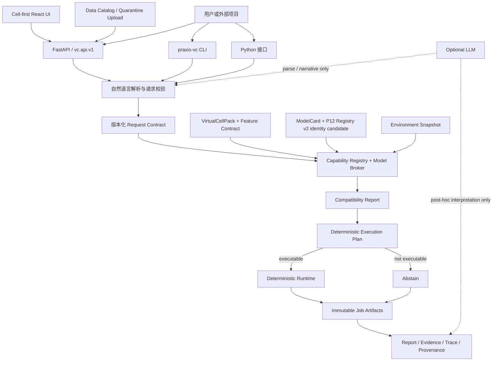

# PRAXIS-VirtualCell 当前项目全景与外部集成说明

> 文档状态：`CURRENT_PROJECT_AND_INTEGRATION_GUIDE`
>
> 核对日期：2026-08-02
>
> 当前本地仓库：`/Volumes/T7/PRAXIS-virtualcell`
>
> 当前分支：`codex/p12-model-registry-v2`
>
> DOCS-CLOSURE parent：`b02d21985bcde50cf0758d339b05b13bb3e200a2`
>
> DOCS-CLOSURE completion / P12 starting SHA：
> `b19c896202bea56f894d0ad540501331af42a40c`
>
> 当前 work unit：`Phase 12 — Virtual Cell Model Zoo v2`；状态 `VALIDATING`；
> completion SHA 尚未形成
>
> 工作树保护清单：不在本文固定；每轮从现场 `git status --short` 动态重建，任何
> 新 staged/modified/deleted/untracked 路径默认受保护
>
> 当前 Cell-first 产品代码锚点：`bf44aac25b993e49d0146ccd52dddad5c2fa14de`
>
> 条件式下一候选：`Phase 13 — Model Adapter SDK`；`NOT ACTIVE`、未授权

本文是一份面向其他项目、开发团队、科研合作者和后续智能体的独立项目说明。它回答四个问题：

1. PRAXIS-VirtualCell 现在究竟是什么；
2. 已经完成了哪些可信数据、模型和运行合同；
3. 其他项目当前可以怎样安全地调用或扩展它；
4. 哪些能力尚未完成，不能被宣传为已经实现。

本文按当前源码、合同和已记录测试证据撰写。历史论文、旧项目总结和过时 UI 指南不能覆盖本文所列的当前事实。

---

## 1. 一句话定位

PRAXIS-VirtualCell 是一个以显式合同、确定性运行、可审计证据和诚实弃权为核心的多物种虚拟细胞基础设施。

它当前能够：

- 接收经过严格验证的结构化科学请求；
- 接入符合 VirtualCellPack 合同的数据；
- 检查请求、Pack、模型和执行环境之间的兼容性；
- 在存在匹配且可执行的模型时生成执行计划；
- 保存请求、报告、trace、provenance 和 execution identity；
- 在缺数据、缺模型、不兼容、环境不满足或超出科学范围时明确 abstain；
- 使用可选 LLM 做自然语言解析和文字解释，但不让 LLM 参与数值预测或最终裁决。

它当前**不是**：

- 上传任意原始组学数据后自动训练出预测器的平台；
- 任意物种、任意细胞都已经可预测的世界模型；
- 已经完成科学验证的通用 Virtual Cell；
- 由 LLM 直接生成生物学数值结论的问答系统；
- 已经实现的 Community world model 或 Host–Microbiome digital twin。

当前准确的产品承诺是：

> 任意符合显式合同的数据可以制作成 VirtualCellPack 接入；只有存在匹配、可执行且
> 经过验证并获 product policy 批准的模型时才产生预测，否则明确 abstain。

### 1.1 当前 Phase 12 验证边界

当前实现候选把 model、artifact、environment、adapter、validation evidence 和
operator-policy record 拆为独立 version/fingerprint，并把它们接入 Pack-aware
compatibility、plan 和 job identity。`vc.model-card.v1` 保持兼容，但迁移只生成
`legacy_incomplete` records；无法精确绑定现有 model identity 的 P8/P9 历史结果只
保存为 `binding_status=unbound` 的 migration receipt，不创建 evidence、policy 或
promotion，P9 `available=false` 保持不变。

Registry lifecycle 使用 append-only `cataloged/artifact_ready/revoked/superseded`
events；历史 release、job 和负结果不原地改写。现有 `praxis-vc pack list` 和
`GET /api/packs` 调用链提供 `vc.model-registry-catalog.v2` 白名单、路径脱敏只读投影，
没有新增管理写接口。

Native environment package identity 使用 canonical PEP 503 distribution name 和
显式 version；legacy `python_dependencies` 的 runtime import-module name 则按原始文本
分层保留，不能被 package normalization 合并。Native `model_version` 必须 path-safe；
unsafe legacy raw version 仍进入内部 immutable fingerprint，但所有公开投影返回
`null`，不会改写旧 card bytes 或回显不安全文本。

P12 当前仍是 `VALIDATING`：这些实现候选在全部约定测试、packaging、一次获准本地
commit 和 post-commit 核验完成前不能写成稳定完成能力。本阶段没有外置资产、真实
模型或权重、训练、科学 benchmark/external/OOD run，也没有新的 operator promotion
decision。P13 明确禁止且未授权。

### 1.2 代码与外部资产许可

仓库源码在 `pyproject.toml` 中声明为 MIT License。公共数据集、数据库下载、模型权重、checkpoint 和其他外置科研资产保留各自的许可、引用和使用限制；不能因为仓库代码使用 MIT，就推定这些外部资产也可按 MIT 再分发。

其他项目在发布 Pack、模型或复现实验时，应分别保存：

- 源代码许可；
- dataset terms 和 citation；
- model/weight license；
- Pack manifest 中的 provenance；
- 不能进入发行物的受限资产清单。

---

## 2. 为什么建立这个项目

多数虚拟细胞演示把一次自然语言问答直接连接到一个固定模型。这样可以快速展示结果，但很难回答以下科研问题：

- 输入数据来自哪里，是否被修改过；
- 模型是否真正适用于这个物种、细胞、组学和任务；
- 模型权重、软件环境和特征顺序是否与验证时一致；
- 输出是模型预测、规则建议、历史证据，还是 LLM 生成的文字；
- 当条件不满足时，系统是否会停止，而不是生成看似合理的答案；
- 多个项目是否能在不修改核心 runtime 的情况下接入新数据和新模型。

PRAXIS-VirtualCell 把这些问题视为系统的第一等对象。项目的核心贡献不是宣称“所有细胞都能预测”，而是建立一个可插拔、可验证、可追踪、可拒绝的运行基座。

---

## 3. 核心可信原则

### 3.1 合同优先

数据、请求、特征映射、模型能力、执行环境、兼容性报告、执行计划和运行结果都有显式版本化合同。未知字段和不支持的版本在关键边界上 fail closed。

### 3.2 数据字节不被静默改写

数据适配层不擅自：

- 归一化；
- 补零；
- 去重；
- 改写 feature ID；
- 改变源顺序；
- 把缺失 modality 伪造成存在；
- 生成随机 split；
- 执行未声明的同源基因转换。

如果模型需要这些操作，必须由显式、版本化并带 provenance 的转换合同表达。

### 3.3 兼容不等于有效

系统严格区分：

```text
数据存在
≠ Pack 存在
≠ Pack 有效
≠ 模型兼容
≠ 环境兼容
≠ 可以执行
≠ benchmark 通过
≠ 科学验证通过
≠ 正式推广
```

### 3.4 默认诚实弃权

在 Pack-aware 可信路径中，没有匹配模型、缺权重、缺依赖、缺输出 adapter、超出 OOD 边界或科学门槛未通过时，正确结果是空执行计划或 abstain，而不是 mock prediction。当前 legacy demo 路径的差异在第 4.6 节单独说明。

### 3.5 LLM 不拥有科学真相

LLM 可以：

- 把自然语言解析为候选请求；
- 提示缺失字段；
- 在确定性结果之后生成文字解释；
- 帮助用户阅读 trace 和 provenance。

LLM 不可以：

- 决定 Pack 是否有效；
- 修改真实数据；
- 生成或覆盖模型数值预测；
- 判断模型是否兼容；
- 决定可靠性和 abstain；
- 改写 fingerprint、provenance 或 execution identity；
- 决定科学模型是否 promotion。

所有运行结果都固定记录：

```json
{
  "llm_used_for_prediction": false
}
```

---

## 4. 当前产品形态：Cell-first 科研入口

当前网页已经从传统的流程配置界面改为白色、Cell-first、ChatGPT 类科研入口。

实际可见流程是：

```text
进入网站
  ↓
选择 Cell Context preset
  ↓
输入自然语言科学问题
  ↓
解析并校验结构化请求
  ↓
确定性 runtime 自动路由和运行
  ↓
直接显示报告或 abstain
  ↓
查看 execution identity、证据、trace 和 provenance
```

### 4.1 首页

首页先展示四个常用 Cell Context：

- Human K562；
- Human PBMC；
- Mouse T cell；
- E. coli。

它们是用户提问时的上下文预设，不是持久化 Virtual Cell，也不代表已经绑定了数据 Pack 或经过验证的模型。

### 4.2 Data Center

Data Center 当前是可搜索的 Cell Context 背景库，支持：

- human；
- mouse；
- yeast；
- bacteria；
- 物种筛选；
- 12 个后端维护的 cell presets；
- 同物种 dataset 和 Pack 状态的只读展示。

Data Center 中显示的 dataset 数量和 Pack 数量只是背景信息。当前 UI 明确标注这些对象没有自动绑定到所选 cell。

### 4.3 对话区

选择 cell 后显示单一聊天框和该 cell 的示例问题。点击示例只会填入输入框，不会自动执行。

前端会把所选 species 和 cell type 作为显式结构化上下文交给后端解析。LLM 解析成功时可以继续运行；确定性 fallback 解析需要用户确认结构化解释后再执行。

### 4.4 报告区

当前报告界面包含七类信息：

1. 报告；
2. 预测；
3. 模块路由；
4. 数据与执行身份；
5. 证据；
6. 运行轨迹；
7. 溯源。

可下载的内容包括结构化报告、文字解释和 Markdown 报告。

### 4.5 旧五阶段 Workspace 的真实状态

旧的 `Ask → Review → Route → Run → Results` 组件仍保留在前端源码中，但当前 `App.tsx` 没有挂载它。当前产品入口只编排：

```text
chat
data-center
```

因此其他项目不应根据过时的用户指南声称“五阶段 Workspace 是当前可见 UI”。

### 4.6 当前 UI 的关键限制

当前 Chat 前端创建 job 时没有传入 `pack_id + pack_version`。因此：

- Cell preset 只提供 context；
- 当前聊天走 legacy adapter 路径；
- 它不会因为 Data Center 中存在同物种 Pack 就自动绑定该 Pack；
- 后端 API 虽已支持显式 Pack identity，但当前主 UI 尚未使用这一能力。

legacy 路径仍可能枚举明确标记的 `MockLinear`、`MockCPA`、`MockGEARS` 或窄域 case runner。它与 P6 Pack-aware 路径的语义不同：

```text
legacy direct chat
  可以产生明确标记为 mock/advisory 的演示报告

Pack-aware runtime
  没有可执行模型时不得回退到 mock，必须 abstain
```

因此 UI 中的“Report generated”只表示后端完成了一次可审计运行并生成报告，不等于真实模型已经完成科学预测。

这也是下一阶段真实模型闭环必须解决的关键接缝。

---

## 5. 系统架构



### 5.1 信任边界

```text
数据真实性       → Pack validator / hash / schema
模型适用性       → CapabilityRegistry / ModelBroker
执行可能性       → environment / asset / dependency / adapter checks
数值预测         → model or mechanism adapter
可靠性与 abstain → deterministic governance
文字解释         → deterministic template or optional LLM
```

LLM 位于科学执行链之外。

---

## 6. 核心对象模型

| 对象 | 含义 | 当前状态 |
|---|---|---|
| Cell Context preset | 物种和 cell type 的提问入口 | 已实现，只读展示上下文 |
| Dataset catalog record | 公共组学资源的元数据和文件身份 | 已实现 |
| Upload receipt | 用户上传原始字节的 quarantine 收据 | 已实现，不是 Pack |
| VirtualCellPack | 数据、语义、资产和 provenance 的版本化包 | 已实现 v0.1–v0.3 |
| Feature contract | 模型期望的 feature namespace、顺序和映射要求 | 已实现 |
| ModelCard | 模型能力、输入、输出、资源、OOD 和 wrapper 合同 | v1 保持兼容 |
| Model Registry v2 identities | model release、artifact、environment、adapter、evidence、operator policy | P12 implementation candidate；验证中 |
| Environment snapshot | 依赖、资源、adapter 和运行环境状态 | v1 保留；Pack-aware v2 candidate 绑定 exact environment identity |
| Compatibility report | Pack × request × model × environment × adapter × evidence × policy 检查结果 | v1 保留；Pack-aware v2 candidate 验证中 |
| Execution plan | 可执行步骤及其 fingerprint | v1 保留；Pack-aware v2 candidate 验证中 |
| Job execution identity | 本次运行绑定的 Pack、release、artifact、environment、adapter、evidence、policy 和 compatibility identity | v1 保留；v2 candidate 验证中 |
| Persistent Virtual Cell | cell + dataset + Pack + model 的持久化产品对象 | 尚未实现 |
| Training job | 上传数据到训练、评估和 promotion 的合同 | 尚未实现 |
| Community model runtime | 多成员动态和交换预测 | 只有抽象合同，尚无真实模型 |

---

## 7. 状态语义：其他项目必须保持的区分

以下五层不是自动递进的状态链：

| 层 | 状态 | 唯一含义 |
|---|---|---|
| Pack | `pack_valid` | manifest、bytes、hash 和科学语义合同通过 |
| Registry | `cataloged / artifact_ready / revoked / superseded` | 身份登记、资产可取用或未来执行 policy；不创建科学结论 |
| 每次请求计算 | `model_compatible / environment_compatible / executable` | exact request×Pack×model×environment×adapter 当次满足 |
| Scientific evidence | `benchmark_passed / scientifically_validated / promotion_eligible` | exact protocol/scope 的不可变科学结果 |
| Product policy | `production_promoted` | 具名 operator 引用 exact evidence 作出的窄域产品决定 |

`available=true`、Pack/model card 存在、兼容成功、代码路径、smoke、UI 或 LLM 评价
都不能推导科学或产品状态。operator decision 不能把
`scientifically_validated=false` 改成 true；registry 也不能创建 evidence。
撤销只影响未来运行，不改写历史 job。

P12 implementation candidate 已补入独立 artifact、environment、adapter、evidence
和 operator-policy record identity，并让 Pack-aware runtime 对 exact 完整绑定
fail closed；但当前状态仍是 `VALIDATING`，不能在 completion SHA 和完成报告形成前
写成稳定完成。P6-era v1 合同继续兼容，不能与 v2 完整治理混称。软件版本发布与
科学/policy promotion 仍分别治理。

---

## 8. P0–P11 已完成工作

### Phase 0：可信边界和确定性基线

- 审计 request、runtime、SpeciesBrain、route、case、model zoo、Report 和 ActiveLearning；
- 定义 Pack 有效、模型兼容和科学验证的分层状态；
- 修复 Report request 丢失；
- 修复 ActiveLearning `genetic_hub@:unspecified`；
- 冻结确定性报告和测试基线。

### Phase 1：严格请求合同

- 建立版本化 species、cell、modality、dataset、perturbation 和 task 域；
- nested JSON 通过验证后不可变；
- 未知字段 fail closed；
- 保留 legacy request 到严格请求合同的显式转换。

### Phase 2：VirtualCellPack 基础合同

- 建立 `vc.pack.v0.1`；
- 绑定 root-relative path、size 和 SHA-256；
- 验证 license 和 taxon；
- 拒绝 traversal、绝对路径、逃逸 symlink 和坏 hash。

### Phase 3：H5AD / AnnData 适配

- backed、只读访问；
- 保持 observations、features 和稀疏矩阵的源顺序；
- 不静默归一化、补零、去重、改 ID 或随机 split。

### Phase 4：标准科学语义

- 建立 `vc.pack.v0.2`；
- 增加 taxon、assembly、cell identity/state/context；
- 增加 condition、control、unit、split 和 leakage 语义；
- 支持 Cellosaurus/local CURIE 和 canonical key；
- 收紧 legacy 和 MCP fail-closed 边界。

### Phase 5：多组学和特征对齐

- 建立 `vc.pack.v0.3`；
- 支持 H5MU；
- 支持完全配对和部分配对多组学；
- 不为缺失 modality 造行或 impute；
- 建立 `vc.model-feature-contract.v1`；
- 记录显式 mapping 和 alignment provenance。

### Phase 6：模型能力运行时

- 严格 ModelCard；
- CapabilityRegistry；
- ModelBroker；
- compatibility report；
- deterministic execution plan；
- 检查 Pack × request × model × environment；
- 缺模型、资产、依赖或 adapter 时生成空 plan 或 abstain。

当前通用 plugin output adapter 只支持：

```text
predict_delta_expression → delta_expression
```

### Phase 7：数据门户

- 建立 human、mouse、yeast、bacteria 数据目录；
- 当前固定为 4 个 dataset、5 个文件、总计 27,823,623 bytes；
- allowlisted 下载；
- 每次下载前重验路径、大小和 hash；
- bearer token、单文件限额和总 quota；
- byte-preserving quarantine upload；
- 上传收据不是 Pack，也不会自动注册或预测。

### Phase 8：产品 Pack 和 Golden Norman

- 三个内置 tiny Pack：human、mouse、bacteria；
- Pack inspect、validate、register、list、compatibility、run CLI；
- Pack 只读 API；
- job 绑定不可变 Pack/model fingerprint；
- Golden Norman/K562 Pack：91,205 × 5,045；
- 三个简单 baseline 和冻结评估；
- 没有运行 GEARS；
- `scientifically_validated=false`。

### Phase 9：OOD 和外部验证

- IID；
- perturbation；
- combination；
- cell type；
- donor；
- dataset/platform；
- species；
- dose/time；
- grouped biological-unit/replicate leakage audit；
- GSE67402 → GSE94117 无适配外部验证。

关键负结果：

```text
candidate MSE  = 1.0603835779
no-change MSE  = 1.0533347059
```

candidate 没有胜过预声明 no-change baseline，因此：

```text
available = false
scientifically_validated = false
```

该负结果被保留，不能用后续 UI 或模型卡状态覆盖。

### Phase 10：CommunityPack 合同

- 建立 `vc.community-pack.v1`；
- E. coli 和 S. cerevisiae tiny member Packs；
- abundance、medium、compartment、time、well-mixed 和 metabolite namespace；
- citation、ID、单位冲突检查；
- 单成员等价检查；
- toy exchange 的声明量精确守恒；
- `CommunityModelAdapter` 抽象合同。

当前没有真实 Community model。正确结果固定为：

```json
{
  "prediction": null,
  "abstain": true,
  "reason": "community_model_unavailable"
}
```

### Phase 11A：数据中心化产品骨架

Phase 11A 曾建立 Dashboard、Organisms、Datasets、VirtualCellPacks、Virtual Cells
和 Agent Runs 的数据中心化前端骨架。它是当前 Git 历史的一部分，产品叙事随后在
同一 Phase 的 UI 收口中改为 Cell-first。

### Phase 11B：Cell-first 正式入口

- 白色产品风格；
- 首页先选择 Cell；
- 常用 Cell presets；
- Data Center 作为 Cell Context 背景库；
- ChatGPT 类单一聊天框；
- 每个 cell 的示例问题；
- 自动解析和运行；
- 直接生成报告或 abstain；
- 展示 execution identity、证据、trace 和 provenance。

Phase 11B 完成的是可信入口，不是“cell 与数据、Pack、模型已经形成可执行绑定”。
该边界没有被 P12 改写。

### Phase 12：Virtual Cell Model Zoo v2（`VALIDATING`）

P12 从 `b19c896202bea56f894d0ad540501331af42a40c` 开始，在
`codex/p12-model-registry-v2` 上形成并正在验证：

- model artifact、environment、adapter、validation evidence、operator policy、
  release 和 lifecycle event 的独立不可变身份；
- Pack-aware v2 compatibility、execution plan 和 job execution identity；
- `vc.model-card.v1` 到 `legacy_incomplete` v2 records 的保守迁移；
- P8/P9 无法 exact model-bind 的 evidence 只作为 `unbound` migration receipt；
- append-only catalog/readiness/revoke/supersede history；
- 现有 Pack list/API 的路径脱敏、字段白名单 Model Registry v2 投影。

P12 没有新增、下载或运行真实权重，没有训练或科学验证，没有新的 operator promotion
decision，也没有管理写 API。当前仍待完整验证和 completion SHA，因此不能写成已
完成；P13 只是条件式下一候选且未授权。

---

## 9. 当前合同与协议版本

### 9.1 服务协议

| 合同 | 当前值 |
|---|---|
| API protocol | `vc.api.v1` |
| Runtime protocol | `vc.runtime.v1` |
| Legacy runtime label | `v0.3` |
| Python package version string | `1.6.0` |

版本注意事项：

- GitHub 已经存在历史 annotated `v1.6.0` tag；
- 当前 Phase 11 产品代码在该历史发布之后继续沿用了 `1.6.0` 字符串；
- DOCS-CLOSURE parent `b02d219...` 及后续本地 docs commit 都不能被描述为现有
  GitHub `v1.6.0` tag 的内容；
- 这是待下一正式版本修复的版本漂移；
- 旧 tag 不得移动、覆盖或重建。

跨项目集成时应同时记录：

```text
product_version
api_protocol_version
runtime_protocol_version
git_sha
artifact SHA-256
```

不能只记录 `1.6.0`。

### 9.2 主要 schema

当前主要版本化合同包括：

- `vc.request.v2`
- `vc.species-ref.v1`
- `vc.cell-context.v1`
- `vc.modality.v1`
- `vc.dataset-ref.v1`
- `vc.perturbation.v1`
- `vc.task.v1`
- `vc.model-input.v1`
- `vc.prediction.v1`
- `vc.pack.v0.1`
- `vc.pack.v0.2`
- `vc.pack.v0.3`
- `vc.model-feature-contract.v1`
- `vc.feature-mapping.v1`
- `vc.alignment-report.v1`
- `vc.model-card.v1`
- `vc.environment.v1`
- `vc.compatibility-report.v1`
- `vc.execution-plan.v1`
- `vc.pack-record.v1`
- `vc.pack-index.v1`
- `vc.pack-catalog.v1`
- `vc.job-execution-identity.v1`
- `vc.model-artifact.v1`（P12 candidate）
- `vc.model-environment.v1`（P12 immutable identity；不同于 runtime snapshot）
- `vc.model-adapter.v1`（P12 identity；不是 P13 Adapter SDK）
- `vc.model-validation-evidence.v1`
- `vc.model-operator-policy.v1`
- `vc.model-release.v1`
- `vc.model-registry-event.v1`
- `vc.model-registry-state.v1`
- `vc.model-registry.v2`
- `vc.model-registry-catalog.v2`
- `vc.model-registry-legacy-receipt.v1`
- `vc.model-registry-legacy-migration-report.v1`
- `vc.environment.v2`
- `vc.compatibility-report.v2`
- `vc.execution-step.v2`
- `vc.execution-plan.v2`
- `vc.job-execution-identity.v2`
- `vc.data-catalog.v1`
- `vc.upload-receipt.v1`
- `vc.community-pack.v1`

其他项目应按 `schema_version` 路由解析器，不能依靠字段形状猜测版本。
以上 P12 新增 schema 当前均属于同一 `VALIDATING` implementation candidate；在 P12
completion report 形成前，外部项目不应把它们当作已发布稳定协议。

---

## 10. 当前数据、Pack 和模型实况

### 10.1 数据目录

当前数据门户包含四个物种：

- human；
- mouse；
- yeast；
- bacteria。

固定目录状态：

```text
datasets       4
files          5
total bytes    27,823,623
usage status   download_only
```

公共文件只有在以下条件全部满足时才标记为 available：

- 位于配置数据根目录的 `public/` 下；
- 路径是 catalog 声明的路径；
- 文件大小匹配；
- SHA-256 匹配。

### 10.2 上传

上传只执行：

```text
认证
→ 大小和 quota 检查
→ 保留原始字节
→ 计算 SHA-256
→ 写入 quarantine
→ 返回 receipt
```

上传不会执行：

- 解包；
- schema mapping；
- QC；
- feature ID 映射；
- Pack authoring；
- Pack 注册；
- 模型训练；
- 模型预测。

### 10.3 内置产品 Pack

当前默认产品 catalog 只有：

- `p8-human-tiny`
- `p8-mouse-tiny`
- `p8-bacteria-tiny`

P10 yeast tiny Pack 存在于 CommunityPack fixture/release 资产中，但不在默认产品 Pack catalog。

### 10.4 默认模型卡

默认 registry 中有五类卡片：

- `ecoli_gem`：标记 available；
- `gears`：planned；
- `scgpt`：planned；
- `norman_mean_baseline`：planned；
- `yeast_deletion_fitness`：planned。

`ecoli_gem` 的 available 只表示 registry 中的资产/能力状态。当前通用 Pack runtime 缺少 growth output adapter，因此不能把它宣传为可对任意 bacteria Pack 执行的通用生长模型。

P12 的保守迁移不会把这五张卡的 `planned/available/missing` 提升为 v2
`artifact_ready`、`executable`、scientifically validated 或 promoted。每张旧卡只
形成 `migration_status=legacy_incomplete` 的 release 和结构化 `legacy_status`；其
不完整 artifact/environment/adapter records 不能进入 v2 可执行计划。P8/P9 历史
receipt 若缺 exact model binding 也只进入 unbound migration report。若旧卡的 raw
`model_version` 不是 canonical path-safe identifier，内部 identity 仍绑定原值，而
公开 catalog/capability/job projection 的 version 显示 `null`。

对 human/K562 Pack 的历史实测曾出现：

```text
pack_valid                   true
norman_mean model_compatible true
scgpt model_compatible       true
environment_compatible       false
execution_plan.executable    false
steps                        0
```

这说明数据验证和兼容性规划已经工作，同时也说明当前环境不能执行这些模型。

### 10.5 Golden Norman/K562

Golden Pack 和冻结评估已建立，但三个简单 baseline 都没有获得科学 promotion。

历史冻结简单 baseline MSE：

```text
no-change       0.00620609
global mean     0.00458205
additive ridge  0.00325706
```

这些值只属于冻结 Norman/K562 benchmark，不是跨数据集、跨细胞或跨物种性能声明。

### 10.6 Community

当前 CommunityPack 验证的是合同、单位、ID、质量守恒和 fail-closed 行为。它没有：

- 真实 CommunityModelAdapter 实现；
- 真实多成员动态模型；
- metabolite exchange 预测模型；
- 实验验证；
- scientifically promoted capability。

---

## 11. 外部项目推荐接入方式

优先级建议：

1. REST API：最清晰、最适合跨语言和跨项目；
2. CLI：适合 shell、批处理和 CI；
3. Python import：适合同一 Python 环境，但稳定性低于版本化 HTTP/schema；
4. 直接读取内部文件：只适合审计，不建议作为运行集成。

---

## 12. REST API

FastAPI 应用位于 `praxis_vc_api/main.py`。默认提供：

- OpenAPI：`/openapi.json`
- Swagger UI：`/docs`

### 12.1 系统和解析

| 方法 | 路径 | 用途 | 是否产生预测 |
|---|---|---|---|
| GET | `/api/health` | 服务、LLM、协议、版本和 Git SHA | 否 |
| POST | `/api/parse` | 自然语言转候选请求并校验 | 否 |
| GET | `/api/options` | 物种、扰动、任务枚举和 cell presets | 否 |
| GET | `/api/modules` | M1–M8 模块目录 | 否 |

### 12.2 Pack

| 方法 | 路径 | 用途 | 是否执行模型 |
|---|---|---|---|
| GET | `/api/packs` | 列出并重新验证 Pack records；P12 candidate 同时投影路径脱敏的 `model_registry` | 否 |
| GET | `/api/packs/{id}/{version}` | 获取单个 Pack record | 否 |
| GET | `/api/packs/{id}/{version}/validate` | 重新验证注册 Pack | 否 |
| POST | `/api/packs/compatibility` | 计算兼容性和计划 | 否 |

当前没有远程 Pack register API。Pack 注册是本地 operator CLI/Python 操作。
P12 没有增加 model-registry 管理写 API；`model_registry` 只包含显式白名单字段，不能
返回 asset cache path、URI、wrapper/implementation locator 或本地路径。

### 12.3 数据门户

| 方法 | 路径 | 用途 |
|---|---|---|
| GET | `/api/data-catalog` | 获取严格公共数据目录 |
| GET | `/api/data-catalog?species=human` | 按物种筛选 |
| GET | `/api/data-catalog/{dataset_id}/files/{file_id}/download` | hash 重验后下载 |
| POST | `/api/data-uploads` | bearer 认证后上传到 quarantine |

### 12.4 Job 和报告

| 方法 | 路径 | 用途 |
|---|---|---|
| POST | `/api/jobs` | 同步执行已验证请求并保存 job |
| GET | `/api/jobs` | 列出本地历史 job |
| GET | `/api/jobs/{job_id}` | 获取状态 |
| GET | `/api/reports/{job_id}` | 获取结构化和 narrative 报告 |
| GET | `/api/reports/{job_id}/trace` | 获取完整消息 trace |
| GET | `/api/reports/{job_id}/provenance` | 获取 provenance、LLM metadata 和 execution identity |
| GET | `/api/reports/{job_id}/module-plan` | 获取该次运行实际保存的模块计划 |
| GET | `/api/reports/{job_id}/markdown` | 获取确定性 Markdown 报告 |

### 12.5 Health 示例

```bash
curl -s http://127.0.0.1:8000/api/health
```

调用方至少应检查：

```json
{
  "status": "ok",
  "api_protocol_version": "vc.api.v1",
  "runtime_protocol_version": "vc.runtime.v1",
  "git_sha": "<exact-sha>"
}
```

### 12.6 解析示例

```bash
curl -s \
  -H 'Content-Type: application/json' \
  -d '{
    "text": "在人 K562 细胞中敲除 AHR 后预测表达变化",
    "mode": "offline"
  }' \
  http://127.0.0.1:8000/api/parse
```

只有在以下条件满足时才应创建 job：

```text
schema_valid = true
clarification_required = false
```

### 12.7 Pack compatibility 示例

```bash
curl -s \
  -H 'Content-Type: application/json' \
  -d @- \
  http://127.0.0.1:8000/api/packs/compatibility <<'JSON'
{
  "pack_id": "p8-human-tiny",
  "pack_version": "1.0.0",
  "request": {
    "request_id": "external-k562-001",
    "species": "human",
    "cell_type": "K562",
    "perturbation_type": "gene",
    "perturbation_targets": ["AHR"],
    "input_modality": "scRNA",
    "output_modality": "delta_expression",
    "task_type": "predict_delta_expression"
  }
}
JSON
```

这是只读规划请求。调用成功不代表模型已运行。

### 12.8 显式 Pack job 示例

```bash
curl -s \
  -H 'Content-Type: application/json' \
  -d @- \
  http://127.0.0.1:8000/api/jobs <<'JSON'
{
  "mode": "offline",
  "enable_llm_report": false,
  "pack_id": "p8-human-tiny",
  "pack_version": "1.0.0",
  "request": {
    "request_id": "external-k562-001",
    "species": "human",
    "cell_type": "K562",
    "perturbation_type": "gene",
    "perturbation_targets": ["AHR"],
    "input_modality": "scRNA",
    "output_modality": "delta_expression",
    "task_type": "predict_delta_expression"
  }
}
JSON
```

`pack_id` 和 `pack_version` 必须同时提供或同时省略。

### 12.9 API 安全边界

当前 VirtualCell API：

- 上传端点有独立 bearer token；
- 其他端点没有通用用户认证、租户隔离或权限系统；
- job 使用本地文件系统持久化；
- 不适合直接裸露在公网；
- 对外部署应由反向代理、TLS、认证、网络 ACL、quota 和审计层保护。

---

## 13. CLI

命令入口：

```text
praxis-vc
```

### 13.1 普通运行

```bash
praxis-vc run \
  --request examples/ahr_k562.json \
  --mode offline \
  --out runs/external-k562
```

### 13.2 自然语言解析和确认

```bash
praxis-vc ask \
  --text "在人 K562 细胞中敲除 AHR 后会怎样" \
  --mode offline
```

默认只显示解析结果。加 `--yes` 才执行：

```bash
praxis-vc ask \
  --text "在人 K562 细胞中敲除 AHR 后会怎样" \
  --mode offline \
  --yes \
  --out runs/external-k562
```

### 13.3 启动 API 和当前 React 网站

```bash
praxis-vc serve --host 127.0.0.1 --port 8000
```

### 13.4 Pack 操作

```bash
praxis-vc pack inspect /path/to/pack
praxis-vc pack validate /path/to/pack
praxis-vc pack register /path/to/pack
praxis-vc pack list
```

`inspect` 只解析 manifest，不读取全部资产，也不声明 Pack 有效。
在 P12 candidate 中，`pack list` 复用同一个 Pack catalog payload，额外返回
`vc.model-registry-catalog.v2` 只读白名单投影；它不执行 lifecycle 写操作，也不把
cataloged 或 legacy available 解释为可预测。

兼容性规划：

```bash
praxis-vc pack compatibility \
  --request examples/ahr_k562.json \
  --pack-id p8-human-tiny \
  --pack-version 1.0.0
```

显式 Pack 运行：

```bash
praxis-vc pack run \
  --request examples/ahr_k562.json \
  --pack-id p8-human-tiny \
  --pack-version 1.0.0 \
  --mode offline \
  --out runs/pack-k562
```

如果没有可执行模型，命令应诚实返回 abstain，而不是生成 mock 结果。

---

## 14. Python 集成

Python 可直接导入，但外部项目应把它视为比 REST schema 更容易变化的程序接口。

主要 workflow：

```python
from praxis_virtualcell.workflows.run_virtualcell_query import (
    parse_query,
    run_full_query,
    run_query,
)
```

Pack 数据合同公开接口：

```python
from praxis_virtualcell.data_packs import (
    AlignmentReport,
    ModelFeatureContract,
    PackManifest,
    PackRegistry,
    RegisteredPack,
    align_features,
    load_anndata_view,
    load_mudata_view,
    validate_pack,
)
```

Community 合同：

```python
from praxis_virtualcell.community_packs import CommunityModelAdapter
```

注意：`CommunityModelAdapter` 当前是抽象接口，不存在可直接执行的默认模型。

---

## 15. 当前普通请求格式

当前普通 `/api/parse` 和 `/api/jobs` 路径使用经过验证的 flat request：

```json
{
  "request_id": "ahr_k562_demo",
  "species": "human",
  "cell_type": "K562",
  "perturbation_type": "gene",
  "perturbation_targets": ["AHR"],
  "input_modality": "scRNA",
  "output_modality": "delta_expression",
  "task_type": "predict_delta_expression"
}
```

当前 validator 支持的主要枚举：

```text
species:
  human
  mouse
  yeast
  bacteria

perturbation_type:
  gene
  gene_combination
  drug
  medium
  ligand

task_type:
  predict_delta_expression
```

严格 nested `vc.request.v2` 已经实现。Pack 路径可以显式处理 v2 或把 legacy request 转换为 v2。外部项目如果需要长期稳定合同，应优先围绕 `schema_version` 和 v2 域对象设计，而不是扩展 legacy flat request 的任意字段。

---

## 16. Job 产物和可复现身份

当前 JobStore 使用本地文件系统，不使用数据库。典型目录：

```text
runs/<job_id>/
├── request.json
├── report.json
├── trace.json
├── provenance.json
├── execution_identity.json
├── report.md
├── narrative_report.md      # 启用且实际生成时
├── llm_meta.json
└── status
```

同名 job 目录拒绝覆盖。

### 16.1 Execution identity

Pack-aware job 记录：

- Pack ID；
- Pack version；
- Pack fingerprint；
- 模型 name/version；
- 模型 fingerprint；
- compatibility fingerprint；
- executable 状态；
- 整体 execution fingerprint。

P12 candidate 对 `vc.execution-plan.v2` 生成
`vc.job-execution-identity.v2`，进一步冻结 submitted/normalized request、plan、
environment snapshot、model release、capability、artifact、environment、adapter、
evidence、operator policy、lifecycle snapshot、science/policy snapshot verdict 和
compatibility fingerprints；`plan_id` 使用 canonical plan identity，并单列每个
execution-step fingerprint。JobStore 要求 submitted request 的 normalized fingerprint
与 plan 相等，也要求 structured report 与 provenance 保存同一 plan；该 identity 只
从该次已保存 plan/report 生成，不查询 live registry 来改写历史状态。落盘 structured
report 与 provenance 中的 execution plan 均替换为同一个字段白名单/路径脱敏 public
plan。历史 `vc.job-execution-identity.v1` bytes 和 legacy adapter 标记保持兼容。

Legacy job 明确记录：

```json
{
  "legacy_adapter": true
}
```

其他项目保存结果时应把 `execution_identity.json` 与报告放在一起。只保存 narrative 或截图不足以复现运行身份。

### 16.2 结果消费原则

读取方应优先消费：

1. structured report；
2. reliability decision；
3. execution identity；
4. provenance；
5. evidence；
6. trace；
7. narrative。

narrative 是解释层，不是数值真相源。

---

## 17. VirtualCellPack 接入

### 17.1 Pack 的作用

VirtualCellPack 负责把以下内容绑定成不可模糊的版本化对象：

- 数据文件；
- 文件 size 和 SHA-256；
- taxon 和 assembly；
- cell identity、state 和 context；
- modality 和 assay；
- feature namespace 和 ID 语义；
- condition、control 和 unit；
- split 和 leakage 边界；
- 数据来源、引用和 license；
- 多组学 pairing；
- feature mapping provenance。

### 17.2 Pack 不是模型

Pack 有效只表示数据合同成立。模型能力必须由 ModelCard 单独声明并由 Broker 匹配。

### 17.3 本地注册

默认 Pack index：

```text
~/.local/share/praxis-virtualcell/pack-index.json
```

可通过以下环境变量覆盖：

```text
PRAXIS_VC_PACK_INDEX
```

每次读取注册记录时都会重新验证 Pack bytes。Pack 路径或内容改变会导致 identity mismatch 或 invalid，而不是继续信任旧记录。

### 17.4 新 Pack 接入检查清单

其他项目提供 Pack 时至少应确认：

- manifest schema 是受支持版本；
- 所有路径都是 Pack root 内相对路径；
- 没有 symlink escape；
- size 和 SHA-256 完全匹配；
- license 和 citation 明确；
- taxon/assembly 与数据一致；
- cell/context/condition/control/unit 明确；
- feature namespace 和 ID format 明确；
- split 以 biological group 为单位；
- 没有静默数据转换；
- Pack 验证通过后仍不自动宣称有预测能力。

---

## 18. 模型接入和当前 Adapter 边界

ModelCard 描述：

- species/taxon；
- modality/assay；
- cell domain；
- perturbation；
- task；
- output；
- feature namespace；
- 资产和 hash；
- 资源需求；
- uncertainty；
- OOD domain；
- wrapper/adapter。

Compatibility report 分开记录：

```text
pack_valid
model_compatible
environment_compatible
assets_available
wrapper_available
executable
scientifically_validated
```

P12 candidate 的 `vc.compatibility-report.v2` 还逐项绑定 model release、capability、
artifact、environment identity、adapter、evidence、operator policy 和 lifecycle
snapshot。只有 native exact-Pack release、经 hash/size 复验的安全 artifact、
`vc.environment.v2` exact identity、exact adapter、promotion-eligible evidence、
production-promoted policy，以及未 revoked/superseded 的 active state 同时成立，
`vc.execution-plan.v2` 才包含 step；否则保存稳定拒因并空 plan/abstain。

产品 Pack CLI/API 路径显式启用 v2 gate。为保持 P8/legacy 低层回归，直接构造自定义
`ModelZooRegistry(custom_path)` 的库调用仍可处于 v1 compatibility mode；该路径不是
v2 fully governed 产品执行面，不能用来绕过 product Pack 路径或声称 P12 完整治理。

当前通用 plugin runtime 只实现：

```text
predict_delta_expression → delta_expression
```

要接入 growth、fitness、absolute expression、metabolic flux、drug response 等输出，需要新增明确的 output adapter 和相应测试。不能仅修改模型卡的 `status` 或 `outputs` 就宣称模型可运行。

模型权重和大型资产必须外置，并通过 hash、模型卡和环境身份绑定，不能直接提交进 Git。

---

## 19. 数据门户接入和治理

关键环境变量：

| 变量 | 用途 |
|---|---|
| `PRAXIS_VC_DATA_ROOT` | 公共数据和 quarantine 的绝对根目录 |
| `PRAXIS_VC_DATA_CATALOG` | 覆盖默认 catalog |
| `PRAXIS_VC_UPLOAD_TOKEN` | 至少 32 字符的上传 bearer token |
| `PRAXIS_VC_UPLOAD_MAX_BYTES` | 单文件上限 |
| `PRAXIS_VC_UPLOAD_TOTAL_BYTES` | 总 quota |

上传示例：

```bash
curl -s \
  -H "Authorization: Bearer ${UPLOAD_TOKEN}" \
  -F species=human \
  -F file=@matrix.h5ad \
  http://127.0.0.1:8000/api/data-uploads
```

返回 receipt 后，外部系统必须把它标记为：

```text
quarantined upload
```

不能标记为：

```text
validated dataset
registered Pack
buildable Virtual Cell
prediction-ready data
```

---

## 20. 安装与运行

### 20.1 Python

要求：

```text
Python >= 3.11
推荐复现版本：Python 3.13
```

源码开发安装：

```bash
python3.13 -m venv .venv
source .venv/bin/activate
python -m pip install -e ".[api]"
```

严格复现应使用 `requirements/` 下的 Python 3.13 hash-lock 文件，而不是重新自由解析依赖。

### 20.2 React

```bash
cd praxis_vc_react
npm ci
npm run build
cd ..
praxis-vc serve --host 127.0.0.1 --port 8000
```

浏览：

```text
http://127.0.0.1:8000
```

Vite 开发服务器默认在 5173，并把 `/api` 代理到后端。可通过 `VITE_DEV_API` 调整开发代理，通过 `VITE_API_BASE` 覆盖生产 API base。

### 20.3 可选 extras

| Extra | 作用 |
|---|---|
| `api` | FastAPI + Uvicorn |
| `web` | 旧 Streamlit UI |
| `omics` | AnnData + MuData |
| `mechanistic` | COBRA/GEM |
| `dev` | 测试、lint 和开发工具 |

### 20.4 Wheel

完整 release wheel 的构建入口：

```bash
PYTHON_BIN=python3.13 \
  scripts/build_release_wheel.sh /tmp/praxis-dist
```

目标 wheel 包含：

- Python runtime；
- CLI；
- FastAPI；
- 构建后的 React 静态文件；
- 旧 Streamlit 入口；
- 包内小型合同和资产。

### 20.5 Docker

```bash
scripts/build_release_container.sh praxis-virtualcell:local
```

运行时应把 `runs` 和所需外部数据作为显式 volume，并把密钥通过进程环境或 secret manager 注入。

---

## 21. 主要环境变量

| 变量 | 用途 |
|---|---|
| `PRAXIS_VIRTUALCELL_MODE` | `offline` 或 `llm_assisted` |
| `DEEPSEEK_API_KEY` | 可选 DeepSeek key |
| `PRAXIS_VC_LLM_BASE_URL` | LLM endpoint |
| `PRAXIS_VC_LLM_MODEL` | LLM model name |
| `PRAXIS_VC_RUNS` | job 产物目录 |
| `PRAXIS_VC_STATIC_ROOT` | React 静态文件根目录 |
| `PRAXIS_VC_PACK_INDEX` | Pack index |
| `PRAXIS_VC_MODEL_REGISTRY` | Model registry |
| `PRAXIS_VC_MODEL_CACHE` | 外置模型缓存 |
| `PRAXIS_VC_DATA_ROOT` | 外置数据根目录 |
| `PRAXIS_VC_DATA_CATALOG` | 数据 catalog |
| `PRAXIS_VC_UPLOAD_TOKEN` | 上传认证 token |
| `PRAXIS_VC_UPLOAD_MAX_BYTES` | 上传单文件限额 |
| `PRAXIS_VC_UPLOAD_TOTAL_BYTES` | 上传总 quota |
| `GEARS_DATA_ROOT` | 外部 GEARS 数据根目录 |
| `GEARS_DATA_NAME` | GEARS dataset name |
| `VITE_DEV_API` | React 开发代理地址 |
| `VITE_API_BASE` | React API base |

`.env`、API key、外部数据、模型权重和部署 secret 都不是仓库内容，不应被复制或提交。

---

## 22. 仓库目录

| 路径 | 责任 |
|---|---|
| `praxis_virtualcell/` | VirtualCell runtime、agents、contracts、Pack、model zoo、governance、workflow |
| `praxis2/` | 继承的 PRAXIS-2 兼容层和底层基础设施 |
| `praxis_vc_api/` | FastAPI 薄适配；不拥有科学判断 |
| `praxis_vc_react/` | 当前 Cell-first React 主 UI |
| `praxis_vc_web/` | 旧 Streamlit UI |
| `examples/` | 可运行请求示例 |
| `data/` | 小型合同 fixture 和 benchmark evidence；大型数据外置 |
| `reports/` | 版本化测试和审计证据 |
| `requirements/` | Python 3.13 hash locks |
| `scripts/` | 构建、验证、审计和运行脚本 |
| `deploy/vc/` | release container 和服务入口 |
| `docs/` | ADR、runbook、状态、测试和路线图 |
| `runs/` | 本地生成的 job 产物，不是源代码 |
| `old/` | 迁移后的历史工作树和恢复资产，不参与当前运行 |

---

## 23. 当前仓库和存储布局

当前规范开发目录：

```text
/Volumes/T7/PRAXIS-virtualcell
```

T7 使用 ExFAT。为了避免 AppleDouble 文件损坏 Git pack index，Git metadata 位于 APFS：

```text
/Users/mzy/Projects/.PRAXIS-virtualcell-gitdir
```

工作树根目录中的 `.git` 文件指向该外置 Git dir。

历史目录已经归档到：

```text
/Volumes/T7/PRAXIS-virtualcell/old
```

`old/` 不属于当前代码，不应被构建、测试、批量清理或提交。

该仓库包含运行离线 CLI、API 和 React 产品所需的源码和小型资产，但不自带：

- 当前 Python virtualenv；
- 生产 `.env`；
- DeepSeek key；
- P7/Golden 的全部外置大数据；
- 模型权重和 checkpoints；
- GPU 环境；
- 远程服务器配置；
- 公网 TLS、域名和通用权限系统。

因此“源码足够重建产品”不等于“源码包含所有数据、凭据和科学模型”。

---

## 24. 测试和证据

### 24.1 P10 历史 exact-SHA 证据

在 P10 SHA `5f2eb940c07f2cae5b664f35a57c407026d66587`：

```text
P10 CommunityPack 定向             38 passed
Pack/capability/packaging/P10      192 passed
VirtualCell core                   1310 passed, 35 skipped, 9 deselected
legacy                             1146 passed, 59 skipped, 105 deselected
Ruff                               PASS
pip check                          PASS
```

GitHub Actions run `30434482562` 的五个 job 全部成功。该证据只属于该 exact SHA。

### 24.2 记录的 `b02d219...` 本地重建证据

迁移后使用新建 Python 3.13 hash-lock 环境完成。它只绑定 DOCS-CLOSURE parent，
不能自动继承给 docs-only completion commit：

```text
依赖安装                           PASS
pip check                          PASS
Ruff                               PASS
legacy                             1146 passed, 59 skipped, 105 deselected
frontend typecheck                 PASS
frontend lint                      PASS
frontend build                     PASS
frontend bundle budget             PASS
Playwright                         12/12 passed
release wheel build                PASS
offline CLI smoke                  PASS
API health/root                    PASS
```

该次 core 测试结果不是全绿：

```text
1309 passed
35 skipped
9 deselected
1 failed
```

唯一失败：

```text
test_playwright_python_can_be_overridden_without_editing_config
```

原因是 `playwright.config.ts` 中环境变量表达式包含转义的 `\${...}`，而 packaging 文本合同测试要求未转义源码字符串。这是当前已知 packaging/text-contract 回归，不是 runtime 执行失败，但在修复并重跑前不能声称“当前全部测试通过”。

最新本地 wheel 证据：

```text
size     1,043,145 bytes
SHA-256  0a31bbb4bfc2f5773cda459e6790b6ccd6ff11dab8d386c026ad37bd0c42aa96
```

该 hash 只标识该次本地构建，不代表已经发布到 GitHub。本次 DOCS-CLOSURE 不修改
代码，也不重跑 core、legacy、frontend 或发行物；只报告实际文档检查。

### 24.3 P12 验证状态

P12 当前位于以 `b19c896...` 为 HEAD 的 allowlisted implementation working tree，状态
为 `VALIDATING`。Model Registry v2、cache、capability runtime、Pack product 和 job
identity 的 fail-closed/定向测试正在收口；受影响 core、legacy、frontend、Ruff、
pip check、packaging、`git diff --check` 和 post-commit 核验仍必须以最终完成报告的
exact 命令、计数和 SHA 为准。本节不提前记录会随验证变化的数字，也不把 P10、
`b02d219...` 或 DOCS-CLOSURE 的历史测试继承为 P12 证据。

### 24.4 Skip 和 deselect 的含义

skip/deselect 不能写成：

- 外部模型通过；
- LLM 真实调用通过；
- GPU 训练通过；
- 远程科学验证通过；
- Community model 通过。

它们只表示相应测试没有在该次本地 scope 中执行。

---

## 25. 当前已知限制

### 产品限制

- Cell preset 不是持久化 Virtual Cell；
- 当前 React Chat 不绑定 Pack identity；
- 没有 Pack Factory；
- 没有 operator approval UI；
- 没有持久化 VirtualCell registry；
- 没有服务器数据安装工作流；
- 没有用户/租户/通用权限系统；
- Data Center 只展示真实 catalog/Pack 背景状态。

### 数据限制

- 不支持任意原始测序文件的自动处理；
- 上传只进入 quarantine；
- 没有自动 schema mapping 和 QC；
- 没有自动 Pack authoring；
- 大型公共数据外置。

### 模型限制

- 通用 adapter 只支持 delta expression；
- P12 只定义 adapter identity，不是 P13 Adapter SDK，也没有新增 task/output adapter；
- P12 v2 identities 和 Pack-aware gate 尚处 `VALIDATING`，没有 completion SHA；
- custom-path 低层 ModelZooRegistry 保留显式 v1 compatibility mode，不能称 v2 fully
  governed 产品路径；
- 当前部署/本地默认环境没有完整真实权重生态；
- 模型卡 available 不等于 runtime 可执行；
- Golden baselines 没有科学 promotion；
- P9 外部验证是负结果。

### 科学限制

- 没有“任意细胞预测器”；
- 没有多物种科学能力同时通过的证据；
- 没有真实 Community model；
- 没有 Host–Microbiome model；
- 没有 biological world model；
- 不能把 routing、规则建议或 LLM narrative 当作预测。

### 工程限制

- 当前版本字符串存在发布漂移；
- 当前 P12 working tree 尚待最终验证、一次本地 commit 和 post-commit 核验；
- 当前 core suite 有一个 packaging/text-contract 失败；
- JobStore 是本地文件系统；
- API 除上传外没有通用认证；
- `docs/USER-GUIDE.md` 的五阶段网页描述已过时；
- 旧编号 `docs/PHASE13-30-MASTER-PROMPT.md` 已从现行树删除；原 bytes 保留在 Git
  历史中，当前不得作为接手或授权入口；
- 多份历史状态文档只对其原始 SHA/日期有效。

---

## 26. 其他项目的安全集成模板

### 26.1 只读能力发现

适合需要知道 PRAXIS 当前支持什么的项目：

```text
GET /api/health
GET /api/options
GET /api/modules
GET /api/data-catalog
GET /api/packs
```

调用方只显示服务返回的状态，不自行把 `available` 升级为 `validated`。

### 26.2 请求解析服务

适合已有前端或 Agent 的项目：

```text
POST /api/parse
→ 检查 schema_valid
→ 需要澄清则停止
→ 用户或上游系统确认
→ POST /api/jobs
```

不要绕过解析结果的校验字段。

### 26.3 Pack-aware 运行

适合已经制作 VirtualCellPack 的项目：

```text
本地 validate/register
→ POST /api/packs/compatibility
→ 检查 execution_plan.executable
→ POST /api/jobs，显式传 pack_id + pack_version
→ 保存 execution identity
```

### 26.4 结果归档

至少保存：

```text
request
structured report
reliability decision
execution identity
provenance
trace
software git SHA
artifact hash
```

### 26.5 失败处理

调用方必须把以下结果当作正常、可预期的科学输出：

- clarification required；
- pack invalid；
- model incompatible；
- environment incompatible；
- asset unavailable；
- output adapter missing；
- OOD；
- benchmark failed；
- community model unavailable；
- abstain。

不能在这些状态下调用 LLM 生成替代数值。

---

## 27. 外部项目接入检查清单

### 身份

- [ ] 记录 `/api/health` 的协议版本和 exact `git_sha`
- [ ] 记录 wheel/container SHA 或 image digest
- [ ] 不只依赖产品版本字符串

### 请求

- [ ] 使用受支持 schema
- [ ] 校验未知字段和枚举
- [ ] 需要澄清时停止
- [ ] 不让 LLM 绕过 validator

### 数据接入

- [ ] 记录 dataset/Pack fingerprint
- [ ] 验证路径、size 和 SHA-256
- [ ] 记录 license、citation、taxon 和 assembly
- [ ] 不做未声明转换
- [ ] 上传 receipt 不冒充 Pack

### 模型接入

- [ ] 使用严格 ModelCard
- [ ] 权重外置且 hash-bound
- [ ] adapter 支持任务和输出
- [ ] 环境依赖可验证
- [ ] 区分 available、executable 和 scientifically validated

### 评估

- [ ] 预声明 biological-group split
- [ ] 审计 leakage
- [ ] 预声明 baseline 和 metric
- [ ] 单独处理 OOD
- [ ] 负结果原样保留
- [ ] 未通过时 abstain

### 结果

- [ ] 保存 execution identity
- [ ] 保存 provenance 和 trace
- [ ] 把 narrative 标为解释层
- [ ] 不把 smoke test 写成科学验证

### 安全

- [ ] API 不裸露公网
- [ ] 上传使用强 bearer token
- [ ] secret 不进入 Git
- [ ] 数据根目录最小权限
- [ ] 外置数据和模型有独立备份与审计

---

## 28. 后续路线图 P12–P30

P12 行记录当前正在验证的 work unit；P13–P30 是计划，不是当前已实现能力，也不是
自动授权。

| 阶段 | 目标 |
|---|---|
| P12 | `VALIDATING`：Model Registry v2 artifact、environment、adapter、evidence、policy 身份分层 |
| P13 | 统一 VirtualCellModelAdapter SDK |
| P14 | 第一个窄域、真实验证的 E. coli growth capability |
| P15 | Yeast deletion fitness / condition response |
| P16 | Human K562 perturbation delta expression |
| P17 | PRAXIS Virtual Cell Brain，多模型分解、选择、执行和审查 |
| P18 | Multi-omics cell-state representation |
| P19 | 受控 Pack Factory：receipt → reviewed/validated RegisteredPack |
| P20 | Training Pipeline：training job/result、checkpoint/model identity 和 tiny dry-run |
| P21A | 冻结 Benchmark System、运行合同和 append-only evidence ledger |
| P21B | 每个 candidate 的独立 run-only evidence 窗口 |
| P21C | 每个 exact scope 的独立 operator-only policy 窗口 |
| P22 | Curated Virtual Cell Registry；只导入已有 evidence/policy |
| P23A | Cell interaction evidence score |
| P23B | 可选 receiver response；需独立干预数据和授权 |
| P24 | 真实 CommunityModelAdapter |
| P25 | Virtual Microbiome prototype |
| P26 | Host–Microbiome coupled system |
| P27A | Experiment Design historical offline replay |
| P27B | 可选具名专家 shadow review |
| P27C | 可选 prospective pilot |
| P28 | Multi-agent virtual biology |
| P29 | 有限域、typed biological world-model candidate |
| P30A | Local RC |
| P30B1 | Push + exact-SHA CI |
| P30B2 | Main/tag/artifact release |
| P30B3 | Immutable staging |
| P30B4 | Production + real rollback |

路线顺序必须保持：

```text
先冻结模型身份和 Adapter 合同
→ 再建立三个窄任务的真实模型与科学验证
→ 再做多模型 Agent
→ 再做多组学、Pack Factory、训练合同和 benchmark
→ 再做细胞交互和 community
→ 最后讨论 world model
```

不能因为路线图中出现某个名称，就把它写成当前能力。

---

## 29. 当前推荐的下一技术闭环

当前唯一技术闭环是完成 P12 验证和收口：从
`b19c896202bea56f894d0ad540501331af42a40c` 开始的 exact allowlisted changes 必须通过
分层 identity、legacy migration、append-only lifecycle、路径脱敏、Pack-aware
evidence×policy gate、job snapshot 和 v1 compatibility 的全部硬门，再完成定向与
受影响回归、Ruff、pip check、packaging、`git diff --check`、一次获准本地 commit
和 post-commit 状态核验。P12 不下载或运行新权重、不训练、不作真实科学验证，也不
作新的 operator promotion decision。

只有 actual P12 completion SHA 和完成报告形成后，P13 Adapter SDK 才成为唯一下一
候选。当前不得创建 P13 branch、修改 P13 代码或把本文件当作 P13 授权；任何 P13
草案都必须标记 `NOT ACTIVE` 并等待用户另发精确 allowlist 和操作边界。

在进入更大世界模型之前，最重要的闭环仍然是：

```text
新数据
→ 明确 metadata 和 feature mapping
→ strict Pack validate
→ operator-approved register
→ 绑定真实 ModelCard、权重和 adapter
→ 在 held-out biological groups 上比较预声明 baseline
→ 通过后形成 scientific evidence
→ 再由独立 operator policy 决定是否 production_promoted
→ 未通过继续 abstain
```

该闭环应先在一个窄任务上完成，例如：

- E. coli condition → growth；
- Yeast deletion → fitness；
- K562 perturbation → delta expression。

每项能力都必须独立声明其适用物种、cell context、任务、输出、数据、模型、OOD 和证据。

---

## 30. 权威文件入口

建议其他项目按以下顺序阅读：

1. [README](../README.md)
2. [Testing Guide](TESTING.md)
3. [Versioning Contract](VERSIONING.md)
4. [P0–P10 Summary](PHASE0-10-SUMMARY-AND-REMAINING-WORK.md)
5. [VirtualCellPack Capability Matrix](VIRTUALCELLPACK-CAPABILITY-MATRIX.md)
6. [Community Readiness Checklist](COMMUNITY-READINESS-CHECKLIST.md)
7. [P11A Historical Design](PHASE11A-DATA-CENTRIC-UI-DESIGN.md)
8. [P12–P30 Execution Plan](PHASE12-30-EXECUTION-PLAN-AND-PROMPTS.md)
9. [P12–P30 Detailed Checklist](PHASE12-30-DETAILED-COMPLETION-CHECKLIST.md)
10. [P12–P30 Master Prompt](PHASE12-30-MASTER-PROMPT.md)
11. [P12–P30 Sequential Master Prompt](PHASE12-30-SEQUENTIAL-MASTER-PROMPT.md)
12. 本当前项目与集成指南
13. [Repository Layout](REPOSITORY-LAYOUT.md)
14. [Installation Guide](INSTALL.md)
15. 当前 work unit 的 ADR、runbook、contracts、代码和测试

关键 ADR：

- [P0 Foundation](ADR-0001-virtualcellpack-p0-foundation.md)
- [P4 Standard Semantics](ADR-0002-virtualcellpack-p4-standard-semantics.md)
- [P5 Multiomics Alignment](ADR-0003-virtualcellpack-p5-multiomics-alignment.md)
- [P6 Capability Runtime](ADR-0004-virtualcellpack-p6-capability-runtime.md)
- [P7 Data Portal](ADR-0005-virtualcellpack-p7-data-portal.md)
- [P8 Golden Norman](ADR-0006-virtualcellpack-p8-golden-norman.md)
- [P8 Product Surfaces](ADR-0007-virtualcellpack-p8-product-surfaces.md)
- [P9 OOD Validation](ADR-0008-virtualcellpack-p9-ood-validation.md)
- [P12 Model Zoo v2](ADR-0009-virtualcell-model-zoo-v2.md)（implementation candidate）

关键 runbook：

- [Capability Runtime](runbooks/VIRTUALCELLPACK-CAPABILITY-RUNTIME.md)
- [Data Portal](runbooks/VIRTUALCELLPACK-DATA-PORTAL.md)
- [Multiomics](runbooks/VIRTUALCELLPACK-MULTIOMICS.md)
- [Golden Norman](runbooks/VIRTUALCELLPACK-GOLDEN-NORMAN.md)
- [Pack Product Surfaces](runbooks/VIRTUALCELLPACK-PRODUCT-SURFACES.md)
- [P9 OOD Validation](runbooks/VIRTUALCELLPACK-P9-OOD-VALIDATION.md)
- [P12 Model Zoo v2](runbooks/VIRTUALCELL-MODEL-ZOO-V2.md)（validation runbook）
- [External Disk Git Maintenance](runbooks/EXTERNAL-DISK-GIT-MAINTENANCE.md)

---

## 31. 给其他项目或后续智能体的最短交接摘要

```text
PRAXIS-VirtualCell 当前是一个合同驱动、确定性运行、可审计且会诚实
abstain 的多物种虚拟细胞基础设施。

已完成产品阶段是 Phase 11，DOCS-CLOSURE completion 是
b19c896202bea56f894d0ad540501331af42a40c。当前唯一 work unit 是 Phase 12 Model
Registry v2：以同一 SHA 起步，在 codex/p12-model-registry-v2 上处于 VALIDATING；
completion SHA 尚未形成。P13 只是条件式下一候选，NOT ACTIVE、未授权。

当前 UI 是：
选择 Cell Context → Chat → 自动解析/运行 → Report/Abstain，
另有 Data Center 供搜索 12 个 cell presets，并只读展示同物种数据和 Pack
背景。Preset 不是持久化 Virtual Cell，当前 Chat 也没有绑定 Pack identity。

数据层已经支持 strict VirtualCellPack v0.1–v0.3、H5AD/H5MU、feature
contract、hash 和 provenance。模型层已有严格 ModelCard；P12 candidate 进一步
分离 artifact/environment/adapter/evidence/policy identity，并让 Pack-aware
compatibility/plan/job 对 exact bindings fail closed。v1 仍兼容，通用 adapter 当前
仍只支持 predict_delta_expression → delta_expression。

P12 legacy migration 不创建 evidence/policy/promotion；无法精确绑定的 P8/P9
结果保持 unbound/incomplete。registry lifecycle 是 append-only，Pack list/API 只
返回路径脱敏白名单投影。P12 没有真实 science run 或新 operator decision。

数据存在不等于 Pack；Pack、registry、per-request compatibility/executable、
scientific evidence 和 product policy 是五个独立层次。只有 exact
request×Pack×model×environment×adapter×evidence×policy 全部满足时才执行；缺模型、
缺资产、缺 adapter、OOD、evidence 或 policy 不足时必须 abstain。LLM 只能解析和
解释，永远不能参与数值预测或最终裁决。

跨项目优先使用 vc.api.v1 REST API，并保存 exact git_sha、Pack/model
fingerprints、execution identity、provenance 和 trace。上传 API 只进入
quarantine，不会自动 QC、生成 Pack、训练模型或预测。

当前还没有任意细胞预测器、Pack Factory、持久化 Virtual Cell、真实
Community model、Virtual Microbiome 或 biological world model。
```

---

## 32. 最终边界

PRAXIS-VirtualCell 的可信度不来自展示了多少物种、多少 cell card 或多少模型名称，而来自每次运行都能回答：

```text
使用了什么数据？
数据字节和语义是否验证？
使用了哪个模型和环境？
模型为什么兼容？
执行了哪些步骤？
证据来自哪个 benchmark？
当前是否 OOD？
为什么预测，或者为什么 abstain？
结果能否由相同 identity 重放？
```

只有这些问题都有可审计答案时，系统才产生其合同允许的结果。否则，诚实 abstain 就是正确的产品行为。
